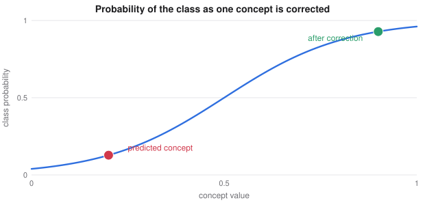

# Vision-Language Models and Concept Bottlenecks

> Deep Learning course notes
> Sources: listed under References

**What this file is really about:**
$$\text{contrastive pairs}\ \to\ \text{language-defined vision}\ \to\ \text{cross-attention}\ \to\ \text{named concepts you can inspect}$$

**How to use this file.** Part A builds these models from their tensors. Part B shows the core code. Part C is practice with answers.

## Contents

---

# Part A — Maths From the Ground Up

## A1. Contrastive learning

Given matching pairs, the **InfoNCE** loss asks that each item be most similar to its own partner among $N$ candidates:

$$L_i=-\log\frac{\exp(s_{ii}/\tau)}{\sum_j\exp(s_{ij}/\tau)}.$$

The temperature $\tau$ controls how sharply the softmax picks among candidates.

## A2. From a label set to language

CLIP removes the fixed label list: any sentence can act as a class. The same model supports retrieval, zero-shot classification and clustering by text.

## A3. Vision-language models

To answer questions about an image, feed visual information to a language model. Two designs are common.

- **Visual prefix.** Treat image patch tokens as extra tokens before the text.
- **Cross-attention.** Text tokens form the queries, and image tokens form the keys and values.

With $T$ text tokens and $P$ image patches, the cross-attention weight matrix has shape $T\times P$, and the output has one row per text token.

A learned **summary** compresses many patches into a few tokens, which reduces the cost of attending to them.

## A4. Concept bottleneck models

A black-box classifier gives no insight into why. A **concept bottleneck model** predicts named concepts first, such as "red beak", and then predicts the class from those concepts alone:

$$x\to\hat c\to\hat y.$$

The key benefit is **intervention**: if a concept is wrong, a person can correct it and see the class change.


*Correcting one wrong concept can flip the prediction, because the class depends on concepts alone.*

## A5. Limits of concept bottlenecks

Concepts must be sufficient for the task, or accuracy falls. Concept predictions can also leak information beyond their meaning. **Concept embedding** models give each concept a vector instead of one number, keeping accuracy while staying inspectable. **Post-hoc** bottlenecks add concepts to an already trained network.

## A6. InfoNCE is ordinary cross-entropy

Treat the positive as the correct class among $K+1$ candidates, with logits $s_i/\tau$:

$$L=-\log\frac{e^{s_+/\tau}}{\sum_{i=0}^Ke^{s_i/\tau}}.$$

If the model knows nothing, every candidate is equally likely, so $L=\log(K+1)$. It can also be shown that $I(X;Y)\ge\log(K+1)-L$, so a lower loss certifies more shared information, and more negatives allow a higher bound.

## A7. Zero-shot classification, step by step

1. Encode the image, giving $u$ with $\|u\|=1$.
2. For each class name, encode a sentence such as "a photo of a dog", giving $v_c$.
3. Pick $\arg\max_cu^\top v_c$.

No classifier is trained, so adding a class only needs a new sentence. Averaging several prompt templates usually improves accuracy.

## A8. Shapes in cross-attention

With $Q$ of shape $(N_q,d)$ and image tokens $K,V$ of shape $(N_k,d)$, the scores are $N_q\times N_k$. The output is $N_q\times d$. Each question token gets one answer vector, however many image tokens exist.

## A9. Concept bottlenecks in equations

The network has two parts: concepts $\hat c=g(x)$ and a label $\hat y=f(\hat c)$. Joint training minimises

$$L=L_y(f(g(x)),y)+\lambda\sum_jL_c(\hat c_j,c_j).$$

**Intervention** replaces a wrong $\hat c_j$ with the true value and reruns $f$. Because $f$ is often linear, each concept's contribution to the label can be read directly.

---

# Part B — In Code

## B1. InfoNCE

```python
logits = a @ b.T / tau
loss = F.cross_entropy(logits, torch.arange(len(a)))
```

## B2. Cross-attention

```python
attn = nn.MultiheadAttention(d, heads, batch_first=True)
out, weights = attn(query=text, key=image, value=image)
```

## B3. A complete contrastive model

Two views of hidden factors are matched. Retrieval accuracy shows whether the encoders have aligned.

```python
import torch
from torch import nn
from torch.nn import functional as F

torch.manual_seed(0)
A = torch.randn(32, 8); B = torch.randn(32, 8)

def batch(n):
    z = torch.randn(n, 8)
    return z @ A.T + 0.1 * torch.randn(n, 32), z @ B.T + 0.1 * torch.randn(n, 32)

f = nn.Sequential(nn.Linear(32, 64), nn.ReLU(), nn.Linear(64, 16))
g = nn.Sequential(nn.Linear(32, 64), nn.ReLU(), nn.Linear(64, 16))
opt = torch.optim.Adam([*f.parameters(), *g.parameters()], lr=1e-3)

for step in range(800):
    x, y = batch(256)
    u, v = F.normalize(f(x), dim=1), F.normalize(g(y), dim=1)
    logits = u @ v.T / 0.1
    t = torch.arange(256)
    loss = (F.cross_entropy(logits, t) + F.cross_entropy(logits.T, t)) / 2
    opt.zero_grad(); loss.backward(); opt.step()

x, y = batch(512)
acc = (F.normalize(f(x), dim=1) @ F.normalize(g(y), dim=1).T).argmax(1).eq(torch.arange(512)).float().mean().item()
print('retrieval accuracy', round(acc, 3), 'chance', round(1 / 512, 4))
assert acc > 0.5
```

## B4. A concept bottleneck with intervention

```python
import torch
from torch import nn
from torch.nn import functional as F

torch.manual_seed(0)
X = torch.randn(2000, 10)
C = (X[:, :3] > 0).float()                         # true concepts
Y = ((C[:, 0] + C[:, 1] + C[:, 2]) >= 2).long()     # the label depends only on concepts

g = nn.Sequential(nn.Linear(10, 32), nn.ReLU(), nn.Linear(32, 3))
f = nn.Linear(3, 2)
opt = torch.optim.Adam([*g.parameters(), *f.parameters()], lr=3e-3)

for _ in range(500):
    logits = g(X)
    loss = F.cross_entropy(f(torch.sigmoid(logits)), Y) + F.binary_cross_entropy_with_logits(logits, C)
    opt.zero_grad(); loss.backward(); opt.step()

with torch.no_grad():
    c_hat = torch.sigmoid(g(X))
    print('accuracy', f(c_hat).argmax(1).eq(Y).float().mean().item())
    c_hat[:, 0] = 1 - C[:, 0]                       # corrupt one concept on purpose
    print('corrupted', f(c_hat).argmax(1).eq(Y).float().mean().item())
    c_hat[:, 0] = C[:, 0]                           # intervene with the truth
    print('corrected', f(c_hat).argmax(1).eq(Y).float().mean().item())
```

---

# Part C — Practice

**P1.** Similarities to the positive and one negative are $2$ and $0$, with $\tau=1$. Find the InfoNCE loss.

<details><summary>Answer</summary>

$-\ln\big(e^2/(e^2+1)\big)=0.127$.

</details>

**P2.** $T=10$, $P=196$. What shape are the cross-attention weights?

<details><summary>Answer</summary>

$10\times196$.

</details>

**P3.** Why can a person fix a concept bottleneck's prediction?

<details><summary>Answer</summary>

The class depends only on the concepts, so changing a wrong concept changes the class.

</details>

**P4.** With 255 negatives, what is InfoNCE at chance?

<details><summary>Answer</summary>

$\ln256=5.545$.

</details>

**P5.** Queries of shape $5\times d$ attend to 196 image tokens. What is the output shape?

<details><summary>Answer</summary>

$5\times d$.

</details>
