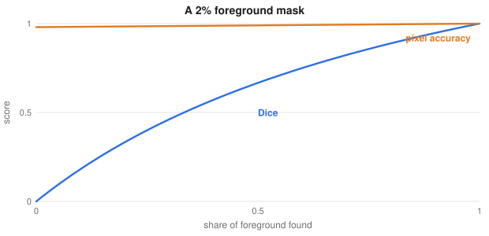

# Detection, Segmentation and Dense Prediction

> Deep Learning course notes
> Sources: listed under References

**What this file is really about:**
$$\text{from one label to a set}\ \to\ \text{assign targets}\ \to\ \text{worked losses}\ \to\ \text{masks, keypoints and depth}$$

**How to use this file.** Part A extends classification to spatial outputs. Part B shows the core code. Part C is practice with answers.

## Contents

---

# Part A — Maths From the Ground Up

## A1. From one label to a set of objects

A detector predicts a set of objects, each with a class and a box. The number of objects varies by image, so the network must propose many candidates and decide which are real.

## A2. Target assignment

**Anchors** are candidate boxes spread over the image. Each one is matched with a ground-truth box by IoU: high overlap becomes positive, low overlap negative, and those in between are often ignored. Each positive candidate learns a class, and offsets to the true box.

## A3. Losses

A detector combines a classification loss and a box regression loss. Most candidates are background, so **focal loss** down-weights easy negatives:

$$L=-(1-p_t)^\gamma\log p_t.$$

## A4. Set prediction

DETR-style models predict a fixed set of queries, and match them one-to-one to ground truth with the **Hungarian algorithm**. One-to-one matching removes the need for non-maximum suppression.

## A5. Segmentation

- **Semantic** segmentation labels each pixel with a class.
- **Instance** segmentation separates each object.
- **Panoptic** segmentation does both.

The **Dice** score measures mask overlap:

$$\text{Dice}=\frac{2|A\cap B|}{|A|+|B|}.$$

**Careful.** When foreground is rare, cross-entropy can look excellent while predicting only background, whereas Dice is then zero.


*A model that predicts only background gets a low cross-entropy, and a Dice score of zero.*

## A6. Keypoints, depth and promptable masks

Keypoint models predict one heatmap per joint. Depth models predict a number per pixel. **Promptable** models take a point, a box or a phrase, and return the matching mask. Language grounding extends this to any described object.

## A7. Encoding box regression targets

Rather than predicting raw coordinates, predict offsets from an anchor $(x_a,y_a,w_a,h_a)$:

$$t_x=\frac{x-x_a}{w_a},\quad t_y=\frac{y-y_a}{h_a},\quad t_w=\log\frac w{w_a},\quad t_h=\log\frac h{h_a}.$$

Dividing by the anchor size makes targets scale-free. The log keeps sizes positive once decoded, and treats a doubling the same at any scale.

## A8. Deriving focal loss

Let $p_t$ be the probability given to the true class. Cross-entropy is $-\log p_t$. Focal loss multiplies by $(1-p_t)^\gamma$. An easy example with $p_t=0.9$ and $\gamma=2$ has its loss scaled by $0.01$, while a hard one with $p_t=0.1$ keeps a factor of $0.81$. Thousands of easy background boxes stop drowning out the rare objects.

## A9. Average precision, worked

Sort detections by confidence. Mark each as true or false using IoU against unmatched ground truth. With 3 ground-truth objects and outcomes T, F, T, T:

| Rank | Precision | Recall |
|---|---|---|
| 1 | 1.00 | 0.33 |
| 2 | 0.50 | 0.33 |
| 3 | 0.67 | 0.67 |
| 4 | 0.75 | 1.00 |

Take the interpolated precision, the best precision at this recall or beyond, and integrate over recall: $0.33\times1+0.33\times0.75+0.33\times0.75\approx0.83$.

## A10. Feature pyramids and set prediction

Small objects vanish in low-resolution maps, so **feature pyramids** combine levels through a top-down path. Each level then detects objects near its own scale.

In **set prediction**, a transformer outputs $N$ boxes. The Hungarian algorithm finds the one-to-one assignment with minimum total cost, so duplicates are penalised directly, and no non-maximum suppression is needed.

---

# Part B — In Code

## B1. Dice loss

```python
inter = (p * y).sum()
dice = 2 * inter / (p.sum() + y.sum() + 1e-6)
loss = 1 - dice
```

## B2. Focal loss

```python
ce = F.binary_cross_entropy_with_logits(logits, y, reduction='none')
pt = torch.exp(-ce)
loss = ((1 - pt) ** gamma * ce).mean()
```

## B3. Encode, decode, IoU and non-maximum suppression

```python
import numpy as np

def encode(box, anchor):                     # boxes as (cx, cy, w, h)
    return np.r_[(box[:2] - anchor[:2]) / anchor[2:], np.log(box[2:] / anchor[2:])]

def decode(t, anchor):
    return np.r_[anchor[:2] + t[:2] * anchor[2:], anchor[2:] * np.exp(t[2:])]

def iou(a, b):                               # boxes as (x1, y1, x2, y2)
    w = max(0, min(a[2], b[2]) - max(a[0], b[0]))
    h = max(0, min(a[3], b[3]) - max(a[1], b[1]))
    inter = w * h
    return inter / ((a[2] - a[0]) * (a[3] - a[1]) + (b[2] - b[0]) * (b[3] - b[1]) - inter)

def nms(boxes, scores, thr=0.5):
    order = np.argsort(-scores).tolist()
    keep = []
    while order:
        i = order.pop(0)
        keep.append(i)
        order = [j for j in order if iou(boxes[i], boxes[j]) < thr]
    return keep

b, a = np.array([5.0, 6.0, 4.0, 2.0]), np.array([4.0, 4.0, 2.0, 2.0])
assert np.allclose(decode(encode(b, a), a), b)
boxes = np.array([[0, 0, 10, 10], [1, 1, 11, 11], [20, 20, 30, 30]], float)
assert nms(boxes, np.array([0.9, 0.8, 0.7])) == [0, 2]
print('round trip and suppression are correct')
```

## B4. Average precision

```python
import numpy as np

def average_precision(hits, n_true):
    hits = np.asarray(hits, float)
    tp = np.cumsum(hits)
    precision = tp / np.arange(1, len(hits) + 1)
    recall = tp / n_true
    best = np.maximum.accumulate(precision[::-1])[::-1]     # interpolated precision
    return float(np.sum(np.diff(np.r_[0, recall]) * best))

ap = average_precision([1, 0, 1, 1], 3)
print(round(ap, 3))
assert abs(ap - (1 + 0.75 + 0.75) / 3) < 1e-9
```

## B5. Hungarian matching

```python
import numpy as np
from scipy.optimize import linear_sum_assignment

cost = np.array([[1.0, 4.0, 5.0], [2.0, 0.5, 9.0], [7.0, 6.0, 0.2]])
pred, target = linear_sum_assignment(cost)
print(list(zip(pred.tolist(), target.tolist())), 'total', cost[pred, target].sum())
assert list(target) == [0, 1, 2]
```

---

# Part C — Practice

**P1.** $|A|=30$, $|B|=20$, and the intersection is 10. Find the Dice score.

<details><summary>Answer</summary>

$20/50=0.4$.

</details>

**P2.** $p_t=0.9$, $\gamma=2$. By what factor does focal loss scale cross-entropy?

<details><summary>Answer</summary>

$0.1^2=0.01$.

</details>

**P3.** Why does a DETR-style model not need non-maximum suppression?

<details><summary>Answer</summary>

One-to-one matching assigns each object to a single query, so duplicates are penalised during training.

</details>

**P4.** An anchor has width 10, and the box has width 20. Find $t_w$.

<details><summary>Answer</summary>

$\ln2=0.693$.

</details>

**P5.** With $\gamma=2$, what is the focal scale for $p_t=0.5$?

<details><summary>Answer</summary>

$(0.5)^2=0.25$.

</details>
