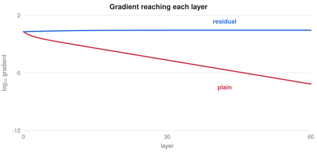

# Network Architectures

> Deep Learning course notes
> Sources: listed under References

**What this file is really about:**
$$\text{why deep nets are hard}\ \to\ \text{normalise}\ \to\ \text{residuals}\ \to\ \text{efficient convolutions}\ \to\ \text{U-Nets}\ \to\ \text{memory over time}$$

**How to use this file.** Part A explains why each idea was needed. Part B is complete code. Part C is practice with answers.

## Contents

---

# Part A — Maths From the Ground Up

## A1. Deeper should not be worse

A deeper network can represent everything a shallower one can, since extra layers could simply be the identity. In practice, plain networks beyond about 20 layers often have higher **training** error than shallower ones. This is an optimisation problem, not overfitting.

## A2. Batch normalisation

For a mini-batch, normalise each channel to zero mean and unit variance, then let the network rescale:

$$\hat x=\frac{x-\mu_B}{\sigma_B},\qquad y=\gamma\hat x+\beta.$$

It lets training use higher learning rates. At test time, running averages replace the batch statistics, so behaviour differs between `train()` and `eval()`.

**Careful.** Very small batches make $\mu_B$ and $\sigma_B$ noisy. Use group or layer normalisation instead.

| Normalise over | Name | Typical use |
|---|---|---|
| The batch, per channel | Batch norm | Convolutional networks with large batches |
| Features, per example | Layer norm | Transformers and sequences |
| Channel groups | Group norm | Small batches, U-Nets |

## A3. Residual connections

Instead of learning $H(x)$ directly, learn the difference $F(x)=H(x)-x$:

$$y=x+F(x).$$

If the identity is best, $F$ just needs to go to zero, which is easy. The gradient of the output contains an identity term:

$$\frac{\partial y}{\partial x}=I+\frac{\partial F}{\partial x}.$$

So gradients have a direct path back, and networks of 100 layers or more become trainable.

When shapes change, a $1\times1$ convolution on the shortcut matches them. A **bottleneck** block uses $1\times1$, $3\times3$ and $1\times1$ convolutions to reduce computation.



## A4. Efficient convolutions

A standard convolution from $c_{\text{in}}$ to $c_{\text{out}}$ channels with size $f$ costs $f^2c_{\text{in}}c_{\text{out}}$ weights. A **depthwise separable** convolution splits this into one filter per channel, then a $1\times1$ convolution to mix channels:

$$f^2c_{\text{in}}+c_{\text{in}}c_{\text{out}}.$$

With $f=3$ and 64 channels in and out, that is 36,864 against 4,672 weights, about 8 times fewer.

**EfficientNet** scales depth, width and image size together, using a fixed compound rule.

## A5. Encoders and decoders: U-Net

To produce an output for each pixel, a network must recover spatial detail lost during downsampling. A **U-Net** downsamples in an encoder, upsamples in a decoder, and **concatenates** feature maps across the matching levels through skip connections. Fine detail comes from the encoder, and context comes from the bottom of the U.

**Transposed convolutions** upsample, but can produce checkerboard artefacts. Interpolation followed by a convolution avoids them.

## A6. Recurrent networks

A recurrent network updates a hidden state: $h_t=\tanh(Wh_{t-1}+Ux_t+b)$. It handles any sequence length, and shares weights across time. Backpropagation through time multiplies Jacobians, so gradients vanish or explode depending on the spectral radius of $W$.

Clipping handles explosion. Vanishing needs a change of architecture.

## A7. LSTM and GRU

An **LSTM** keeps a separate cell state, controlled by three gates:

$$f_t=\sigma(W_f[h_{t-1},x_t]),\quad i_t=\sigma(W_i[h_{t-1},x_t]),\quad g_t=\tanh(W_g[h_{t-1},x_t]),$$
$$c_t=f_t\odot c_{t-1}+i_t\odot g_t,\qquad o_t=\sigma(W_o[h_{t-1},x_t]),\qquad h_t=o_t\odot\tanh(c_t).$$

Because the cell state is updated by addition, gradients along it are scaled by the forget gate, and not by repeated multiplication by $W$. A **GRU** has two gates, and often performs about as well.

## A8. Why transformers replaced recurrent networks

A recurrent network passes everything through one state, step by step, so it is hard to parallelise and has limited memory. Attention lets every token read any other directly, and runs in parallel. Recurrent models remain useful for streaming data, since they use constant memory per step.

## A9. Attention in vision

Vision transformers lack the built-in locality of convolutions, so they need more data or pretraining. **Hybrids** use convolutions early and attention later. **ConvNeXt** shows that modernised convolutional networks stay competitive.

---

# Part B — In Code

## B1. A complete ResNet for small images

```python
import torch
from torch import nn
from torch.nn import functional as F


class ResBlock(nn.Module):
    def __init__(self, c_in, c_out, stride=1):
        super().__init__()
        self.c1 = nn.Conv2d(c_in, c_out, 3, stride, 1, bias=False)
        self.b1 = nn.BatchNorm2d(c_out)
        self.c2 = nn.Conv2d(c_out, c_out, 3, 1, 1, bias=False)
        self.b2 = nn.BatchNorm2d(c_out)
        self.short = nn.Identity()
        if stride != 1 or c_in != c_out:
            self.short = nn.Sequential(nn.Conv2d(c_in, c_out, 1, stride, bias=False), nn.BatchNorm2d(c_out))

    def forward(self, x):
        y = F.relu(self.b1(self.c1(x)))
        y = self.b2(self.c2(y))
        return F.relu(y + self.short(x))


class ResNet(nn.Module):
    def __init__(self, n=3, classes=10):
        super().__init__()
        self.stem = nn.Sequential(nn.Conv2d(3, 16, 3, 1, 1, bias=False), nn.BatchNorm2d(16), nn.ReLU())
        self.s1 = self.stage(16, 16, n, 1)
        self.s2 = self.stage(16, 32, n, 2)
        self.s3 = self.stage(32, 64, n, 2)
        self.head = nn.Linear(64, classes)

    @staticmethod
    def stage(c_in, c_out, n, stride):
        blocks = [ResBlock(c_in, c_out, stride)]
        blocks += [ResBlock(c_out, c_out) for _ in range(n - 1)]
        return nn.Sequential(*blocks)

    def forward(self, x):
        x = self.s3(self.s2(self.s1(self.stem(x))))
        return self.head(x.mean((2, 3)))             # global average pooling


model = ResNet()
print(model(torch.randn(2, 3, 32, 32)).shape)        # torch.Size([2, 10])
```

## B2. A U-Net

```python
class Double(nn.Module):
    def __init__(self, a, b):
        super().__init__()
        self.net = nn.Sequential(nn.Conv2d(a, b, 3, 1, 1), nn.GroupNorm(8, b), nn.SiLU(),
                                 nn.Conv2d(b, b, 3, 1, 1), nn.GroupNorm(8, b), nn.SiLU())

    def forward(self, x):
        return self.net(x)


class UNet(nn.Module):
    def __init__(self, c_in=3, c_out=1, w=32):
        super().__init__()
        self.d1, self.d2 = Double(c_in, w), Double(w, 2 * w)
        self.mid = Double(2 * w, 4 * w)
        self.u2, self.u1 = Double(6 * w, 2 * w), Double(3 * w, w)
        self.out = nn.Conv2d(w, c_out, 1)

    def forward(self, x):
        a = self.d1(x)
        b = self.d2(F.max_pool2d(a, 2))
        m = self.mid(F.max_pool2d(b, 2))
        y = self.u2(torch.cat([F.interpolate(m, scale_factor=2), b], 1))
        y = self.u1(torch.cat([F.interpolate(y, scale_factor=2), a], 1))
        return self.out(y)


print(UNet()(torch.randn(1, 3, 64, 64)).shape)       # torch.Size([1, 1, 64, 64])
```

## B3. An LSTM cell, written out

```python
class LSTMCell(nn.Module):
    def __init__(self, n_in, n_hidden):
        super().__init__()
        self.f = nn.Linear(n_in + n_hidden, n_hidden)
        self.i = nn.Linear(n_in + n_hidden, n_hidden)
        self.g = nn.Linear(n_in + n_hidden, n_hidden)
        self.o = nn.Linear(n_in + n_hidden, n_hidden)

    def forward(self, x, state):
        h, c = state
        z = torch.cat([x, h], -1)
        c = torch.sigmoid(self.f(z)) * c + torch.sigmoid(self.i(z)) * torch.tanh(self.g(z))
        h = torch.sigmoid(self.o(z)) * torch.tanh(c)
        return h, c
```

---

# Part C — Practice

**P1.** A deeper plain network has higher training error than a shallower one. Is this overfitting?

<details><summary>Answer</summary>

No. Overfitting would show low training error. This is an optimisation difficulty, which residual connections address.

</details>

**P2.** Count the weights of a $3\times3$ convolution from 32 to 32 channels, with no bias, standard and depthwise separable.

<details><summary>Answer</summary>

Standard: $9\times32\times32=9216$. Separable: $9\times32+32\times32=1312$.

</details>

**P3.** Why is batch norm a poor choice with a batch of 2?

<details><summary>Answer</summary>

The batch statistics are too noisy. Group or layer normalisation does not depend on the batch.

</details>

**P4.** What does a U-Net's skip connection provide?

<details><summary>Answer</summary>

High-resolution spatial detail from the encoder, which was lost during downsampling.

</details>

**P5.** Why do LSTM gradients survive longer?

<details><summary>Answer</summary>

The cell state is updated additively, so its gradient is scaled by the forget gate instead of being repeatedly multiplied through $W$.

</details>
