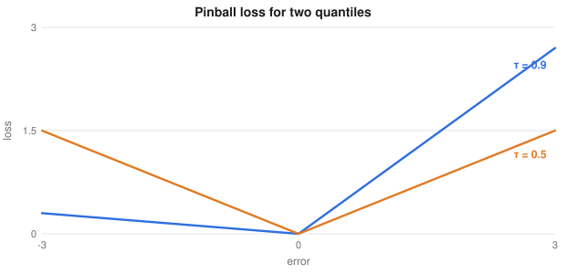

# Generalised Linear Models, Quantiles and State Space

> Extended machine learning notes
> Sources: listed under References

**What this file is really about:**
$$\text{choose a distribution}\ \to\ \text{link it to a line}\ \to\ \text{predict a quantile, not only a mean}\ \to\ \text{track a hidden state over time}$$

**How to use this file.** Part A derives each model. Part B has complete code, checked against libraries or known results. Part C is practice with answers.

## Contents

---

# Part A — Maths From the Ground Up

## A1. One recipe behind many models

Linear regression assumes Gaussian noise, and logistic regression assumes a Bernoulli outcome. A **generalised linear model** keeps the linear score $\eta=x^\top w$ and changes two things: the distribution of $y$, and a **link** $g$ that connects its mean to the score,

$$g(\mathbb E[y\mid x])=x^\top w.$$

| Target | Distribution | Usual link | Mean |
|---|---|---|---|
| Real number | Gaussian | Identity | $\eta$ |
| Yes or no | Bernoulli | Logit | $\sigma(\eta)$ |
| Count | Poisson | Log | $e^\eta$ |
| Positive amount | Gamma | Log | $e^\eta$ |

The link's job is to make every score map to a valid mean.

## A2. Poisson regression, derived

For a count, $p(y\mid\lambda)=\lambda^ye^{-\lambda}/y!$. With $\lambda=e^{x^\top w}$, the negative log-likelihood for one row is

$$L=\lambda-y\,x^\top w+\log y!.$$

Differentiating, with $\partial\lambda/\partial w=\lambda x$,

$$\nabla L=(\lambda-y)x,\qquad\nabla^2L=\lambda xx^\top.$$

The Hessian is positive semi-definite, so the problem is convex. A coefficient is read multiplicatively: raising a feature by one multiplies the expected count by $e^{w}$.

## A3. Fitting by iteratively reweighted least squares

A Newton step is $w\leftarrow w-(X^\top\Lambda X)^{-1}X^\top(\lambda-y)$, with $\Lambda=\text{diag}(\lambda)$. Define a **working response** $z=\eta+(y-\lambda)/\lambda$. Rearranging gives

$$w\leftarrow(X^\top\Lambda X)^{-1}X^\top\Lambda z.$$

Each Newton step is a weighted least-squares problem, which is why this is called IRLS.

## A4. Exposure and overdispersion

If rows cover different amounts of time or area $e_i$, model the rate: $\lambda_i=e_i\exp(x_i^\top w)$. Since $\log\lambda_i=\log e_i+x_i^\top w$, the exposure enters as an **offset** with a fixed coefficient of 1.

A Poisson variable has variance equal to its mean. Real counts are often more spread out. A **negative binomial** has $\text{Var}=\mu+\alpha\mu^2$, which allows this.

## A5. Deviance

For a GLM, $R^2$ is replaced by **deviance**, twice the gap in log-likelihood between a saturated model and yours. For a Poisson,

$$D=2\sum_i\Big(y_i\log\frac{y_i}{\hat\lambda_i}-(y_i-\hat\lambda_i)\Big).$$

Lower is better, and it is the natural loss to compare count models on.

## A6. Quantile regression, derived

To predict the $\tau$-quantile, minimise the **pinball loss**:

$$\rho_\tau(e)=\begin{cases}\tau e&e\ge0\\(\tau-1)e&e<0\end{cases},\qquad e=y-\hat y.$$

**Why the minimiser is the quantile.** For a constant prediction $q$, the derivative of the expected loss is

$$-\tau\,P(y>q)+(1-\tau)\,P(y<q)=F(q)-\tau.$$

Setting this to zero gives $F(q)=\tau$. Fit models at $\tau=0.1$ and $0.9$ to obtain an 80% prediction interval, with no assumption about the noise.



## A7. State-space models

A hidden state evolves, and we see noisy measurements of it:

$$x_t=Fx_{t-1}+w_t,\quad w_t\sim\mathcal N(0,Q),\qquad y_t=Hx_t+v_t,\quad v_t\sim\mathcal N(0,R).$$

For a moving object, $x$ holds position and velocity, $F$ applies velocity, and $y$ is a noisy position.

## A8. The Kalman filter, derived

Everything is Gaussian, so a belief is a mean and a covariance.

**Predict:**

$$\hat x^-=F\hat x,\qquad P^-=FPF^\top+Q.$$

**Update.** Combine the prediction with the measurement. Bayes' rule on two Gaussians gives

$$K=P^-H^\top(HP^-H^\top+R)^{-1},$$
$$\hat x=\hat x^-+K(y-H\hat x^-),\qquad P=(I-KH)P^-.$$

In one dimension with $H=1$, $K=P^-/(P^-+R)$. A noisy sensor means a small gain and more trust in the model. A poor model means a gain near 1 and more trust in the sensor.

## A9. Smoothing and non-linear systems

A filter uses only past data. A **Rauch-Tung-Striebel smoother** runs backwards afterwards, using all the data, and gives a lower error for offline analysis.

Non-linear dynamics use an **extended** Kalman filter, which linearises with Jacobians at each step, or an **unscented** filter, which pushes sample points through the function.

---

# Part B — In Code

## B1. Poisson regression by IRLS

```python
import numpy as np
from sklearn.linear_model import PoissonRegressor

rng = np.random.default_rng(0)
X = rng.normal(size=(3000, 2))
y = rng.poisson(np.exp(0.5 + 0.8 * X[:, 0] - 0.4 * X[:, 1]))
A = np.c_[np.ones(len(X)), X]

w = np.r_[np.log(y.mean()), 0, 0]
for _ in range(25):
    eta = A @ w
    mu = np.exp(eta)
    z = eta + (y - mu) / mu                       # working response
    w = np.linalg.solve((A.T * mu) @ A, (A.T * mu) @ z)

sk = PoissonRegressor(alpha=0, tol=1e-10, max_iter=2000).fit(X, y)
print(w.round(3))
assert np.allclose(w, np.r_[sk.intercept_, sk.coef_], atol=1e-4)
```

## B2. Rates with an exposure offset

```python
import numpy as np

rng = np.random.default_rng(1)
x = rng.normal(size=4000)
exposure = rng.uniform(0.5, 20, 4000)
y = rng.poisson(exposure * np.exp(-1 + 0.7 * x))
A = np.c_[np.ones(4000), x]
offset = np.log(exposure)

w = np.array([np.log(y.sum() / exposure.sum()), 0.0])
for _ in range(25):
    eta = A @ w
    mu = np.exp(eta + offset)
    w = np.linalg.solve((A.T * mu) @ A, (A.T * mu) @ (eta + (y - mu) / mu))

print('rate coefficients', w.round(3))
assert np.allclose(w, [-1, 0.7], atol=0.05)
```

## B3. Quantile regression

```python
import numpy as np
from sklearn.linear_model import QuantileRegressor

rng = np.random.default_rng(0)
x = rng.uniform(0, 4, 3000)
y = 2 * x + (0.2 + 0.5 * x) * rng.normal(size=3000)     # noise grows with x
A = np.c_[np.ones(3000), x]
tau, w = 0.9, np.zeros(2)

for t in range(1, 30001):
    e = y - A @ w
    g = -A.T @ (tau * (e > 0) + (tau - 1) * (e < 0)) / len(y)
    w -= 0.5 / t ** 0.5 * g

cover = (y <= A @ w).mean()
sk = QuantileRegressor(quantile=tau, alpha=0).fit(x[:, None], y)
print('coverage', round(cover, 3), w.round(2), 'library', round(sk.intercept_, 2), sk.coef_.round(2))
assert abs(cover - tau) < 0.02
```

## B4. A Kalman filter and smoother

```python
import numpy as np

rng = np.random.default_rng(0)
F = np.array([[1.0, 1.0], [0.0, 1.0]]); H = np.array([[1.0, 0.0]])
Q = 0.01 * np.eye(2); R = np.array([[4.0]])

truth, obs, x = [], [], np.array([0.0, 1.0])
for _ in range(200):
    x = F @ x + rng.multivariate_normal([0, 0], Q)
    truth.append(x[0]); obs.append(x[0] + rng.normal(0, 2))
truth, obs = np.array(truth), np.array(obs)

m, P = np.zeros(2), 10 * np.eye(2)
filt, covs, preds, pred_covs = [], [], [], []
for y in obs:
    m_, P_ = F @ m, F @ P @ F.T + Q                       # predict
    preds.append(m_); pred_covs.append(P_)
    K = P_ @ H.T @ np.linalg.inv(H @ P_ @ H.T + R)
    m = m_ + (K * (y - H @ m_)).ravel()                   # update
    P = (np.eye(2) - K @ H) @ P_
    filt.append(m); covs.append(P)

smooth = [filt[-1]]
for t in range(198, -1, -1):                              # Rauch-Tung-Striebel, backwards
    G = covs[t] @ F.T @ np.linalg.inv(pred_covs[t + 1])
    smooth.append(filt[t] + G @ (smooth[-1] - preds[t + 1]))
smooth = np.array(smooth[::-1]); filt = np.array(filt)

rmse = lambda a: float(np.sqrt(((a - truth) ** 2).mean()))
print('raw', round(rmse(obs), 3), 'filter', round(rmse(filt[:, 0]), 3), 'smoother', round(rmse(smooth[:, 0]), 3))
assert rmse(smooth[:, 0]) < rmse(filt[:, 0]) < rmse(obs)
```

## B5. Choosing a family

Squared error is the wrong measure for right-skewed amounts.

```python
import numpy as np
from sklearn.linear_model import GammaRegressor, LinearRegression
from sklearn.metrics import mean_gamma_deviance

rng = np.random.default_rng(0)
X = rng.normal(size=(4000, 3))
mu = np.exp(1 + 0.8 * X[:, 0] - 0.5 * X[:, 1])
y = rng.gamma(2.0, mu / 2.0)
a, b = X[:3000], X[3000:]

gamma = GammaRegressor(alpha=0, max_iter=1000).fit(a, y[:3000])
linear = np.clip(LinearRegression().fit(a, y[:3000]).predict(b), 1e-3, None)
d_g = mean_gamma_deviance(y[3000:], gamma.predict(b))
d_l = mean_gamma_deviance(y[3000:], linear)
print('gamma deviance', round(d_g, 3), 'linear', round(d_l, 3))
assert d_g < d_l
```

---

# Part C — Practice

**P1.** In a Poisson model, $w=0.693$ for a feature. What does adding one unit do?

<details><summary>Answer</summary>

It multiplies the expected count by $e^{0.693}=2$.

</details>

**P2.** Why is exposure given a coefficient of exactly 1?

<details><summary>Answer</summary>

Doubling the time observed should double the expected count, so $\log e$ enters with coefficient 1.

</details>

**P3.** With $\tau=0.9$, what is the loss for $e=2$ and for $e=-2$?

<details><summary>Answer</summary>

$1.8$ and $0.2$.

</details>

**P4.** With $P^-=3$ and $R=1$, find the Kalman gain and the updated variance.

<details><summary>Answer</summary>

$K=0.75$, and $P=(1-0.75)\times3=0.75$.

</details>

**P5.** The filter's measurement noise $R$ is set far too large. What happens?

<details><summary>Answer</summary>

The gain shrinks, so the estimate trusts its model and responds slowly to real changes.

</details>
