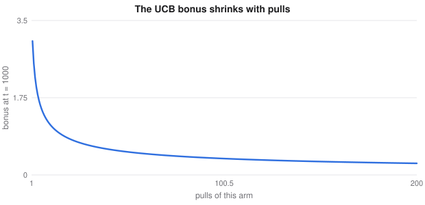

# Causal Inference, Bandits and Automatic Tuning

> Extended machine learning notes
> Sources: listed under References

**What this file is really about:**
$$\text{what would have happened}\ \to\ \text{learning while acting}\ \to\ \text{finding good settings with few trials}$$

**How to use this file.** Part A derives each method. Part B has complete code, checked against known answers. Part C is practice with answers.

## Contents

---

# Part A — Maths From the Ground Up

## A1. Prediction is not causation

A model predicting hospital deaths may learn that asthma lowers pneumonia risk, because asthmatic patients are treated more aggressively. Prediction asks what we expect to **see**. A causal question asks what would happen if we **did** something.

## A2. Potential outcomes

Each unit has two potential outcomes, $Y(1)$ if treated and $Y(0)$ if not. Only one is ever observed. The **average treatment effect** is

$$\text{ATE}=\mathbb E[Y(1)-Y(0)].$$

Comparing observed groups gives

$$\mathbb E[Y\mid T=1]-\mathbb E[Y\mid T=0]=\text{ATE}+\text{selection bias},$$

when those who were treated differ from those who were not. Randomisation makes treatment independent of the potential outcomes, and removes the bias.

## A3. Adjusting for confounders

Without randomisation, assume **unconfoundedness**: given measured features $X$, treatment is as good as random, and **overlap**, $0<e(x)<1$. Then

$$\text{ATE}=\mathbb E_X\big[\mathbb E[Y\mid T=1,X]-\mathbb E[Y\mid T=0,X]\big].$$

Fit an outcome model and average the predicted differences. Do not adjust for variables caused by the treatment, because that blocks part of its effect.

## A4. Propensity scores, derived

Let $e(x)=P(T=1\mid x)$. Weighting recreates a randomised population:

$$\mathbb E\Big[\frac{TY}{e(X)}\Big]=\mathbb E\Big[\frac{\mathbb E[T\mid X]\,\mathbb E[Y(1)\mid X]}{e(X)}\Big]=\mathbb E[Y(1)].$$

So the **inverse propensity weighted** estimate is

$$\widehat{\text{ATE}}=\frac1n\sum_i\Big(\frac{T_iY_i}{e_i}-\frac{(1-T_i)Y_i}{1-e_i}\Big).$$

Extreme propensities give huge weights and noisy estimates.

## A5. Doubly robust estimation

Combine both models, with $\mu_t(x)$ the outcome models:

$$\hat\psi_i=\mu_1(x_i)-\mu_0(x_i)+\frac{T_i(Y_i-\mu_1(x_i))}{e_i}-\frac{(1-T_i)(Y_i-\mu_0(x_i))}{1-e_i}.$$

The estimate is consistent if **either** the outcome model or the propensity model is correct.

## A6. Difference-in-differences

Compare the change in a treated group with the change in a control group:

$$\text{DiD}=(\bar Y_{T,\text{after}}-\bar Y_{T,\text{before}})-(\bar Y_{C,\text{after}}-\bar Y_{C,\text{before}}).$$

It relies on **parallel trends**: without treatment, both groups would have changed by the same amount. Check the trends before the intervention.

## A7. Uplift modelling

To target an offer, you need who **changes** because of it. The **T-learner** fits one model per arm, and scores $\hat\tau(x)=\hat\mu_1(x)-\hat\mu_0(x)$. Spend budget on the highest uplift, and not on the highest purchase probability, since those people may buy anyway.

## A8. Bandits and regret

At each round, choose an arm and see its reward only. Choosing learns, and also costs. **Regret** after $T$ rounds is

$$R_T=T\mu^*-\sum_t\mu_{a_t}.$$

$\varepsilon$-greedy explores at a fixed rate, so its regret grows linearly unless $\varepsilon$ decays.

## A9. UCB, derived

Hoeffding's inequality says an average of $n$ rewards in $[0,1]$ satisfies

$$P\big(\mu>\hat\mu+u\big)\le e^{-2nu^2}.$$

Setting this probability to $t^{-4}$ and solving gives $u=\sqrt{2\ln t/n}$. So **UCB1** picks

$$\arg\max_a\ \hat\mu_a+\sqrt{\frac{2\ln t}{n_a}}.$$

Rarely tried arms get a large bonus, which is optimism under uncertainty. Regret grows only as $\log T$.



## A10. Thompson sampling

Keep a posterior for each arm, draw one value from each, and play the highest. For Bernoulli rewards with a Beta prior, the posterior is $\text{Beta}(1+s,1+f)$. An arm is played with exactly the probability that it is best, and exploration fades on its own.

## A11. Contextual bandits

If rewards depend on features, model them. **LinUCB** fits ridge regression per arm and picks

$$\arg\max_a\ x^\top\hat\theta_a+\alpha\sqrt{x^\top A_a^{-1}x}.$$

## A12. Bayesian optimisation

When each trial is expensive, model the score with a Gaussian process and decide where to sample next. With incumbent $f^+$, posterior $\mu,\sigma$, and $z=(\mu-f^+)/\sigma$, the **expected improvement** has a closed form:

$$\text{EI}=(\mu-f^+)\Phi(z)+\sigma\phi(z).$$

It is large where the mean is high, or where uncertainty is high.

## A13. Early stopping across trials

**Successive halving** starts many configurations with little budget, keeps the best half, doubles the budget and repeats. **Hyperband** runs this at several aggressiveness levels, because the best trade-off is unknown. Random search, or these, often beat grid search because only a few settings matter.

---

# Part B — In Code

## B1. Removing confounding

The true effect is exactly 1, and the naive comparison is badly wrong.

```python
import numpy as np
from sklearn.linear_model import LinearRegression, LogisticRegression

rng = np.random.default_rng(0)
n = 40000
x = rng.normal(size=n)
t = (rng.random(n) < 1 / (1 + np.exp(-x))).astype(int)
y = 1.0 * t + 3 * x + rng.normal(size=n)
X = x[:, None]

naive = y[t == 1].mean() - y[t == 0].mean()

m1 = LinearRegression().fit(X[t == 1], y[t == 1])
m0 = LinearRegression().fit(X[t == 0], y[t == 0])
mu1, mu0 = m1.predict(X), m0.predict(X)
regression = (mu1 - mu0).mean()

e = LogisticRegression().fit(X, t).predict_proba(X)[:, 1]
ipw = (t * y / e - (1 - t) * y / (1 - e)).mean()
aipw = (mu1 - mu0 + t * (y - mu1) / e - (1 - t) * (y - mu0) / (1 - e)).mean()

print('naive', round(naive, 2), 'regression', round(regression, 3), 'ipw', round(ipw, 3), 'doubly robust', round(aipw, 3))
assert naive > 3 and abs(regression - 1) < 0.05 and abs(aipw - 1) < 0.05 and abs(ipw - 1) < 0.2
```

## B2. Difference-in-differences

```python
import numpy as np

rng = np.random.default_rng(0)
n = 5000
group = rng.integers(2, size=n); after = rng.integers(2, size=n)
y = 10 + 5 * group + 2 * after + 3 * group * after + rng.normal(size=n)
m = lambda g, a: y[(group == g) & (after == a)].mean()
did = (m(1, 1) - m(1, 0)) - (m(0, 1) - m(0, 0))
print('estimate', round(did, 3))
assert abs(did - 3) < 0.2
```

## B3. Uplift with a T-learner

```python
import numpy as np
from sklearn.ensemble import GradientBoostingRegressor

rng = np.random.default_rng(0)
n = 8000
X = rng.uniform(-2, 2, (n, 3))
t = rng.integers(2, size=n)
tau = np.where(X[:, 0] > 0, 2.0, 0.0)
y = X[:, 1] + t * tau + rng.normal(size=n)

m1 = GradientBoostingRegressor(random_state=0).fit(X[t == 1], y[t == 1])
m0 = GradientBoostingRegressor(random_state=0).fit(X[t == 0], y[t == 0])
uplift = m1.predict(X) - m0.predict(X)
top = uplift >= np.median(uplift)
print('true effect in the top half', tau[top].mean().round(3), 'in the rest', tau[~top].mean().round(3))
assert tau[top].mean() > 1.7 and tau[~top].mean() < 0.3
```

## B4. Bandits compared

```python
import numpy as np

def run(policy, means, T, seed):
    rng = np.random.default_rng(seed)
    k = len(means); n, s = np.zeros(k), np.zeros(k); regret = 0.0
    for t in range(1, T + 1):
        a = policy(n, s, t, rng)
        r = rng.random() < means[a]
        n[a] += 1; s[a] += r; regret += max(means) - means[a]
    return regret

def eps_greedy(n, s, t, rng, e=0.1):
    if rng.random() < e or n.min() == 0:
        return int(rng.integers(len(n)))
    return int((s / n).argmax())

def ucb(n, s, t, rng):
    if n.min() == 0:
        return int(n.argmin())
    return int((s / n + np.sqrt(2 * np.log(t) / n)).argmax())

def thompson(n, s, t, rng):
    return int(rng.beta(1 + s, 1 + n - s).argmax())

means = [0.3, 0.5, 0.6]
for name, p in [('epsilon greedy', eps_greedy), ('ucb', ucb), ('thompson', thompson)]:
    print(name, round(np.mean([run(p, means, 5000, s) for s in range(20)]), 1))
assert np.mean([run(thompson, means, 5000, s) for s in range(20)]) < np.mean([run(eps_greedy, means, 5000, s) for s in range(20)])
```

## B5. LinUCB

```python
import numpy as np

rng = np.random.default_rng(0)
theta = np.array([[1.0, 0.0], [-1.0, 0.0], [0.0, 1.0]])
d, k = 2, 3
A = [np.eye(d) for _ in range(k)]; b = [np.zeros(d) for _ in range(k)]
regret = 0.0

for t in range(4000):
    x = rng.normal(size=d)
    ps = []
    for a in range(k):
        Ai = np.linalg.inv(A[a])
        ps.append(x @ Ai @ b[a] + 0.5 * np.sqrt(x @ Ai @ x))
    a = int(np.argmax(ps))
    r = x @ theta[a] + 0.1 * rng.normal()
    A[a] += np.outer(x, x); b[a] += r * x
    regret += (theta @ x).max() - x @ theta[a]

print('average regret per round', round(regret / 4000, 3))
assert regret / 4000 < 0.15
```

## B6. Bayesian optimisation from scratch

```python
import numpy as np
from scipy.stats import norm

f = lambda x: -(np.sin(3 * x) + 0.2 * (x - 2.5) ** 2)
grid = np.linspace(0, 5, 501)
k = lambda a, b: np.exp(-0.5 * (a[:, None] - b[None]) ** 2 / 0.6 ** 2)

def posterior(X, y):
    L = np.linalg.cholesky(k(X, X) + 1e-6 * np.eye(len(X)))
    alpha = np.linalg.solve(L.T, np.linalg.solve(L, y))
    ks = k(X, grid)
    v = np.linalg.solve(L, ks)
    return ks.T @ alpha, np.sqrt(np.maximum(1e-12, 1 - (v ** 2).sum(0)))

def bayes_opt(n, seed):
    rng = np.random.default_rng(seed)
    X = rng.uniform(0, 5, 3); y = f(X)
    for _ in range(n - 3):
        offset = y.mean()
        mu, sd = posterior(X, y - offset)
        imp = mu + offset - y.max()
        z = imp / sd
        ei = imp * norm.cdf(z) + sd * norm.pdf(z)
        X = np.r_[X, grid[ei.argmax()]]; y = f(X)
    return y.max()

def random_search(n, seed):
    return f(np.random.default_rng(seed).uniform(0, 5, n)).max()

best = f(grid).max()
gap_bo = np.mean([best - bayes_opt(12, s) for s in range(20)])
gap_rs = np.mean([best - random_search(12, s) for s in range(20)])
print('average gap to the optimum: bayesian', round(gap_bo, 4), 'random', round(gap_rs, 4))
assert gap_bo < gap_rs
```

## B7. Successive halving

```python
import numpy as np

rng = np.random.default_rng(0)
final = rng.uniform(0.5, 0.95, 81)                  # each configuration's true final score
score = lambda c, b: final[c] - 0.3 / np.sqrt(b) + 0.2 / np.sqrt(b) * rng.normal()

alive, budget, used = list(range(81)), 1, 0
while len(alive) > 1:
    results = [(score(c, budget), c) for c in alive]
    used += budget * len(alive)
    alive = [c for _, c in sorted(results, reverse=True)[:max(1, len(alive) // 3)]]
    budget *= 3

print('picked', round(final[alive[0]], 3), 'best', round(final.max(), 3), 'budget', used, 'full search', 81 * 81)
assert final[alive[0]] > 0.9 and used < 81 * 81 / 10
```

---

# Part C — Practice

**P1.** Treated average 12, untreated 8, but healthier people chose treatment. Is the effect 4?

<details><summary>Answer</summary>

Not necessarily. The difference includes selection bias.

</details>

**P2.** A treated unit has $e=0.1$ and $Y=5$. What is its contribution to the first IPW term?

<details><summary>Answer</summary>

$5/0.1=50$.

</details>

**P3.** Treated group went from 10 to 16, and control from 9 to 12. Find the DiD.

<details><summary>Answer</summary>

$6-3=3$.

</details>

**P4.** $\hat\mu=0.5$, $n=8$, $t=100$. Find the UCB score.

<details><summary>Answer</summary>

$0.5+\sqrt{2\times4.605/8}=1.573$.

</details>

**P5.** An arm has 3 successes and 1 failure, with a uniform prior. What is the posterior mean?

<details><summary>Answer</summary>

$\text{Beta}(4,2)$ has mean $4/6=0.667$.

</details>
