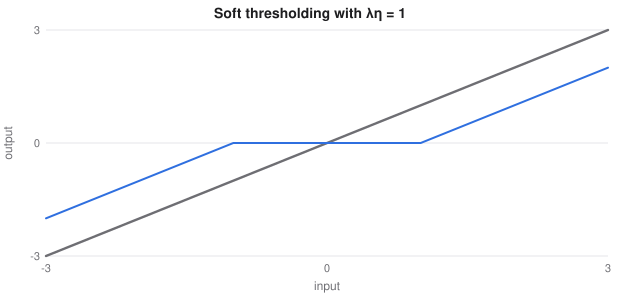

# Graphical Models, Optimisers, Ranking and Privacy

> Extended machine learning notes
> Sources: listed under References

**What this file is really about:**
$$\text{structured probability}\ \to\ \text{faster optimisers}\ \to\ \text{learning to order}\ \to\ \text{learning from less, and privately}\ \to\ \text{modern boosting}$$

**How to use this file.** Each part stands alone. Part B has complete code, checked against libraries or brute force. Part C is practice with answers.

## Contents

---

# Part A — Maths From the Ground Up

## A1. Graphical models

A joint distribution over $n$ binary variables has $2^n$ entries. A graph records which variables interact directly, so the joint factorises. A **Markov random field** writes

$$p(x)=\frac1Z\prod_c\psi_c(x_c).$$

A **factor graph** draws each $\psi_c$ as a node connected to its variables. Directed graphs are a special case, with each factor a conditional probability.

## A2. Message passing on a chain

Summing out variables one at a time avoids the exponential sum:

$$\sum_{x_1,x_2,x_3}\psi_{12}\psi_{23}=\sum_{x_2}\Big(\sum_{x_1}\psi_{12}\Big)\Big(\sum_{x_3}\psi_{23}\Big).$$

**Sum-product** defines a message $m_{i\to j}(x_j)=\sum_{x_i}\psi_{ij}(x_i,x_j)\psi_i(x_i)\prod_{k\ne j}m_{k\to i}(x_i)$. A marginal is the product of incoming messages and local evidence. On a tree this is exact, in time linear in the number of edges.

On graphs with cycles, **loopy belief propagation** repeats the same updates. It is approximate and may not converge, and it often works well in practice.

## A3. Proximal gradient

Consider $f(w)+g(w)$, with $f$ smooth and $g$ non-smooth, such as $\lambda\|w\|_1$. The **proximal operator** solves

$$\text{prox}_{\eta g}(v)=\arg\min_w\ g(w)+\frac1{2\eta}\|w-v\|^2.$$

For the L1 norm it is soft thresholding. The **ISTA** update is $w\leftarrow\text{prox}_{\eta g}(w-\eta\nabla f(w))$. With $L$ the largest curvature and $\eta=1/L$, its error falls as $O(1/k)$. **FISTA** adds momentum and reaches $O(1/k^2)$.



## A4. Quasi-Newton methods and L-BFGS

Newton's method uses $H^{-1}\nabla f$, which costs $O(p^3)$. BFGS builds an approximation to $H^{-1}$ from observed differences

$$s_k=w_{k+1}-w_k,\qquad y_k=\nabla f_{k+1}-\nabla f_k.$$

**L-BFGS** stores only the latest $m$ pairs. Its two-loop recursion computes the search direction in $O(mp)$, so it suits large smooth deterministic problems. It is the default solver for logistic regression in scikit-learn.

## A5. ADMM

To solve $\min f(w)+g(z)$ subject to $w=z$, form the augmented Lagrangian and alternate:

$$w\leftarrow\arg\min_wf(w)+\frac\rho2\|w-z+u\|^2,$$
$$z\leftarrow\text{prox}_{g/\rho}(w+u),\qquad u\leftarrow u+w-z.$$

Splitting problems this way suits distributed data, where each machine solves its own $w$ step.

## A6. Learning to rank

Ranking cares about order, and the top matters most. There are three families.

- **Pointwise.** Predict relevance for each item independently.
- **Pairwise.** RankNet predicts which of two is better, with $P(i>j)=\sigma(s_i-s_j)$ and a logistic loss.
- **Listwise.** Optimise a whole-list measure.

NDCG is not differentiable. **LambdaRank** multiplies each pair's gradient by $|\Delta\text{NDCG}|$, the change in the metric if the two items swapped, which empirically optimises NDCG.

## A7. Differential privacy

A randomised algorithm $M$ is **$\varepsilon$-differentially private** if for datasets differing in one person, and any output set $S$,

$$P(M(D)\in S)\le e^\varepsilon P(M(D')\in S).$$

For a query with **sensitivity** $\Delta$, the most one person can change it, the **Laplace mechanism** adds noise of scale $\Delta/\varepsilon$. A count has $\Delta=1$. Privacy budgets add up across queries.

**DP-SGD** clips each example's gradient to norm $C$, adds Gaussian noise scaled to $C$, and averages. Clipping limits sensitivity, and noise hides any one person.

## A8. Federated learning

Raw data stay on devices. In **FedAvg**, each client takes a few local steps, and the server averages the resulting weights by client size:

$$w\leftarrow\sum_k\frac{n_k}nw_k.$$

Different data across clients cause **client drift**. Federated learning by itself does not give privacy, since updates can leak data, so it is combined with secure aggregation and noise.

## A9. Active learning

If labels are expensive, choose which to buy. **Uncertainty sampling** picks the row where the model is least sure. **Query by committee** picks where models disagree. Beware that selecting only uncertain rows gives a biased training set, so evaluate on a random held-out set.

## A10. LightGBM and CatBoost

**Histogram splits** bin each feature into, say, 255 values, so a split search costs $O(\text{bins})$ per feature, rather than $O(n)$.

**LightGBM** grows **leaf-wise**, splitting the leaf with the largest gain, which is accurate and can overfit on small data. **GOSS** keeps large-gradient rows and samples the rest. **Exclusive feature bundling** merges features that are rarely non-zero together.

**CatBoost** handles categories with **ordered target statistics**. Each row is encoded from only the rows before it in a random order, so its own label cannot leak in. Plain target encoding leaks, and is optimistic on training data.

---

# Part B — In Code

## B1. Sum-product against brute force

```python
from itertools import product

import numpy as np

unary = [np.array([0.7, 0.3]), np.array([0.5, 0.5]), np.array([0.2, 0.8]), np.array([0.6, 0.4])]
pair = np.array([[0.9, 0.1], [0.2, 0.8]])
n = len(unary)

fwd = [np.ones(2) for _ in range(n)]; bwd = [np.ones(2) for _ in range(n)]
for i in range(1, n):
    fwd[i] = pair.T @ (fwd[i - 1] * unary[i - 1])
for i in range(n - 2, -1, -1):
    bwd[i] = pair @ (bwd[i + 1] * unary[i + 1])
marginals = [f * u * b / (f * u * b).sum() for f, u, b in zip(fwd, unary, bwd)]

brute = np.zeros((n, 2))
for x in product([0, 1], repeat=n):
    p = np.prod([unary[i][x[i]] for i in range(n)]) * np.prod([pair[x[i], x[i + 1]] for i in range(n - 1)])
    for i in range(n):
        brute[i, x[i]] += p
brute /= brute.sum(1, keepdims=True)
print(np.round(marginals, 4)[:2])
assert np.allclose(marginals, brute)
```

## B2. ISTA and FISTA for the lasso

```python
import numpy as np
from sklearn.linear_model import Lasso

rng = np.random.default_rng(0)
X = rng.normal(size=(200, 40)) + 3 * rng.normal(size=(200, 1))     # a shared factor makes the problem ill-conditioned
y = X[:, :3] @ np.array([3.0, -2.0, 1.5]) + rng.normal(size=200)
lam, n = 0.1, len(y)
L = np.linalg.eigvalsh(X.T @ X / n).max()
soft = lambda v, t: np.sign(v) * np.maximum(np.abs(v) - t, 0)
obj = lambda w: ((X @ w - y) ** 2).sum() / (2 * n) + lam * np.abs(w).sum()

def ista(k):
    w = np.zeros(40)
    for _ in range(k):
        w = soft(w - X.T @ (X @ w - y) / n / L, lam / L)
    return w

def fista(k):
    w = v = np.zeros(40); t = 1.0
    for _ in range(k):
        new = soft(v - X.T @ (X @ v - y) / n / L, lam / L)
        t2 = (1 + np.sqrt(1 + 4 * t * t)) / 2
        v = new + (t - 1) / t2 * (new - w)
        w, t = new, t2
    return w

sk = Lasso(alpha=lam, fit_intercept=False, tol=1e-12, max_iter=100000).fit(X, y)
best = obj(sk.coef_)
print('gap after 20 steps: ista', obj(ista(20)) - best, 'fista', obj(fista(20)) - best)
assert obj(fista(20)) - best < obj(ista(20)) - best
assert abs(obj(fista(5000)) - best) < 1e-6
```

## B3. L-BFGS

```python
import numpy as np
from scipy.optimize import minimize
from sklearn.datasets import load_breast_cancer

X, y = load_breast_cancer(return_X_y=True)
X = np.c_[np.ones(len(X)), (X - X.mean(0)) / X.std(0)]

def fg(w):
    z = X @ w
    loss = (np.logaddexp(0, z) - y * z).mean() + 0.005 * w @ w
    return loss, X.T @ (1 / (1 + np.exp(-z)) - y) / len(y) + 0.01 * w

def lbfgs(steps=200, m=10):
    w = np.zeros(X.shape[1]); f, g = fg(w)
    S, Y = [], []
    for _ in range(steps):
        q, alphas = g.copy(), []
        for s, u in zip(reversed(S), reversed(Y)):             # first loop, newest to oldest
            a = (s @ q) / (u @ s); alphas.append(a); q -= a * u
        r = q * ((S[-1] @ Y[-1]) / (Y[-1] @ Y[-1]) if S else 1.0)
        for (s, u), a in zip(zip(S, Y), reversed(alphas)):     # second loop, oldest to newest
            r += s * (a - (u @ r) / (u @ s))
        d, t = -r, 1.0
        while True:                                            # backtracking line search
            f2, g2 = fg(w + t * d)
            if f2 <= f + 1e-4 * t * (g @ d) or t < 1e-10:
                break
            t /= 2
        s, u = t * d, g2 - g
        w, f, g = w + s, f2, g2
        if s @ u > 1e-12:
            S.append(s); Y.append(u); S, Y = S[-m:], Y[-m:]
        if np.linalg.norm(g) < 1e-6:
            break
    return f

ours = lbfgs()
theirs = minimize(fg, np.zeros(X.shape[1]), jac=True, method='L-BFGS-B', options=dict(gtol=1e-8)).fun
print(round(ours, 6), round(theirs, 6))
assert abs(ours - theirs) < 1e-5
```

## B4. ADMM for the lasso

```python
import numpy as np
from sklearn.linear_model import Lasso

rng = np.random.default_rng(1)
X = rng.normal(size=(150, 20)); y = 2 * X[:, 0] - X[:, 5] + 0.5 * rng.normal(size=150)
n, lam, rho = len(y), 0.1, 10.0
M = np.linalg.inv(X.T @ X + rho * np.eye(20))
Xy = X.T @ y
w = z = u = np.zeros(20)

for _ in range(1500):
    w = M @ (Xy + rho * (z - u))
    z = np.sign(w + u) * np.maximum(np.abs(w + u) - lam * n / rho, 0)
    u = u + w - z

sk = Lasso(alpha=lam, fit_intercept=False, tol=1e-12, max_iter=100000).fit(X, y)
print('largest difference', np.abs(z - sk.coef_).max())
assert np.allclose(z, sk.coef_, atol=1e-4)
```

## B5. RankNet and NDCG

```python
import numpy as np
import torch
from torch import nn

torch.manual_seed(0); rng = np.random.default_rng(0)
true_w = np.array([1.0, -0.5, 2.0, 0.0, 0.5])
X = rng.normal(size=(200, 20, 5))                   # queries, items, features
rel = np.clip(np.round((X @ true_w) * 0.7 + 1.5 + 0.2 * rng.normal(size=(200, 20))), 0, 4)
Xa, ra = torch.tensor(X[:150], dtype=torch.float32), torch.tensor(rel[:150], dtype=torch.float32)
Xb, rb = X[150:], rel[150:]

model = nn.Sequential(nn.Linear(5, 32), nn.ReLU(), nn.Linear(32, 1))
opt = torch.optim.Adam(model.parameters(), lr=3e-3)

for step in range(300):
    s = model(Xa).squeeze(-1)
    diff = s[:, None] - s[:, :, None].transpose(1, 2) if False else s.unsqueeze(2) - s.unsqueeze(1)
    better = (ra.unsqueeze(2) > ra.unsqueeze(1)).float()
    loss = (torch.nn.functional.softplus(-diff) * better).sum() / better.sum()
    opt.zero_grad(); loss.backward(); opt.step()

def ndcg(rels):
    dcg = lambda r: ((2 ** r - 1) / np.log2(np.arange(len(r)) + 2)).sum()
    return dcg(rels) / dcg(np.sort(rels)[::-1])

score = model(torch.tensor(Xb, dtype=torch.float32)).squeeze(-1).detach().numpy()
learned = np.mean([ndcg(r[np.argsort(-s)]) for r, s in zip(rb, score)])
shuffled = np.mean([ndcg(rng.permutation(r)) for r in rb])
print('NDCG learned', round(learned, 3), 'random order', round(shuffled, 3))
assert learned > 0.95 and shuffled < learned - 0.2
```

## B6. Differential privacy

```python
import numpy as np

rng = np.random.default_rng(0)
data = rng.integers(2, size=10000)
eps = 0.5
noisy = data.sum() + rng.laplace(0, 1 / eps, 200000)
print('mean error', round(noisy.mean() - data.sum(), 3), 'variance', round(noisy.var(), 2), 'theory', 2 / eps ** 2)
assert abs(noisy.var() - 2 / eps ** 2) < 0.3

# DP-SGD for logistic regression: clip each example, then add noise.
X = rng.normal(size=(4000, 5)); y = (X[:, 0] - X[:, 1] > 0).astype(float)
w, C, sigma = np.zeros(5), 1.0, 1.0
for t in range(800):
    i = rng.choice(len(X), 200, replace=False)
    g = (1 / (1 + np.exp(-X[i] @ w)) - y[i])[:, None] * X[i]
    g = g / np.maximum(1, np.linalg.norm(g, axis=1, keepdims=True) / C)
    w -= 0.3 * (g.sum(0) + sigma * C * rng.normal(size=5)) / 200

acc = ((X @ w > 0) == y).mean()
print('accuracy with DP-SGD', round(acc, 3))
assert acc > 0.9
```

## B7. Federated averaging on uneven clients

```python
import numpy as np

rng = np.random.default_rng(0)
X = rng.normal(size=(5000, 5)); y = (X[:, 0] + X[:, 1] > 0).astype(float)
order = np.argsort(X[:, 2])                         # clients hold different parts of the data
clients = np.array_split(order, 8)
w = np.zeros(5)

for round_ in range(40):
    updates, sizes = [], []
    for c in clients:
        v = w.copy()
        for _ in range(5):
            v -= 0.5 * X[c].T @ (1 / (1 + np.exp(-X[c] @ v)) - y[c]) / len(c)
        updates.append(v); sizes.append(len(c))
    w = np.average(updates, axis=0, weights=sizes)

acc = ((X @ w > 0) == y).mean()
print('accuracy', round(acc, 3))
assert acc > 0.97
```

## B8. Active learning against random labelling

```python
import numpy as np
from sklearn.datasets import make_classification
from sklearn.linear_model import LogisticRegression

def run(strategy, seed):
    X, y = make_classification(3000, 20, n_informative=8, class_sep=0.8, random_state=seed)
    Xt, yt = X[2000:], y[2000:]; X, y = X[:2000], y[:2000]
    rng = np.random.default_rng(seed)
    pool = np.ones(2000, bool)
    idx = rng.choice(2000, 20, replace=False); pool[idx] = False
    for _ in range(12):
        chosen = np.flatnonzero(~pool)
        m = LogisticRegression(max_iter=500).fit(X[chosen], y[chosen])
        left = np.flatnonzero(pool)
        if strategy == 'random':
            new = rng.choice(left, 10, replace=False)
        else:
            new = left[np.argsort(np.abs(m.predict_proba(X[left])[:, 1] - 0.5))[:10]]
        pool[new] = False
    chosen = np.flatnonzero(~pool)
    return LogisticRegression(max_iter=500).fit(X[chosen], y[chosen]).score(Xt, yt)

a = np.mean([run('uncertainty', s) for s in range(30)])
b = np.mean([run('random', s) for s in range(30)])
print('uncertainty', round(a, 4), 'random', round(b, 4))
assert a > b
```

## B9. Why ordered target statistics matter

This category is pure noise. Plain target encoding still looks excellent on the training data.

```python
import numpy as np
from sklearn.metrics import roc_auc_score

rng = np.random.default_rng(0)
n = 4000
cat = rng.integers(1000, size=n); y = rng.integers(2, size=n)
prior = y.mean()

def plain(cat, y, a=1.0):
    s, c = np.zeros(1000), np.zeros(1000)
    np.add.at(s, cat, y); np.add.at(c, cat, 1)
    return (s[cat] + a * prior) / (c[cat] + a)

def ordered(cat, y, a=1.0):
    order = rng.permutation(n)
    s, c, out = np.zeros(1000), np.zeros(1000), np.zeros(n)
    for i in order:
        out[i] = (s[cat[i]] + a * prior) / (c[cat[i]] + a)   # uses only the earlier rows
        s[cat[i]] += y[i]; c[cat[i]] += 1
    return out

leaky, honest = roc_auc_score(y, plain(cat, y)), roc_auc_score(y, ordered(cat, y))
print('training AUC: plain', round(leaky, 3), 'ordered', round(honest, 3))
assert leaky > 0.75 and honest < 0.56
```

---

# Part C — Practice

**P1.** How many terms does brute force sum for marginals over 20 binary variables?

<details><summary>Answer</summary>

$2^{20}$, about a million, against 19 message steps forward and backward on a chain.

</details>

**P2.** What is the proximal operator of $\lambda\|w\|_1$ at $v=2$, with $\eta\lambda=0.5$?

<details><summary>Answer</summary>

$1.5$.

</details>

**P3.** A count query uses $\varepsilon=0.1$. What is the Laplace scale?

<details><summary>Answer</summary>

$1/0.1=10$.

</details>

**P4.** Two queries use $\varepsilon=0.5$ and $0.3$. What is the total budget by basic composition?

<details><summary>Answer</summary>

$0.8$.

</details>

**P5.** Why can plain target encoding overfit?

<details><summary>Answer</summary>

Each row's encoding includes its own label, which is a form of leakage.

</details>
