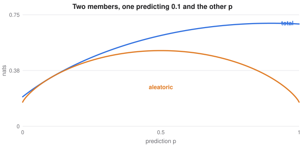

# Robust, Uncertain and Compact Networks

> Extended deep learning notes
> Sources: listed under References

**What this file is really about:**
$$\text{attacks and defences}\ \to\ \text{knowing when you do not know}\ \to\ \text{smaller, faster models}\ \to\ \text{training across machines}$$

**How to use this file.** Each part stands alone. Part B has complete code, every block checked by running it. Part C is practice with answers.

## Contents

---

# Part A — Maths From the Ground Up

## A1. Adversarial examples

A small change to an input, invisible to people, can flip a prediction. The cause is partly geometric. For a linear score $w^\top x$, a change $\delta$ with $\|\delta\|_\infty\le\epsilon$ can shift it by

$$\epsilon\|w\|_1,$$

which grows with input dimension, even when each pixel changes very little.

## A2. FGSM and PGD

To raise the loss most under an $\ell_\infty$ limit, move each input by $\epsilon$ in the direction of the gradient's sign. That is the **fast gradient sign method**:

$$x'=x+\epsilon\,\text{sign}(\nabla_xL(x,y)).$$

**Projected gradient descent** repeats smaller steps of size $\alpha$, and projects back into the allowed region after each:

$$x^{t+1}=\Pi_{\|x'-x\|_\infty\le\epsilon}\big(x^t+\alpha\,\text{sign}(\nabla_xL)\big).$$

PGD is much stronger. An evaluation that tries only FGSM can give false confidence, as can defences that merely hide gradients.

## A3. Adversarial training

Train on attacked inputs. This is a min-max problem:

$$\min_w\ \mathbb E\Big[\max_{\|\delta\|\le\epsilon}L(f_w(x+\delta),y)\Big].$$

The inner maximum is approximated with PGD. Robustness costs compute, and usually some clean accuracy.

## A4. Two kinds of uncertainty

**Aleatoric** uncertainty is noise in the data, which more data cannot remove. **Epistemic** uncertainty is ignorance of the model, which more data can reduce. Decisions need both, and a softmax score alone provides neither reliably: networks can be very confident on inputs unlike anything they saw.

## A5. MC dropout and deep ensembles

**MC dropout** keeps dropout active at test time and averages $T$ forward passes:

$$\hat y=\frac1T\sum_tf_t(x),\qquad\widehat{\text{Var}}=\frac1T\sum_t(f_t(x)-\hat y)^2.$$

A **deep ensemble** trains several networks from different starting points. It costs more, and is usually the stronger baseline, because different solutions disagree where data are absent.

For classification, the **mutual information** separates the two kinds:

$$\underbrace{H\big[\bar p\big]}_{\text{total}}-\underbrace{\tfrac1T\sum_tH[p_t]}_{\text{aleatoric}}=\text{epistemic}.$$



## A6. Knowledge distillation

Train a small student on a large teacher's soft outputs at temperature $T$:

$$L=\alpha\,\text{CE}(y,s)+(1-\alpha)\,T^2\,\text{KL}\big(\text{softmax}(t/T)\,\big\|\,\text{softmax}(s/T)\big).$$

Soft outputs carry information about which wrong classes are plausible. The gradient of the soft term shrinks as $1/T^2$, so the factor $T^2$ keeps the two parts balanced.

## A7. Pruning

Most weights contribute little. **Magnitude pruning** removes the smallest ones, then fine-tunes. Removing weights gradually works better than removing them all at once. Unstructured pruning saves memory only when stored sparsely. **Structured** pruning removes whole channels, which speeds up ordinary hardware.

## A8. Quantisation

Store weights and activations as small integers. Uniform quantisation maps a real range $[a,b]$ to $[0,2^n-1]$:

$$S=\frac{b-a}{2^n-1},\qquad q=\text{round}\Big(\frac{r-a}S\Big),\qquad\hat r=a+Sq.$$

The rounding error is at most $S/2$. Eight-bit weights take one quarter of the memory. **Post-training** quantisation is simple. **Quantisation-aware training** simulates rounding during training, and loses less accuracy.

## A9. Training across machines

**Data parallel** training gives each of $K$ workers a shard, and averages their gradients. With equal shards, the average equals the full-batch gradient. The effective batch is $Kb$, so a common rule scales the learning rate with $K$, with a warmup. Batch norm statistics need to be synchronised, or computed per worker. Communication often limits scaling, not compute.

---

# Part B — In Code

## B1. FGSM, PGD and adversarial training

```python
import torch
from torch import nn
from torch.nn import functional as F
from sklearn.datasets import make_classification

torch.manual_seed(0)
X, y = make_classification(4000, 30, n_informative=15, class_sep=1.5, random_state=0)
X = torch.tensor((X - X.mean(0)) / X.std(0), dtype=torch.float32); y = torch.tensor(y)
Xa, ya, Xb, yb = X[:3000], y[:3000], X[3000:], y[3000:]
eps = 0.25


def fgsm(m, x, y):
    x = x.clone().requires_grad_(True)
    F.cross_entropy(m(x), y).backward()
    return (x + eps * x.grad.sign()).detach()


def pgd(m, x, y, steps=10):
    a = x.clone()
    for _ in range(steps):
        a.requires_grad_(True)
        g = torch.autograd.grad(F.cross_entropy(m(a), y), a)[0]
        a = (a.detach() + eps / 4 * g.sign())
        a = torch.max(torch.min(a, x + eps), x - eps)       # project back
    return a.detach()


def train(adv):
    m = nn.Sequential(nn.Linear(30, 128), nn.ReLU(), nn.Linear(128, 128), nn.ReLU(), nn.Linear(128, 2))
    opt = torch.optim.Adam(m.parameters(), lr=1e-3)
    for epoch in range(60):
        for i in torch.randperm(3000).split(128):
            x = pgd(m, Xa[i], ya[i], 5) if adv else Xa[i]
            loss = F.cross_entropy(m(x), ya[i])
            opt.zero_grad(); loss.backward(); opt.step()
    return m


acc = lambda m, x: m(x).argmax(1).eq(yb).float().mean().item()
plain, robust = train(False), train(True)
print('plain: clean', round(acc(plain, Xb), 3), 'fgsm', round(acc(plain, fgsm(plain, Xb, yb)), 3), 'pgd', round(acc(plain, pgd(plain, Xb, yb)), 3))
print('robust: clean', round(acc(robust, Xb), 3), 'pgd', round(acc(robust, pgd(robust, Xb, yb)), 3))
assert acc(plain, pgd(plain, Xb, yb)) <= acc(plain, fgsm(plain, Xb, yb)) + 0.02
assert acc(robust, pgd(robust, Xb, yb)) > acc(plain, pgd(plain, Xb, yb)) + 0.1
```

## B2. MC dropout and ensembles

Uncertainty should grow away from the training data.

```python
import torch
from torch import nn

torch.manual_seed(0)
x = torch.cat([torch.linspace(-3, -1, 150), torch.linspace(1, 3, 150)]).unsqueeze(1)
y = torch.sin(x) + 0.05 * torch.randn_like(x)
test = torch.tensor([[-2.0], [0.0], [2.0], [7.0]])


def net(p=0.0):
    return nn.Sequential(nn.Linear(1, 128), nn.ReLU(), nn.Dropout(p), nn.Linear(128, 128), nn.ReLU(), nn.Dropout(p), nn.Linear(128, 1))


def fit(m):
    opt = torch.optim.Adam(m.parameters(), lr=3e-3, weight_decay=1e-5)
    for _ in range(1200):
        loss = ((m(x) - y) ** 2).mean()
        opt.zero_grad(); loss.backward(); opt.step()
    return m


dropout = fit(net(0.1)); dropout.train()                    # stays active at test time
with torch.no_grad():
    mc = torch.stack([dropout(test) for _ in range(200)]).std(0).squeeze()

members = [fit(net()) for _ in range(5)]
with torch.no_grad():
    ens = torch.stack([m(test) for m in members]).std(0).squeeze()

print('MC dropout spread', mc.numpy().round(3))
print('ensemble spread  ', ens.numpy().round(3))
assert mc[3] > 2 * mc[0] and ens[3] > 2 * ens[0]
```

## B3. Separating the two kinds of uncertainty

```python
import numpy as np

def entropy(p):
    return -(p * np.log(np.clip(p, 1e-12, 1))).sum(-1)

agree = np.array([[0.5, 0.5]] * 4)                          # every member unsure
disagree = np.array([[0.99, 0.01], [0.01, 0.99], [0.99, 0.01], [0.01, 0.99]])

for name, p in [('members agree they are unsure', agree), ('confident members disagree', disagree)]:
    total, aleatoric = entropy(p.mean(0)), entropy(p).mean()
    print(name, '| total', round(total, 3), 'aleatoric', round(aleatoric, 3), 'epistemic', round(total - aleatoric, 3))

assert abs(entropy(agree.mean(0)) - entropy(agree).mean()) < 1e-9
assert entropy(disagree.mean(0)) - entropy(disagree).mean() > 0.6
```

## B4. Knowledge distillation

The student sees few true labels, but plenty of teacher outputs.

```python
import torch
from torch import nn
from torch.nn import functional as F
from sklearn.datasets import make_classification

torch.manual_seed(0)
X, y = make_classification(6000, 20, n_informative=12, n_classes=4, n_clusters_per_class=1, class_sep=1.2, random_state=0)
X = torch.tensor(X, dtype=torch.float32); y = torch.tensor(y)
Xa, ya, Xb, yb = X[:5000], y[:5000], X[5000:], y[5000:]
labelled = torch.arange(100)


def train(model, loss_fn, steps=800):
    opt = torch.optim.Adam(model.parameters(), lr=2e-3)
    for _ in range(steps):
        loss = loss_fn(model)
        opt.zero_grad(); loss.backward(); opt.step()
    return model


small = lambda: nn.Sequential(nn.Linear(20, 16), nn.ReLU(), nn.Linear(16, 4))
teacher = train(nn.Sequential(nn.Linear(20, 256), nn.ReLU(), nn.Linear(256, 256), nn.ReLU(), nn.Linear(256, 4)),
                lambda m: F.cross_entropy(m(Xa), ya))
with torch.no_grad():
    soft = teacher(Xa)
T = 4.0

def distil(m):
    i = torch.randint(5000, (256,))
    s = m(Xa[i])
    kd = F.kl_div(F.log_softmax(s / T, 1), F.softmax(soft[i] / T, 1), reduction='batchmean') * T * T
    return 0.5 * F.cross_entropy(m(Xa[labelled]), ya[labelled]) + 0.5 * kd

alone = train(small(), lambda m: F.cross_entropy(m(Xa[labelled]), ya[labelled]))
student = train(small(), distil)
acc = lambda m: m(Xb).argmax(1).eq(yb).float().mean().item()
print('teacher', round(acc(teacher), 3), 'small alone', round(acc(alone), 3), 'distilled', round(acc(student), 3))
assert acc(student) > acc(alone)
```

## B5. Pruning, then fine-tuning

```python
import torch
from torch import nn
from torch.nn import functional as F
from sklearn.datasets import make_classification

torch.manual_seed(0)
X, y = make_classification(3000, 20, n_informative=10, class_sep=1.5, random_state=0)
X = torch.tensor(X, dtype=torch.float32); y = torch.tensor(y)
Xa, ya, Xb, yb = X[:2400], y[:2400], X[2400:], y[2400:]
m = nn.Sequential(nn.Linear(20, 128), nn.ReLU(), nn.Linear(128, 128), nn.ReLU(), nn.Linear(128, 2))
acc = lambda: m(Xb).argmax(1).eq(yb).float().mean().item()


def train(steps, masks=None):
    opt = torch.optim.Adam(m.parameters(), lr=1e-3)
    for _ in range(steps):
        loss = F.cross_entropy(m(Xa), ya)
        opt.zero_grad(); loss.backward(); opt.step()
        if masks:
            for p, k in masks:
                p.data *= k                                 # pruned weights stay at zero


train(400); before = acc()
params = [p for p in m.parameters() if p.ndim == 2]
limit = torch.cat([p.abs().flatten() for p in params]).quantile(0.8)
masks = [(p, (p.abs() > limit).float()) for p in params]
for p, k in masks:
    p.data *= k
pruned = acc()
train(150, masks)
kept = sum(k.sum().item() for _, k in masks) / sum(k.numel() for _, k in masks)
print('before', round(before, 3), 'after pruning', round(pruned, 3), 'after fine-tuning', round(acc(), 3), 'weights kept', round(kept, 2))
assert acc() > before - 0.03 and kept < 0.21
```

## B6. Uniform quantisation

```python
import numpy as np

def quantise(r, bits=8):
    a, b = r.min(), r.max()
    S = (b - a) / (2 ** bits - 1)
    return np.round((r - a) / S).astype(np.uint8 if bits <= 8 else np.uint16), a, S

w = np.random.default_rng(0).normal(0, 0.1, 100000)
q, a, S = quantise(w)
back = a + S * q
print('largest error', np.abs(w - back).max(), 'bound', S / 2, 'bytes', w.nbytes, 'to', q.nbytes)
assert np.abs(w - back).max() <= S / 2 + 1e-12 and q.nbytes * 8 == w.nbytes
```

## B7. Averaged gradients equal the full gradient

```python
import torch
from torch import nn

torch.manual_seed(0)
X, y = torch.randn(64, 5), torch.randn(64, 1)
m = nn.Linear(5, 1)

full = torch.autograd.grad(((m(X) - y) ** 2).mean(), m.weight)[0]
shards = [torch.autograd.grad(((m(a) - b) ** 2).mean(), m.weight)[0] for a, b in zip(X.chunk(4), y.chunk(4))]
assert (torch.stack(shards).mean(0) - full).abs().max() < 1e-6
print('the average of four shards equals the full gradient')
```

## B8. Distributed training in PyTorch

Save as a script. It runs two processes on one CPU, and also works unchanged across GPUs with the `nccl` backend.

```python
import torch
import torch.distributed as dist
import torch.multiprocessing as mp
from torch import nn
from torch.nn.parallel import DistributedDataParallel as DDP
from torch.utils.data import DataLoader, DistributedSampler, TensorDataset


def worker(rank, size):
    dist.init_process_group('gloo', init_method='tcp://127.0.0.1:29500', rank=rank, world_size=size)
    torch.manual_seed(0)
    X = torch.randn(512, 4)
    data = TensorDataset(X, X @ torch.tensor([1.0, -2.0, 3.0, 0.5]).unsqueeze(1))
    sampler = DistributedSampler(data, num_replicas=size, rank=rank)      # gives each process its own shard
    loader = DataLoader(data, batch_size=32, sampler=sampler)
    model = DDP(nn.Linear(4, 1))
    opt = torch.optim.SGD(model.parameters(), lr=0.05 * size)             # scaled with the number of workers
    for epoch in range(40):
        sampler.set_epoch(epoch)
        for x, y in loader:
            loss = ((model(x) - y) ** 2).mean()
            opt.zero_grad(); loss.backward(); opt.step()
    if rank == 0:
        print(model.module.weight.data.numpy().round(2))
    dist.destroy_process_group()


if __name__ == '__main__':
    mp.spawn(worker, args=(2,), nprocs=2)
```

---

# Part C — Practice

**P1.** A linear score has $\|w\|_1=40$, with $\epsilon=0.01$. How far can an attack move it?

<details><summary>Answer</summary>

$0.4$.

</details>

**P2.** Why is reporting only FGSM accuracy risky?

<details><summary>Answer</summary>

It is a weak single-step attack. A stronger iterative attack can find failures it misses.

</details>

**P3.** Weights range from $-1$ to $1$, with 8 bits. Find $S$ and the worst rounding error.

<details><summary>Answer</summary>

$S=2/255=0.00784$, with error at most $0.00392$.

</details>

**P4.** Why does distillation multiply the soft loss by $T^2$?

<details><summary>Answer</summary>

Softening scales its gradient by $1/T^2$, so the factor restores the balance with the hard loss.

</details>

**P5.** What does high mutual information across ensemble members suggest?

<details><summary>Answer</summary>

Confident members disagree, so the uncertainty is epistemic and more data could help.

</details>
