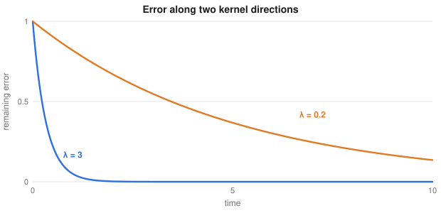

# Deep Learning Theory, Changing Tasks and Science

> Extended deep learning notes
> Sources: listed under References

**What this file is really about:**
$$\text{why networks train}\ \to\ \text{inputs with structure}\ \to\ \text{learning many tasks}\ \to\ \text{networks as dynamics and equations}\ \to\ \text{tables}$$

**How to use this file.** Each part stands alone. Part B has complete code, checked by running it. Part C is practice with answers.

## Contents

---

# Part A — Maths From the Ground Up

## A1. The neural tangent kernel

Expand a network around its starting weights:

$$f(x;w)\approx f(x;w_0)+\nabla_wf(x;w_0)^\top(w-w_0).$$

This is linear in $w$, with features $\phi(x)=\nabla_wf(x;w_0)$. The kernel between two inputs is

$$\Theta(x,x')=\nabla_wf(x;w_0)^\top\nabla_wf(x';w_0).$$

## A2. Training dynamics in the kernel regime

Under gradient flow on squared loss, predictions on the training set obey

$$\dot f=-\Theta\,(f-y).$$

This is a linear system, with solution $f(t)-y=e^{-\Theta t}(f(0)-y)$. Directions with a large eigenvalue are learned first. For very wide networks, $\Theta$ stays nearly constant during training, so the network behaves like kernel regression.

Real networks of finite width also change their features as they train, which kernels cannot do.



## A3. The lottery ticket hypothesis

A dense network may contain a sparse subnetwork which, trained alone from its **original** initial weights, matches the full network. Finding it uses **iterative magnitude pruning**: train, prune the smallest weights, rewind the rest to their initial values, and repeat. The same mask with new random weights often does worse, which suggests that initialisation matters.

## A4. Permutation-invariant inputs: Deep Sets

A function on a set must not depend on order. The Deep Sets result says that such functions can be written

$$f(X)=\rho\Big(\sum_{x\in X}\phi(x)\Big).$$

The sum is what makes it invariant. Summing can be replaced by a mean or maximum. Attention without positions is a related design, and adds interactions between elements.

## A5. Meta-learning: MAML

Learn a starting point that adapts quickly. For each task $i$, take a gradient step on its support set:

$$w_i'=w-\alpha\nabla_wL_i^{\text{support}}(w).$$

Then improve the start using the loss **after** adaptation on the query set:

$$w\leftarrow w-\beta\sum_i\nabla_wL_i^{\text{query}}(w_i').$$

By the chain rule the outer gradient includes the Hessian of the inner loss:

$$\nabla_wL(w')=(I-\alpha\nabla^2L^{\text{support}})\nabla_{w'}L(w').$$

**First-order MAML** drops the Hessian term, and often performs nearly as well.

## A6. Continual learning

A network trained on a new task tends to overwrite the old one. This is **catastrophic forgetting**. There are three main defences:

- **Replay** stores a few old examples, or generates them.
- **Regularisation** protects weights important to old tasks.
- **Architectural** methods give tasks their own parameters.

**Elastic weight consolidation** approximates the old posterior with a Gaussian, whose precision is the diagonal Fisher information $F$:

$$L=L_{\text{new}}(w)+\frac\lambda2\sum_iF_i(w_i-w_i^{\text{old}})^2.$$

## A7. Neural ordinary differential equations

A residual block looks like an Euler step: $h_{t+1}=h_t+f(h_t)$. Take the step size to zero, and the layers become

$$\frac{dh}{dt}=f(h,t;w).$$

An ODE solver computes the output. Gradients can be obtained by backpropagating through the solver, or through the **adjoint method**, which solves a second ODE backwards and uses constant memory.

## A8. Physics-informed networks

To solve a differential equation, make a network $u(t)$ and penalise its violation of the equation, with derivatives from automatic differentiation:

$$L=\frac1N\sum_i\big(\mathcal D[u](t_i)\big)^2+\text{boundary and initial condition terms}.$$

No labelled solution data are needed. Training can be difficult for stiff or high-frequency problems, and classical solvers are often better for standard equations. Their appeal is in combining sparse measurements with known physics.

## A9. Deep learning on tables

Gradient-boosted trees remain strong on tabular data. Three properties favour them: they handle irregular functions, they ignore uninformative features, and they are unaffected by rescaling.

**FT-Transformer** turns each feature into a token, using $x_jw_j+b_j$ for numbers and an embedding for categories, then applies a transformer with a class token. Neural models become attractive with very large data, mixed input types, and when combining with images or text.

---

# Part B — In Code

## B1. The empirical neural tangent kernel

Kernel regression predicts what a very wide network learns.

```python
import torch
from torch import nn
from torch.func import functional_call, jacrev, vmap

torch.manual_seed(0)
X = torch.linspace(-2, 2, 12).unsqueeze(1); y = torch.sin(2 * X)
Xs = torch.linspace(-2, 2, 41).unsqueeze(1)
net = nn.Sequential(nn.Linear(1, 1024), nn.Tanh(), nn.Linear(1024, 1))
params = {k: v.detach() for k, v in net.named_parameters()}
f = lambda p, x: functional_call(net, p, (x.unsqueeze(0),)).squeeze()


def features(x):
    J = vmap(jacrev(f), (None, 0))(params, x)
    return torch.cat([j.flatten(1) for j in J.values()], 1)


Ja, Js = features(X), features(Xs)
K = Ja @ Ja.T
f0a, f0s = net(X).detach(), net(Xs).detach()
kernel = f0s + Js @ Ja.T @ torch.linalg.solve(K + 1e-4 * torch.eye(12), y - f0a)

opt = torch.optim.SGD(net.parameters(), lr=0.002)
for _ in range(6000):
    loss = ((net(X) - y) ** 2).mean()
    opt.zero_grad(); loss.backward(); opt.step()

trained = net(Xs).detach()
corr = torch.corrcoef(torch.cat([kernel.T, trained.T]))[0, 1].item()
print('correlation of kernel and trained predictions', round(corr, 4), 'training loss', round(loss.item(), 4))
assert corr > 0.97
```

## B2. Learning speed follows the kernel spectrum

```python
import numpy as np

Theta = np.array([[2.0, 1.0], [1.0, 2.0]])          # eigenvalues 3 and 1
y = np.array([1.0, -1.0])                           # lies along the slow direction
values, vectors = np.linalg.eigh(Theta)
for t in (0.5, 2.0):
    error = vectors @ np.diag(np.exp(-values * t)) @ vectors.T @ (0 - y)
    print('t', t, 'remaining error', np.round(error, 3))
assert abs(np.linalg.norm(vectors @ np.diag(np.exp(-values)) @ vectors.T @ y) - np.exp(-1) * np.linalg.norm(y)) < 1e-9
```

## B3. Lottery tickets

```python
import copy

import torch
from torch import nn
from torch.nn import functional as F
from sklearn.datasets import make_classification

torch.manual_seed(0)
X, y = make_classification(3000, 20, n_informative=12, class_sep=1.2, random_state=0)
X = torch.tensor(X, dtype=torch.float32); y = torch.tensor(y)
Xa, ya, Xb, yb = X[:2400], y[:2400], X[2400:], y[2400:]
make = lambda: nn.Sequential(nn.Linear(20, 200), nn.ReLU(), nn.Linear(200, 200), nn.ReLU(), nn.Linear(200, 2))


def train(m, mask=None, steps=500):
    opt = torch.optim.Adam(m.parameters(), lr=1e-3)
    for _ in range(steps):
        if mask:
            for k, v in m.named_parameters():
                if k in mask:
                    v.data *= mask[k]
        loss = F.cross_entropy(m(Xa), ya)
        opt.zero_grad(); loss.backward(); opt.step()
    return m(Xb).argmax(1).eq(yb).float().mean().item()


net = make(); start = copy.deepcopy(net.state_dict())
full = train(net)
named = {k: v for k, v in net.named_parameters() if v.ndim == 2}
limit = torch.cat([v.abs().flatten() for v in named.values()]).quantile(0.9)
mask = {k: (v.abs() > limit).float() for k, v in named.items()}

ticket = make(); ticket.load_state_dict(start)      # rewind to the original start
print('full', round(full, 3), 'winning ticket', round(train(ticket, mask), 3), 'same mask, new start', round(train(make(), mask), 3))
assert train(ticket, mask) > 0.85
```

On an easy problem like this one, a new random start with the same mask often does just as well. The difference between a winning ticket and a random start shows up mainly in larger networks and harder tasks, so treat this as the procedure and not as proof of the effect.

## B4. Deep Sets

```python
import torch
from torch import nn

torch.manual_seed(0)
phi = nn.Sequential(nn.Linear(1, 64), nn.ReLU(), nn.Linear(64, 64))
rho = nn.Sequential(nn.Linear(64, 64), nn.ReLU(), nn.Linear(64, 1))
model = lambda x: rho(phi(x).mean(1)).squeeze(1)
opt = torch.optim.Adam([*phi.parameters(), *rho.parameters()], lr=2e-3)

for step in range(2000):
    x = torch.rand(128, 10, 1)
    loss = ((model(x) - x.max(1).values.squeeze(1)) ** 2).mean()
    opt.zero_grad(); loss.backward(); opt.step()

x = torch.rand(8, 10, 1)
assert (model(x) - model(x[:, torch.randperm(10)])).abs().max() < 1e-5
test = torch.rand(2000, 10, 1)
error = (model(test) - test.max(1).values.squeeze(1)).abs().mean().item()
print('mean error when predicting the maximum', round(error, 4))
assert error < 0.05
```

## B5. MAML on sine waves

```python
import math
import torch
from torch import nn
from torch.func import functional_call

torch.manual_seed(0)
net = nn.Sequential(nn.Linear(1, 64), nn.ReLU(), nn.Linear(64, 64), nn.ReLU(), nn.Linear(64, 1))
opt = torch.optim.Adam(net.parameters(), lr=1e-3)
alpha = 0.01


def task():
    amp, phase = 0.5 + 4.5 * torch.rand(1), math.pi * torch.rand(1)
    def sample(n):
        x = -5 + 10 * torch.rand(n, 1)
        return x, amp * torch.sin(x + phase)
    return sample


mse = lambda p, x, y: ((functional_call(net, p, (x,)) - y) ** 2).mean()


def adapt(p, x, y, steps=1, create=True):
    for _ in range(steps):
        g = torch.autograd.grad(mse(p, x, y), list(p.values()), create_graph=create)
        p = {k: v - alpha * dv for (k, v), dv in zip(p.items(), g)}
    return p


for it in range(5000):
    loss = 0
    for _ in range(4):
        s = task()
        p = adapt(dict(net.named_parameters()), *s(10))
        loss = loss + mse(p, *s(10)) / 4
    opt.zero_grad(); loss.backward(); opt.step()

before, after = [], []
for _ in range(200):
    s = task()
    x, y = s(10); xt, yt = s(100)
    p = dict(net.named_parameters())
    before.append(mse(p, xt, yt).item())
    after.append(mse(adapt(p, x, y, 5, False), xt, yt).item())
print('loss on new tasks: before adapting', round(sum(before) / 200, 3), 'after five steps', round(sum(after) / 200, 3))
assert sum(after) < 0.6 * sum(before)
```

## B6. Elastic weight consolidation

```python
import torch
from torch import nn
from torch.nn import functional as F

torch.manual_seed(0)
rotation = torch.tensor([[0.0, -1.0], [1.0, 0.0]])


def make_task(R):
    x = torch.randn(1500, 10)
    head = x[:, :2] @ R.T
    y = (head[:, 0] + 0.8 * head[:, 1] > 0).long()
    return x, y


Ta, Tb = make_task(torch.eye(2)), make_task(rotation)
acc = lambda m, t: m(t[0]).argmax(1).eq(t[1]).float().mean().item()


def fit(m, t, penalty=None, steps=400):
    opt = torch.optim.Adam(m.parameters(), lr=2e-3)
    for _ in range(steps):
        loss = F.cross_entropy(m(t[0]), t[1]) + (penalty() if penalty else 0)
        opt.zero_grad(); loss.backward(); opt.step()


def run(lam):
    torch.manual_seed(1)
    m = nn.Sequential(nn.Linear(10, 64), nn.ReLU(), nn.Linear(64, 2))
    fit(m, Ta)
    grads = [torch.zeros_like(p) for p in m.parameters()]
    for x, y in zip(*[v[:300] for v in Ta]):
        g = torch.autograd.grad(F.cross_entropy(m(x[None]), y[None]), list(m.parameters()))
        grads = [a + b ** 2 / 300 for a, b in zip(grads, g)]        # diagonal Fisher
    old = [p.detach().clone() for p in m.parameters()]
    fit(m, Tb, lambda: lam * sum((f * (p - o) ** 2).sum() for f, p, o in zip(grads, m.parameters(), old)))
    return acc(m, Ta), acc(m, Tb)


plain, ewc = run(0.0), run(200.0)
print('no protection: old', round(plain[0], 3), 'new', round(plain[1], 3))
print('with EWC:      old', round(ewc[0], 3), 'new', round(ewc[1], 3))
assert ewc[0] > plain[0] + 0.05
```

## B7. A neural ODE

```python
import torch
from torch import nn

torch.manual_seed(0)
A = torch.tensor([[-0.1, 2.0], [-2.0, -0.1]])       # the unknown true dynamics


def rk4(f, x, t1, n):
    h = t1 / n
    out = [x]
    for _ in range(n):
        a = f(x); b = f(x + h / 2 * a); c = f(x + h / 2 * b); d = f(x + h * c)
        x = x + h / 6 * (a + 2 * b + 2 * c + d)
        out.append(x)
    return torch.stack(out)


x0 = torch.tensor([[2.0, 0.0]])
truth = rk4(lambda x: x @ A.T, x0, 3.0, 60).detach()
model = nn.Sequential(nn.Linear(2, 64), nn.Tanh(), nn.Linear(64, 2))
opt = torch.optim.Adam(model.parameters(), lr=3e-3)

for step in range(1500):
    loss = ((rk4(model, x0, 3.0, 60) - truth) ** 2).mean()
    opt.zero_grad(); loss.backward(); opt.step()

print('trajectory error', round(loss.item(), 5))
assert loss.item() < 0.02
```

## B8. A physics-informed network

Solve $u'=-u$ with $u(0)=1$, whose exact solution is $e^{-t}$.

```python
import math
import torch
from torch import nn

torch.manual_seed(0)
u = nn.Sequential(nn.Linear(1, 32), nn.Tanh(), nn.Linear(32, 32), nn.Tanh(), nn.Linear(32, 1))
opt = torch.optim.Adam(u.parameters(), lr=2e-3)

for step in range(3000):
    t = 2 * torch.rand(128, 1)
    t.requires_grad_(True)
    y = u(t)
    dy = torch.autograd.grad(y.sum(), t, create_graph=True)[0]
    loss = ((dy + y) ** 2).mean() + ((u(torch.zeros(1, 1)) - 1) ** 2).mean()
    opt.zero_grad(); loss.backward(); opt.step()

value = u(torch.ones(1, 1)).item()
print('u(1) =', round(value, 4), 'exact', round(math.exp(-1), 4))
assert abs(value - math.exp(-1)) < 0.01
```

## B9. FT-Transformer against boosted trees

```python
import torch
from torch import nn
from torch.nn import functional as F
from sklearn.datasets import make_classification
from sklearn.ensemble import HistGradientBoostingClassifier

torch.manual_seed(0)
X, y = make_classification(4000, 12, n_informative=8, class_sep=1.0, random_state=0)
Xa, ya, Xb, yb = X[:3000], y[:3000], X[3000:], y[3000:]
gbm = HistGradientBoostingClassifier(random_state=0).fit(Xa, ya).score(Xb, yb)


class FTTransformer(nn.Module):
    def __init__(self, p, d=48):
        super().__init__()
        self.w, self.b = nn.Parameter(torch.randn(p, d) * 0.1), nn.Parameter(torch.randn(p, d) * 0.1)
        self.cls = nn.Parameter(torch.randn(1, 1, d) * 0.1)
        layer = nn.TransformerEncoderLayer(d, 4, 96, dropout=0.0, batch_first=True, norm_first=True)
        self.enc = nn.TransformerEncoder(layer, 2, enable_nested_tensor=False)
        self.out = nn.Linear(d, 2)

    def forward(self, x):
        tokens = x.unsqueeze(2) * self.w + self.b           # one token per feature
        z = torch.cat([self.cls.expand(len(x), -1, -1), tokens], 1)
        return self.out(self.enc(z)[:, 0])


Ta, Tb = torch.tensor(Xa, dtype=torch.float32), torch.tensor(Xb, dtype=torch.float32)
ta = torch.tensor(ya)
m = FTTransformer(12)
opt = torch.optim.AdamW(m.parameters(), lr=1e-3, weight_decay=1e-4)
for epoch in range(25):
    for i in torch.randperm(3000).split(128):
        loss = F.cross_entropy(m(Ta[i]), ta[i])
        opt.zero_grad(); loss.backward(); opt.step()

m.eval()
acc = m(Tb).argmax(1).eq(torch.tensor(yb)).float().mean().item()
print('FT-Transformer', round(acc, 3), 'boosted trees', round(gbm, 3))
assert acc > 0.8
```

---

# Part C — Practice

**P1.** A kernel has eigenvalues 4 and 0.1. How much slower is the second direction?

<details><summary>Answer</summary>

40 times slower.

</details>

**P2.** Why does Deep Sets sum the element features?

<details><summary>Answer</summary>

A sum does not depend on order, so the whole function is permutation-invariant.

</details>

**P3.** What does first-order MAML drop?

<details><summary>Answer</summary>

The Hessian term in the outer gradient.

</details>

**P4.** EWC has $F_i=2$, $\lambda=1$, and a weight moved by 3. Find the penalty.

<details><summary>Answer</summary>

$\tfrac12\times2\times9=9$.

</details>

**P5.** What is one Euler step of $h'=f(h)$ with step 1?

<details><summary>Answer</summary>

$h+f(h)$, which is a residual block.

</details>
