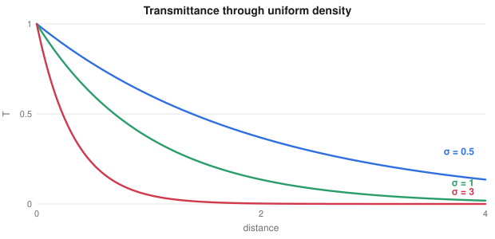

# Modern Control, Scene Rendering and Looking Inside Networks

> Extended deep learning notes
> Sources: listed under References

**What this file is really about:**
$$\text{exploring by entropy}\ \to\ \text{learning from logs}\ \to\ \text{planning with a model}\ \to\ \text{rendering as a differentiable program}\ \to\ \text{reading what a network computes}$$

**How to use this file.** Each part stands alone. Part B has complete code, checked by running it. Part C is practice with answers.

## Contents

---

# Part A — Maths From the Ground Up

## A1. Maximum-entropy reinforcement learning

Add a reward for keeping options open:

$$J(\pi)=\sum_t\mathbb E\big[r_t+\alpha\,\mathcal H(\pi(\cdot\mid s_t))\big].$$

The soft Bellman target includes the entropy of the next action:

$$y=r+\gamma\big(\min_iQ_{\bar\theta_i}(s',a')-\alpha\log\pi(a'\mid s')\big),\qquad a'\sim\pi.$$

## A2. Soft actor-critic

**SAC** uses a replay buffer, two critics whose minimum limits overestimation, slowly moving target critics, and a stochastic actor improved through

$$\max_\phi\ \mathbb E\big[\min_iQ_i(s,a_\phi)-\alpha\log\pi_\phi(a_\phi\mid s)\big].$$

Actions come from a reparameterised Gaussian passed through $\tanh$. The change of variables adds a correction:

$$\log\pi(a)=\log\mathcal N(u)-\sum_i\log(1-\tanh^2u_i).$$

## A3. Offline reinforcement learning

In many settings exploration is unsafe, so we must learn from logs. Q-learning then fails from **extrapolation error**: its $\max$ picks actions never seen in the data, whose values are never corrected.

**Behaviour cloning** just copies the logged actions by supervised learning. **Conservative Q-learning** adds a penalty pushing values down on unseen actions and up on logged ones:

$$\alpha\,\mathbb E_s\Big[\log\sum_ae^{Q(s,a)}-\mathbb E_{a\sim\text{data}}Q(s,a)\Big].$$

## A4. Model-based reinforcement learning

Learn the dynamics, then use them.

**Dyna** mixes real steps with imagined updates drawn from a learned model, and so needs fewer real steps.

**Model-predictive control** plans a short horizon at each step, executes only the first action, and replans, which corrects model errors. The **cross-entropy method** is a simple planner: sample action sequences, keep the best, refit the sampling distribution, and repeat.

**World models** learn a compact latent state, and train a policy on imagined trajectories.

## A5. Neural radiance fields

A **NeRF** represents a scene as a function $F(x,d)\to(c,\sigma)$ from position and view direction to colour and density. A pixel integrates along its camera ray:

$$C(r)=\int T(t)\,\sigma(t)\,c(t)\,dt,\qquad T(t)=\exp\Big(-\int_0^t\sigma(s)\,ds\Big).$$

Discretising into segments of length $\delta_i$, with $\alpha_i=1-e^{-\sigma_i\delta_i}$,

$$\hat C=\sum_iT_i\,\alpha_i\,c_i,\qquad T_i=\prod_{j<i}(1-\alpha_j).$$

The whole renderer is differentiable, so it is trained only from photographs.



## A6. Fourier features

A plain network learns low frequencies first, and blurs detail. Encoding inputs with sines and cosines of increasing frequency,

$$\gamma(x)=\big(\sin(2^k\pi x),\cos(2^k\pi x)\big)_{k=0}^{K-1},$$

lets the network fit fine detail. This idea is essential to NeRF.

## A7. Gaussian splatting

Instead of a network, represent a scene as many 3D Gaussians, each with position, covariance, colour and opacity. Rendering projects and blends them, so it is fast and differentiable, and optimisation adjusts each Gaussian directly from images. Training and display are far faster than for a basic NeRF, at the price of larger storage.

## A8. Looking inside networks

Three questions separate the common tools.

- A **probe** asks whether information is present: can a simple classifier read it from activations? It does not prove the model uses it.
- **Activation patching** asks whether a component is causally used: copy an activation from one run to another, and see if the output changes.
- A **circuit** is a small set of components that together implements a behaviour.

## A9. Superposition and sparse autoencoders

If features are sparse, a model can store more features than it has dimensions by overlapping them, accepting a little interference. So individual neurons are often not interpretable.

A **sparse autoencoder** expands activations $h$ into a larger code with mostly zero entries:

$$z=\text{ReLU}(W_eh+b),\qquad\hat h=W_dz,$$
$$L=\|h-\hat h\|^2+\lambda\|z\|_1.$$

Its directions are often more interpretable, and can be tested by patching.

---

# Part B — In Code

## B1. Soft actor-critic from scratch

The goal is to drive a point on a line to the origin.

```python
import copy
import random

import torch
from torch import nn
from torch.distributions import Normal

random.seed(0); torch.manual_seed(0)


def env_step(x, a):
    x2 = (x + 0.2 * a).clamp(-1, 1)
    return x2, -(x2 ** 2)


class Actor(nn.Module):
    def __init__(self):
        super().__init__()
        self.net = nn.Sequential(nn.Linear(1, 64), nn.ReLU(), nn.Linear(64, 2))

    def forward(self, s):
        mu, log_std = self.net(s).chunk(2, -1)
        dist = Normal(mu, log_std.clamp(-5, 1).exp())
        u = dist.rsample()
        return torch.tanh(u), dist.log_prob(u) - torch.log(1 - torch.tanh(u) ** 2 + 1e-6)


critic = lambda: nn.Sequential(nn.Linear(2, 64), nn.ReLU(), nn.Linear(64, 1))
actor, q1, q2 = Actor(), critic(), critic()
t1, t2 = copy.deepcopy(q1), copy.deepcopy(q2)
opt_a, opt_q = torch.optim.Adam(actor.parameters(), lr=1e-3), torch.optim.Adam([*q1.parameters(), *q2.parameters()], lr=1e-3)
memory, alpha, gamma = [], 0.02, 0.95

for episode in range(120):
    x = torch.tensor([random.uniform(-1, 1)])
    for t in range(20):
        with torch.no_grad():
            a = actor(x)[0]
        x2, r = env_step(x, a)
        memory.append((x, a, r, x2)); x = x2
        if len(memory) >= 128:
            S, A, R, N = (torch.stack(v) for v in zip(*random.sample(memory, 128)))
            with torch.no_grad():
                an, ln = actor(N)
                inp = torch.cat([N, an], 1)
                y = R + gamma * (torch.min(t1(inp), t2(inp)) - alpha * ln)
            sa = torch.cat([S, A], 1)
            loss = ((q1(sa) - y) ** 2).mean() + ((q2(sa) - y) ** 2).mean()
            opt_q.zero_grad(); loss.backward(); opt_q.step()
            a_new, lp = actor(S)
            inp = torch.cat([S, a_new], 1)
            pi_loss = (alpha * lp - torch.min(q1(inp), q2(inp))).mean()
            opt_a.zero_grad(); pi_loss.backward(); opt_a.step()
            with torch.no_grad():
                for tgt, src in [(t1, q1), (t2, q2)]:
                    for p, q in zip(tgt.parameters(), src.parameters()):
                        p.mul_(0.99).add_(0.01 * q)

with torch.no_grad():
    states = torch.tensor([[-0.8], [0.8]])
    mean_action = torch.tanh(actor.net(states).chunk(2, -1)[0]).squeeze()
print('mean action at -0.8 and 0.8:', mean_action.numpy().round(2))
assert mean_action[0] > 0.3 and mean_action[1] < -0.3
```

## B2. Extrapolation error, and the conservative fix

```python
import numpy as np

gamma, n_states = 0.9, 5
logged = [(s, 0, 1.0, min(s + 1, n_states - 1)) for s in range(n_states)]        # the logs only ever use action 0


def offline(cql=0.0, sweeps=400):
    Q = np.zeros((n_states, 2))
    Q[:, 1] = 15.0                                    # an unseen action starts with an unjustified high value
    for _ in range(sweeps):
        for s, a, r, n in logged:
            Q[s, a] += 0.2 * (r + gamma * Q[n].max() - Q[s, a])
            if cql:
                p = np.exp(Q[s] - Q[s].max()); p /= p.sum()
                Q[s] -= 0.2 * cql * p                 # pushes down what the policy prefers
                Q[s, a] += 0.2 * cql                  # pushes up what the data show
    return Q


plain, safe = offline(), offline(1.0)
print('greedy actions, plain', plain.argmax(1), 'conservative', safe.argmax(1))
assert plain.argmax(1).tolist() == [1] * 5 and safe.argmax(1).tolist() == [0] * 5
```

## B3. Dyna: fewer real steps

```python
import numpy as np


def run(plan, seed):
    rng = np.random.default_rng(seed)
    N, Q, model, total = 12, np.zeros((12, 2)), {}, 0
    for episode in range(15):
        s = 0
        for t in range(200):
            q = Q[s] + 1e-6 * rng.random(2)
            a = int(rng.integers(2)) if rng.random() < 0.1 else int(q.argmax())
            n = max(0, min(N - 1, s + (1 if a else -1)))
            r = float(n == N - 1); done = n == N - 1
            Q[s, a] += 0.5 * (r + 0.95 * Q[n].max() * (not done) - Q[s, a])
            model[(s, a)] = (r, n, done); total += 1
            keys = list(model)
            for _ in range(plan):
                ps, pa = keys[rng.integers(len(keys))]
                pr, pn, pd = model[(ps, pa)]
                Q[ps, pa] += 0.5 * (pr + 0.95 * Q[pn].max() * (not pd) - Q[ps, pa])
            s = n
            if done:
                break
    return total


plain = np.mean([run(0, s) for s in range(20)])
dyna = np.mean([run(20, s) for s in range(20)])
print('real steps: Q-learning', plain, 'Dyna', dyna)
assert dyna < plain
```

## B4. Learning a model, then planning

```python
import numpy as np

rng = np.random.default_rng(0)
A_true = np.array([[1.0, 0.1], [0.0, 1.0]]); B_true = np.array([[0.005], [0.1]])

S = rng.uniform(-2, 2, (500, 2)); U = rng.uniform(-1, 1, (500, 1))
N = S @ A_true.T + U @ B_true.T + 0.001 * rng.normal(size=(500, 2))
coef = np.linalg.lstsq(np.c_[S, U], N, rcond=None)[0].T          # least-squares dynamics
A, B = coef[:, :2], coef[:, 2:]


def plan(x, horizon=20, pop=300, elite=30, rounds=4):
    mean, sd = np.zeros(horizon), np.ones(horizon)
    for _ in range(rounds):
        acts = np.clip(mean + sd * rng.normal(size=(pop, horizon)), -1, 1)
        s = np.tile(x, (pop, 1)); cost = np.zeros(pop)
        for t in range(horizon):
            s = s @ A.T + acts[:, t:t + 1] @ B.T
            cost += (s ** 2).sum(1)
        best = acts[np.argsort(cost)[:elite]]
        mean, sd = best.mean(0), best.std(0) + 1e-3
    return mean[0]


x = np.array([1.5, 0.0])
for t in range(120):
    x = A_true @ x + B_true.ravel() * plan(x)
print('final state', x.round(3))
assert np.linalg.norm(x) < 0.15
```

## B5. Volume rendering, checked analytically

```python
import numpy as np

def render(sigma, color, delta):
    alpha = 1 - np.exp(-sigma * delta)
    trans = np.cumprod(np.r_[1, 1 - alpha[:-1]])
    return (trans * alpha * color).sum(), (trans * alpha).sum()

n, L, s = 128, 2.0, 1.5
c, opacity = render(np.full(n, s), np.full(n, 0.7), L / n)
exact = 1 - np.exp(-s * L)
print('opacity', round(opacity, 6), 'exact', round(exact, 6), 'colour', round(c, 4))
assert abs(opacity - exact) < 1e-9 and abs(c - 0.7 * exact) < 1e-9
```

## B6. Fourier features recover detail

```python
import math
import torch
from torch import nn

torch.manual_seed(0)
x = torch.linspace(0, 1, 400).unsqueeze(1)
y = torch.sin(40 * math.pi * x) * 0.5 + torch.sin(4 * math.pi * x)


def fourier(v, k=8):
    return torch.cat([f(2 ** i * math.pi * v) for i in range(k) for f in (torch.sin, torch.cos)], 1)


def fit(features):
    z = features(x)
    net = nn.Sequential(nn.Linear(z.shape[1], 128), nn.ReLU(), nn.Linear(128, 128), nn.ReLU(), nn.Linear(128, 1))
    opt = torch.optim.Adam(net.parameters(), lr=2e-3)
    for _ in range(1500):
        loss = ((net(z) - y) ** 2).mean()
        opt.zero_grad(); loss.backward(); opt.step()
    return loss.item()


plain, encoded = fit(lambda v: v), fit(fourier)
print('error with raw inputs', round(plain, 4), 'with Fourier features', round(encoded, 5))
assert encoded < plain / 10
```

## B7. Fitting an image with Gaussians

```python
import torch

torch.manual_seed(0)
g = torch.linspace(-1, 1, 48)
yy, xx = torch.meshgrid(g, g, indexing='ij')
target = ((xx ** 2 + yy ** 2).sqrt() - 0.6).abs().lt(0.12).float()    # a ring

pos = torch.nn.Parameter(torch.rand(48, 2) * 1.6 - 0.8)
log_size = torch.nn.Parameter(torch.full((48,), -2.0))
amp = torch.nn.Parameter(torch.ones(48))
opt = torch.optim.Adam([pos, log_size, amp], lr=0.02)


def render():
    d = (xx[None] - pos[:, 0, None, None]) ** 2 + (yy[None] - pos[:, 1, None, None]) ** 2
    return (amp[:, None, None] * (-d / (2 * log_size.exp()[:, None, None] ** 2)).exp()).sum(0)


first = ((render() - target) ** 2).mean().item()
for step in range(1200):
    loss = ((render() - target) ** 2).mean()
    opt.zero_grad(); loss.backward(); opt.step()
print('image error', round(first, 4), 'to', round(loss.item(), 4))
assert loss.item() < first / 8
```

## B8. Superposition and a sparse autoencoder

Eight sparse features are squeezed into four dimensions. The autoencoder finds directions that match them.

```python
import torch
from torch import nn
from torch.nn import functional as F

torch.manual_seed(0)
n, m = 8, 4
sample = lambda k: (torch.rand(k, n) < 0.05).float() * torch.rand(k, n)
W = nn.Parameter(torch.randn(m, n) * 0.3)
bias = nn.Parameter(torch.zeros(n))
opt = torch.optim.Adam([W, bias], lr=2e-3)
for step in range(6000):
    x = sample(1024)
    loss = ((F.relu(x @ W.T @ W + bias) - x) ** 2).mean()
    opt.zero_grad(); loss.backward(); opt.step()

model_dirs = W.detach()
stored = (model_dirs.norm(dim=0) > 0.5).sum().item()

enc, dec = nn.Linear(m, 32), nn.Linear(32, m, bias=False)
sae_opt = torch.optim.Adam([*enc.parameters(), *dec.parameters()], lr=2e-3)
for step in range(6000):
    h = sample(1024) @ model_dirs.T
    z = F.relu(enc(h))
    loss = ((dec(z) - h) ** 2).sum(1).mean() + 3e-3 * z.abs().sum(1).mean()
    sae_opt.zero_grad(); loss.backward(); sae_opt.step()
    dec.weight.data = F.normalize(dec.weight.data, dim=0)

true_dirs = F.normalize(model_dirs, dim=0)[:, model_dirs.norm(dim=0) > 0.5]
overlap = (true_dirs.T @ dec.weight.detach()).max(1).values
print('features stored in four dimensions', stored, '| best match with each', overlap.numpy().round(2))
assert stored > m and overlap.min() > 0.85
```

## B9. Probing and patching

The network sees two numbers. Probes and patches show where the first one lives.

```python
import torch
from torch import nn

torch.manual_seed(0)


class Net(nn.Module):
    def __init__(self):
        super().__init__()
        self.a, self.b = nn.Linear(1, 8), nn.Linear(1, 8)
        self.out = nn.Sequential(nn.Linear(16, 32), nn.ReLU(), nn.Linear(32, 1))

    def forward(self, x, patch=None):
        ha, hb = self.a(x[:, :1]), self.b(x[:, 1:])
        if patch is not None:
            ha = patch
        return self.out(torch.cat([ha, hb], 1)), ha, hb


net = Net()
opt = torch.optim.Adam(net.parameters(), lr=3e-3)
for _ in range(2000):
    x = torch.rand(256, 2)
    loss = ((net(x)[0].squeeze(1) - (2 * x[:, 0] - x[:, 1])) ** 2).mean()
    opt.zero_grad(); loss.backward(); opt.step()

x = torch.rand(500, 2)
_, ha, hb = net(x)
ha, hb = ha.detach(), hb.detach()


def probe(h):
    A = torch.cat([h, torch.ones(len(h), 1)], 1)
    w = torch.linalg.lstsq(A, x[:, :1]).solution
    return 1 - ((A @ w - x[:, :1]) ** 2).mean() / x[:, 0].var()


clean = torch.tensor([[0.2, 0.5]]); source = torch.tensor([[0.9, 0.5]])
with torch.no_grad():
    patched = net(clean, patch=net(source)[1])[0].item()
    a, b = net(clean)[0].item(), net(source)[0].item()
print('probe R2 from the first path', round(probe(ha).item(), 3), 'from the second', round(probe(hb).item(), 3))
print('clean', round(a, 3), 'source', round(b, 3), 'patched', round(patched, 3))
assert probe(ha) > 0.99 > 0.1 > probe(hb) and abs(patched - b) < 0.02
```

---

# Part C — Practice

**P1.** Why does SAC use the minimum of two critics?

<details><summary>Answer</summary>

Taking a maximum over noisy values overestimates, and the minimum counters that bias.

</details>

**P2.** Why does plain Q-learning fail on logged data?

<details><summary>Answer</summary>

Its $\max$ can pick actions absent from the data, whose high values are never corrected.

</details>

**P3.** A segment has $\sigma\delta=\ln2$. Find $\alpha$.

<details><summary>Answer</summary>

$1-e^{-\ln2}=0.5$.

</details>

**P4.** Two opaque-half segments in a row with colours 1 and 0. Find the rendered colour.

<details><summary>Answer</summary>

$0.5\times1+0.5\times0.5\times0=0.5$.

</details>

**P5.** A probe reads a feature from a layer perfectly. Does the model use it?

<details><summary>Answer</summary>

Not necessarily. A patching experiment tests whether it is causally used.

</details>
