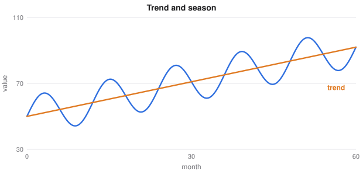

# Details From the Lectures and Beyond

> Extended machine learning notes
> Sources: listed under References

**What this file is really about:**
$$\text{proofs and methods from the slides}\ \to\ \text{derived in full}\ \to\ \text{run and checked}$$

**How to use this file.** This note collects topics that appear in the lecture slides and handouts but were missing or too brief elsewhere here, along with a few close relatives. Each section stands alone. Part B has checked code.

## Contents

---

# Part A — Maths From the Ground Up

## A1. The minimax inequality

For any function $q(x,y)$,

$$\max_y\min_xq(x,y)\le\min_x\max_yq(x,y).$$

**Proof.** For every $x'$ and $y'$, we have $\min_xq(x,y')\le q(x',y')\le\max_yq(x',y)$. The left side depends only on $y'$ and the right only on $x'$, so the inequality survives taking $\max_{y'}$ on the left and $\min_{x'}$ on the right.

This gives **weak duality** at once. A constrained problem $\min_xf(x)$ subject to $g(x)\le0$ equals $\min_x\max_{\lambda\ge0}L(x,\lambda)$, because the inner maximum is infinite if a constraint is broken. Swapping the order gives the dual, which can only be smaller. For convex problems satisfying Slater's condition the two are equal, which is **strong duality**.

## A2. The logistic Hessian is a Fisher information

The Hessian of the logistic loss is $H=X^\top SX$, with $S=\text{diag}(\hat y_i(1-\hat y_i))$. Each weight is largest at $\hat y=0.5$ and small for confident rows. It does not depend on the labels $y$, so it equals its own expectation, and hence equals the **Fisher information**. It also shows why Newton's method on this loss is a weighted least-squares problem.

## A3. Information theory from surprise

The **surprise** of an event is $-\log_2p$: rare events are informative, and independent events add. **Entropy** is the expected surprise, $H(X)=-\sum p\log_2p$. **Information gain** is

$$H(Y)-\sum_v\frac{n_v}nH(Y\mid X=v),$$

which is the **mutual information** $I(X;Y)$ between a feature and the label:

$$I(X;Y)=\sum_{x,y}p(x,y)\log\frac{p(x,y)}{p(x)p(y)}.$$

It is zero exactly when the variables are independent, and it can rank features for selection, including non-linear relationships that correlation misses.

## A4. Pre-pruning and post-pruning

**Pre-pruning** stops growth early, through limits on depth or samples per leaf. It is fast, but a split that looks useless may enable a good one below it, as in XOR.

**Post-pruning** grows the full tree first. **Reduced error pruning** replaces a subtree with a leaf if validation error does not rise, working from the bottom. **Cost-complexity pruning** minimises $R(T)+\alpha|T|$, and picks $\alpha$ by cross-validation.

## A5. Nested cross-validation

If you tune settings using a score, that score is optimistic, because you chose the best of many. **Nested** cross-validation uses an inner loop to tune and an outer loop to evaluate. With $K$ outer folds, $J$ inner folds and $G$ settings, there are $K(JG+1)$ fits. Report the outer score. For the model you deploy, tune once on all the data.

## A6. Shuffling and stratifying

Data files are often sorted. Taking the last fifth as a test set may then contain only one class, so shuffle before splitting. **Stratified** folds preserve class proportions, which matters for rare classes. Do not shuffle time series, and keep all rows from one person in the same fold.

## A7. K-means: the pairwise identity

The within-cluster sum of squares has an equivalent pairwise form:

$$\sum_{x\in C}\|x-\mu\|^2=\frac1{2|C|}\sum_{a,b\in C}\|a-b\|^2.$$

**Proof.** Write $a-b=(a-\mu)-(b-\mu)$ and expand:

$$\sum_{a,b}\|a-b\|^2=2|C|\sum_a\|a-\mu\|^2-2\Big\|\sum_a(a-\mu)\Big\|^2.$$

The last sum is zero because $\mu$ is the mean. So K-means also minimises the average squared distance between points that share a cluster.

## A8. Internal cluster scores

**Davies-Bouldin** averages, over clusters, the worst ratio of within-cluster scatter to between-centre distance:

$$\text{DB}=\frac1k\sum_i\max_{j\ne i}\frac{s_i+s_j}{d_{ij}}.$$

Lower is better. Like the silhouette, it favours compact, separate clusters, so it can mislead on rings or moons.

## A9. Collaborative filtering

Recommend from behaviour alone. **User-based** methods find similar users, and **item-based** methods score an unseen item by

$$\hat r_{ui}=\frac{\sum_{j\in N(i)}s_{ij}r_{uj}}{\sum_{j\in N(i)}|s_{ij}|}.$$

Item neighbours are usually more stable. **Matrix factorisation** generalises better on sparse data. All of these have a **cold-start** problem for new users and items, which needs content features.

## A10. More kernel methods

A **polynomial kernel** $(x^\top z+c)^d$ corresponds to all monomials up to degree $d$, of which there are $\binom{n+d}d$. The kernel computes this in time linear in $n$.

The **representer theorem** says that for a regularised loss on a reproducing-kernel space, the minimiser has the form $f(x)=\sum_i\alpha_ik(x_i,x)$. So an infinite-dimensional problem has only $n$ unknowns, which is why every kernel method is parameterised by the training set.

**Support vector regression** uses an $\epsilon$-insensitive tube, so points inside the tube cost nothing and do not become support vectors. A **one-class SVM** separates the data from the origin in feature space, for anomaly detection.

A **Matérn** kernel, used with Gaussian processes, has a parameter controlling how rough functions are, and is often more realistic than the very smooth RBF.

## A11. Subsets, groups and numerical care

**Stepwise selection** adds and removes features greedily. **Group lasso** penalises $\sum_g\sqrt{|g|}\,\|w_g\|_2$, and so removes whole groups together, such as all dummies of one category.

Solving the normal equations squares the condition number. A **QR decomposition**, $X=QR$, gives the same solution through $Rw=Q^\top y$, which is far more stable.

## A12. Cost-sensitive learning

If mistakes differ in cost, three options exist: reweight the training loss, resample, or keep the model and move the threshold to $c_{\text{fp}}/(c_{\text{fp}}+c_{\text{fn}})$. With calibrated probabilities, moving the threshold is simplest, and the costs can be changed without retraining.

## A13. Latent variables and independence

A **Dirichlet** distribution is a distribution over probability vectors, and is conjugate to the categorical. **Latent Dirichlet allocation** represents each document as a mixture of topics, in the same way that each row is a mixture in a Gaussian mixture.

**Factor analysis** assumes $x=\Lambda z+\epsilon$ with diagonal noise. Probabilistic PCA is the special case of equal noise.

In a Bayesian network, **d-separation** reads conditional independence from the graph. A path is blocked at a chain or a fork when the middle is observed, and at a collider when neither it nor its descendants are observed. Conditioning on a collider **creates** dependence, which is a common cause of selection bias. A node's **Markov blanket** is its parents, children and co-parents: given these, it is independent of everything else.

## A14. Hamiltonian Monte Carlo

Random-walk samplers move slowly in many dimensions. **HMC** adds a momentum $p$ and simulates $H(x,p)=-\log\pi(x)+\tfrac12p^\top p$ with a **leapfrog** integrator, producing long moves that are accepted with high probability. **NUTS** chooses the path length automatically.

## A15. Manifold methods

**Isomap** connects near neighbours, computes shortest-path distances along the graph, and applies classical scaling. **Locally linear embedding** writes each point as a combination of its neighbours, and finds low-dimensional positions preserving those weights.

## A16. Classical forecasting

**Simple exponential smoothing** updates a level, $\ell_t=\alpha y_t+(1-\alpha)\ell_{t-1}$. **Holt** adds a trend and **Holt-Winters** adds a season:

$$\ell_t=\alpha(y_t-s_{t-m})+(1-\alpha)(\ell_{t-1}+b_{t-1}),$$
$$b_t=\beta(\ell_t-\ell_{t-1})+(1-\beta)b_{t-1},\qquad s_t=\gamma(y_t-\ell_t)+(1-\gamma)s_{t-m}.$$

**SARIMA** adds autoregressive and moving-average terms at the seasonal lag. **STL** splits a series into trend, season and remainder.

The **mean absolute scaled error** divides the error by that of a naive forecast, so values below 1 beat naive:

$$\text{MASE}=\frac{\text{mean}|y_t-\hat y_t|}{\text{mean}|y_t-y_{t-m}|}.$$

**Symmetric MAPE** is $\text{mean}\big(2|y-\hat y|/(|y|+|\hat y|)\big)$, which handles values near zero better than MAPE, but is still unstable when both are near zero.



## A17. Assorted tools

The **jackknife** recomputes a statistic leaving out each row, in turn, to estimate its standard error. **Individual conditional expectation** plots draw one line per row, showing the variation a partial dependence plot averages away. **Cohen's kappa** corrects agreement for chance:

$$\kappa=\frac{p_o-p_e}{1-p_e}.$$

The **no free lunch theorem** says that averaged over all possible problems, no learner beats another. Every useful algorithm succeeds because it has an **inductive bias** matching real data.

---

# Part B — In Code

## B1. The minimax inequality

```python
import numpy as np

rng = np.random.default_rng(0)
for _ in range(2000):
    Q = rng.normal(size=(5, 7))                      # rows are x, columns are y
    assert Q.min(0).max() <= Q.max(1).min() + 1e-12
print('max-min never exceeded min-max in 2000 random tables')
```

## B2. Mutual information

```python
import numpy as np
from sklearn.metrics import mutual_info_score

def mi(x, y):
    joint = np.histogram2d(x, y, bins=(np.unique(x).size, np.unique(y).size))[0] / len(x)
    px, py = joint.sum(1, keepdims=True), joint.sum(0, keepdims=True)
    mask = joint > 0
    return float((joint[mask] * np.log(joint[mask] / (px @ py)[mask])).sum())

rng = np.random.default_rng(0)
x = rng.integers(3, size=5000)
y = (x == 1).astype(int) ^ (rng.random(5000) < 0.1)
noise = rng.integers(3, size=5000)
print('related', round(mi(x, y), 4), 'unrelated', round(mi(noise, y), 4))
assert abs(mi(x, y) - mutual_info_score(x, y)) < 1e-9 and mi(noise, y) < 0.01
```

## B3. Reduced error pruning

```python
import copy

import numpy as np
from sklearn.datasets import make_classification
from sklearn.model_selection import train_test_split
from sklearn.tree import DecisionTreeClassifier

X, y = make_classification(2000, 20, n_informative=5, flip_y=0.2, random_state=0)
Xa, Xc, ya, yc = train_test_split(X, y, test_size=0.4, random_state=0)
Xv, Xt, yv, yt = train_test_split(Xc, yc, test_size=0.5, random_state=0)
tree = DecisionTreeClassifier(random_state=0).fit(Xa, ya).tree_
kids_l, kids_r, feat, thr = tree.children_left.copy(), tree.children_right.copy(), tree.feature, tree.threshold
value = tree.value.argmax(2).ravel()


def predict(X, L):
    out = np.zeros(len(X), int)
    for i, row in enumerate(X):
        n = 0
        while L[n] != -1:
            n = L[n] if row[feat[n]] <= thr[n] else kids_r[n]
        out[i] = value[n]
    return out


full = (predict(Xt, kids_l) == yt).mean()
best = (predict(Xv, kids_l) == yv).mean()
for n in range(tree.node_count - 1, -1, -1):                    # children have larger indices
    if kids_l[n] == -1:
        continue
    old = kids_l[n]
    kids_l[n] = -1                                              # try turning this node into a leaf
    score = (predict(Xv, kids_l) == yv).mean()
    if score >= best:
        best = score
    else:
        kids_l[n] = old

def size(n=0):
    return 1 if kids_l[n] == -1 else 1 + size(kids_l[n]) + size(kids_r[n])

print('nodes', tree.node_count, 'to', size(), 'test accuracy', round(full, 3), 'to', round((predict(Xt, kids_l) == yt).mean(), 3))
assert size() < tree.node_count / 2 and (predict(Xt, kids_l) == yt).mean() >= full
```

## B4. Nested cross-validation

```python
import numpy as np
from sklearn.datasets import make_classification
from sklearn.model_selection import GridSearchCV, KFold, cross_val_score
from sklearn.svm import SVC

X, y = make_classification(300, 40, n_informative=5, flip_y=0.1, random_state=0)
grid = {'C': np.logspace(-3, 3, 7), 'gamma': np.logspace(-4, 0, 5)}
search = GridSearchCV(SVC(), grid, cv=KFold(3, shuffle=True, random_state=0))
tuned = search.fit(X, y).best_score_
nested = cross_val_score(search, X, y, cv=KFold(5, shuffle=True, random_state=1)).mean()
print('score used for tuning', round(tuned, 3), 'nested estimate', round(nested, 3), 'fits', 5 * (3 * 35 + 1))
assert tuned >= nested - 0.01
```

## B5. The pairwise identity

```python
import numpy as np

X = np.random.default_rng(0).normal(size=(60, 4))
centre = ((X - X.mean(0)) ** 2).sum()
pairs = ((X[:, None] - X[None]) ** 2).sum() / (2 * len(X))
print(round(centre, 6), round(pairs, 6))
assert abs(centre - pairs) < 1e-9
```

## B6. Item-based collaborative filtering

```python
import numpy as np

rng = np.random.default_rng(0)
U, V = rng.normal(size=(200, 3)), rng.normal(size=(50, 3))
R = U @ V.T + 0.2 * rng.normal(size=(200, 50))
seen = rng.random((200, 50)) < 0.4
M = np.where(seen, R, 0.0)

C = M.T @ M
d = np.sqrt(np.diag(C))
S = C / (d[:, None] * d[None])
np.fill_diagonal(S, 0)

def predict(u, i, k=10):
    candidates = np.flatnonzero(seen[u])
    near = candidates[np.argsort(-np.abs(S[i, candidates]))[:k]]
    return S[i, near] @ R[u, near] / (np.abs(S[i, near]).sum() + 1e-9)

hidden = np.argwhere(~seen)[:3000]
pred = np.array([predict(u, i) for u, i in hidden]); true = R[tuple(hidden.T)]
print('correlation with hidden ratings', round(np.corrcoef(pred, true)[0, 1], 3))
assert np.corrcoef(pred, true)[0, 1] > 0.5
```

## B7. A polynomial kernel equals its features

```python
from itertools import combinations_with_replacement as cwr
from math import comb, factorial, sqrt

import numpy as np

def features(x, d):
    out = []
    for k in range(d + 1):
        for idx in cwr(range(len(x)), k):
            counts = [idx.count(i) for i in set(idx)]
            coef = factorial(d) / (factorial(d - k) * np.prod([factorial(c) for c in counts]))
            out.append(sqrt(coef) * np.prod(x[list(idx)]) if k else 1.0)
    return np.array(out)

x, z = np.array([1.0, -2.0, 0.5]), np.array([0.3, 1.0, 2.0])
phi = features(x, 3)
assert len(phi) == comb(3 + 3, 3) and abs(phi @ features(z, 3) - (x @ z + 1) ** 3) < 1e-9
print(len(phi), 'features, and the kernel gives the same answer directly')
```

## B8. QR against the normal equations

```python
import numpy as np

t = np.linspace(0, 1, 80)
X = np.vander(t, 12, increasing=True)
truth = np.ones(12); y = X @ truth
Q, R = np.linalg.qr(X)
qr = np.linalg.solve(R, Q.T @ y)
normal = np.linalg.solve(X.T @ X, X.T @ y)
print('condition number', f'{np.linalg.cond(X):.1e}', '| error via QR', f'{np.abs(qr - truth).max():.1e}', 'normal', f'{np.abs(normal - truth).max():.1e}')
assert np.abs(qr - truth).max() < np.abs(normal - truth).max()
```

## B9. Hamiltonian Monte Carlo

```python
import numpy as np

rng = np.random.default_rng(0)
P = np.linalg.inv(np.array([[1.0, 0.95], [0.95, 1.0]]))
log_p, grad = lambda x: -0.5 * x @ P @ x, lambda x: -P @ x
x, out, accepted = np.zeros(2), [], 0

for i in range(6000):
    p = rng.normal(size=2)
    q, m, h = x.copy(), p.copy(), 0.15
    m = m + 0.5 * h * grad(q)                        # leapfrog
    for s in range(20):
        q = q + h * m
        if s < 19:
            m = m + h * grad(q)
    m = m + 0.5 * h * grad(q)
    if np.log(rng.random()) < log_p(q) - 0.5 * m @ m - log_p(x) + 0.5 * p @ p:
        x = q; accepted += 1
    out.append(x)

c = np.corrcoef(np.array(out[500:]).T)[0, 1]
print('acceptance', round(accepted / 6000, 3), 'correlation', round(c, 3))
assert abs(c - 0.95) < 0.02 and accepted / 6000 > 0.8
```

## B10. Isomap unrolls a curve

```python
import numpy as np
from scipy.stats import spearmanr
from sklearn.decomposition import PCA
from sklearn.manifold import Isomap

t = np.linspace(0, 3 * np.pi, 400)
X = np.c_[t * np.cos(t), t * np.sin(t)]
iso = Isomap(n_neighbors=8, n_components=1).fit_transform(X).ravel()
pca = PCA(1).fit_transform(X).ravel()
print('rank agreement with the true position: isomap', round(abs(spearmanr(iso, t)[0]), 3), 'pca', round(abs(spearmanr(pca, t)[0]), 3))
assert abs(spearmanr(iso, t)[0]) > 0.99 > abs(spearmanr(pca, t)[0])
```

## B11. Holt-Winters and MASE

```python
import numpy as np

rng = np.random.default_rng(0)
m = 12
t = np.arange(120)
y = 50 + 0.5 * t + 10 * np.sin(2 * np.pi * t / m) + rng.normal(0, 1, 120)
train, test = y[:96], y[96:]


def holt_winters(y, a=0.3, b=0.05, g=0.2, h=24):
    level, trend = y[:m].mean(), (y[m:2 * m].mean() - y[:m].mean()) / m
    season = list(y[:m] - level)
    for i in range(m, len(y)):
        last = level
        level = a * (y[i] - season[i - m]) + (1 - a) * (level + trend)
        trend = b * (level - last) + (1 - b) * trend
        season.append(g * (y[i] - level) + (1 - g) * season[i - m])
    return np.array([level + (k + 1) * trend + season[len(y) - m + k % m] for k in range(h)])


pred = holt_winters(train)
mase = np.abs(test - pred).mean() / np.abs(train[m:] - train[:-m]).mean()
print('MASE', round(mase, 3))
assert mase < 0.5
```

## B12. Kappa and the jackknife

```python
import numpy as np
from sklearn.metrics import cohen_kappa_score

def kappa(a, b):
    labels = np.unique(np.r_[a, b])
    po = (a == b).mean()
    pe = sum((a == k).mean() * (b == k).mean() for k in labels)
    return (po - pe) / (1 - pe)

rng = np.random.default_rng(0)
a, b = rng.integers(3, size=500), rng.integers(3, size=500)
b[:300] = a[:300]
assert abs(kappa(a, b) - cohen_kappa_score(a, b)) < 1e-9

x = rng.normal(size=100)
loo = np.array([np.delete(x, i).mean() for i in range(100)])
se = np.sqrt(99 / 100 * ((loo - loo.mean()) ** 2).sum())
print('kappa', round(kappa(a, b), 3), 'jackknife standard error', round(se, 4))
assert abs(se - x.std(ddof=1) / 10) < 1e-9
```

---

# Part C — Practice

**P1.** A table has $\max_y\min_x=2$ and $\min_x\max_y=5$. What is the largest possible duality gap for this table?

<details><summary>Answer</summary>

$5-2=3$.

</details>

**P2.** $K=5$, $J=3$, $G=20$. How many fits does nested cross-validation need?

<details><summary>Answer</summary>

$5(3\times20+1)=305$.

</details>

**P3.** How many monomials up to degree 2 are there in 10 variables?

<details><summary>Answer</summary>

$\binom{12}2=66$.

</details>

**P4.** $p_o=0.8$, $p_e=0.5$. Find kappa.

<details><summary>Answer</summary>

$0.3/0.5=0.6$.

</details>

**P5.** Why does conditioning on a collider create dependence?

<details><summary>Answer</summary>

Knowing the outcome, one cause being absent makes the other more likely, even if the causes were independent.

</details>
