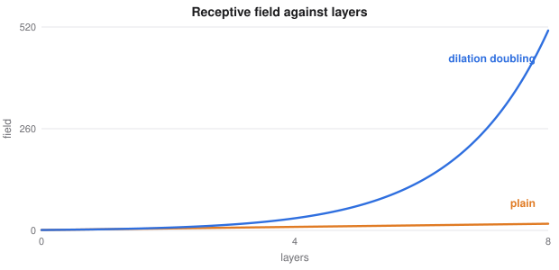

# More Deep Learning Details

> Extended deep learning notes
> Sources: listed under References

**What this file is really about:**
$$\text{topics named in the slides}\ \to\ \text{explained properly}\ \to\ \text{run and checked}$$

**How to use this file.** This note collects methods that appear in the lecture slides and were missing or only named elsewhere here, along with a few close relatives. Each section stands alone. Part B has checked code.

## Contents

---

# Part A — Maths From the Ground Up

## A1. Inductive bias and symmetry

When many functions fit the training data, the architecture decides which is preferred. A convolution assumes locality and translation structure. A prior makes such a preference explicit. **Equivariance** to rotation is harder: standard filters respond differently to a rotated pattern, so rotation-equivariant networks build it in, using steerable filters, group convolutions or spherical harmonics.

## A2. Convolution arithmetic

With input $n$, kernel $f$, padding $p$, stride $s$ and dilation $d$, the output size is

$$\Big\lfloor\frac{n+2p-d(f-1)-1}s\Big\rfloor+1.$$

A **transposed** convolution reverses the shape relation, with output padding $a$:

$$(n-1)s-2p+d(f-1)+a+1.$$

## A3. Dilated convolutions

Dilation places gaps between kernel entries, so a $3\times3$ kernel with dilation $d$ spans $2d+1$ pixels, with no extra weights and no loss of resolution. Stacking dilations of 1, 2 and 4 grows the receptive field exponentially. **DeepLab** uses parallel dilations, called atrous spatial pyramid pooling, to capture several scales.



## A4. More architecture families

**Inception** runs several filter sizes in parallel. **DenseNet** concatenates every earlier layer's output, for strong feature reuse. **MobileNet** is built from depthwise separable convolutions, for mobile compute budgets.

## A5. More optimisers and schedules

**Adagrad** divides by the root of all past squared gradients:

$$w\leftarrow w-\frac\eta{\sqrt{\sum_{\tau\le t}g_\tau^2}+\epsilon}\,g_t.$$

It suits sparse features, but its effective rate only ever falls, which RMSProp fixes with a moving average.

**Nesterov momentum** evaluates the gradient at the point momentum is about to reach, $g=\nabla L(w-\eta\beta v)$, which corrects earlier.

**Cosine annealing** lowers the rate along a half-cosine. **One-cycle** raises it to a peak, then lowers it past its starting point, usually finishing faster.

## A6. Modern augmentation

**Cutout** masks a square. **CutMix** pastes a patch from another image, and mixes labels by area, $\tilde y=\lambda y_a+(1-\lambda)y_b$. **RandAugment** picks a fixed number of operations at one global strength, removing the search of **AutoAugment**. **Test-time augmentation** averages predictions over transformed inputs.

## A7. Saliency maps

The simplest attribution is the gradient of the class score with respect to the pixels, $|\partial y_c/\partial x|$. It shows sensitivity, is often noisy, and does not by itself prove what the model relies on.

## A8. The detection family

**Two-stage detectors** first propose regions, and then classify and refine them.

- **R-CNN** classifies warped crops, one by one.
- **Fast R-CNN** shares one feature map, and uses region-of-interest pooling.
- **Faster R-CNN** adds a **region proposal network**, which predicts an **objectness** score and offsets for each anchor.
- **Mask R-CNN** adds a small mask head to each box. **RoIAlign** samples features with interpolation, avoiding misalignment from rounding.

**One-stage detectors** such as **YOLO** predict directly on a grid. For each cell they output box offsets, objectness and classes, which is fast. Each ground-truth object is assigned to the cell containing its centre, with the offset inside that cell as the target.

## A9. Encoder-decoder sequences

**Seq2seq** reads a source with an encoder, and writes a target with a decoder, so lengths can differ. Without attention, the whole source must pass through a single vector.

**Teacher forcing** feeds the true previous token during training, rather than the model's own prediction, which makes training faster and more stable. At test time, the model sees its own outputs and early mistakes can compound. Gradually reducing the forcing is called **scheduled sampling**.

**Bidirectional** networks run one pass forward and one backward, so each position sees both sides. They suit labelling a whole sequence, and not generating or streaming, since the future is unavailable there.

## A10. Named models and systems

**BERT** is a bidirectional encoder trained to fill in masked tokens. **LLaVA** connects a CLIP-style image encoder to a language model. **DINOv2** is a large self-supervised vision model, whose features work well with simple heads. The **PEFT** library applies LoRA and related methods.

A system can ask a model to propose steps, **call tools**, critique its own work, or check results with a **verifier**. These are orchestration choices, and more steps do not guarantee a better plan. A **jailbreak** is a prompt that bypasses a model's safety behaviour, and **prompt injection** hides instructions in the data a system reads.

## A11. More generative models

**Wasserstein GANs** replace the classifier with a critic that estimates the earth-mover distance, usually with a gradient penalty. **CycleGAN** translates between unpaired domains with a cycle-consistency loss. **StyleGAN** injects a learned style at each resolution.

A **denoising autoencoder** learns to reconstruct clean data from corrupted input. A **β-VAE** raises the weight on the KL term, encouraging disentangled factors. A **VQ-VAE** replaces a continuous code by its nearest entry in a learned codebook, copying the gradient straight through.

**Stable Diffusion** is latent diffusion conditioned on text embeddings, and **Imagen** cascades diffusion at increasing resolutions in pixel space.

## A12. Contrastive queues and large graphs

**MoCo** keeps a queue of past embeddings, as negatives, from a slowly updated encoder, so it needs no huge batches. **GraphSAGE** samples neighbours and learns an aggregator. Because it learns a function of the neighbourhood, it is **inductive**, and applies to nodes never seen in training, unlike transductive methods.

## A13. Neural processes

A Gaussian process needs a fixed kernel, and costs $O(n^3)$. A **conditional neural process** encodes each context pair to $r_i=h(x_i,y_i)$, averages these into $r$, and decodes a target as

$$p(y\mid x,r)=\mathcal N(\mu(x,r),\sigma^2(x,r)).$$

The mean makes it invariant to the order of the context, and the cost is linear. It is meta-learned over many functions.

## A14. More reinforcement learning

**Policy iteration** alternates exact evaluation of a policy with greedy improvement, usually needing few rounds.

**TD($\lambda$)** blends all $n$-step returns, with weights $(1-\lambda)\lambda^{n-1}$. An **eligibility trace** implements it online:

$$e_t(s)=\gamma\lambda e_{t-1}(s)+\mathbb 1[s=s_t],\qquad V(s)\leftarrow V(s)+\alpha\delta_te_t(s).$$

**Prioritised replay** samples surprising transitions more often. A **dueling** network splits $Q=V+A-\text{mean}(A)$. **TRPO** limits each update with a KL constraint. **Monte Carlo tree search** expands a game tree with an upper-confidence rule, and **AlphaGo** guided it with policy and value networks.

## A15. From training to deployment

**TorchScript** and **ONNX** save a model separately from its Python code. **Docker** packs code and dependencies so that runs are reproducible. Exact nearest-neighbour search is linear in the data, so large systems use approximate indexes like **IVF**, which searches only the nearest clusters, or **HNSW**, which walks a layered graph. **FAISS** implements these.

## A16. Open questions

**Grokking** is a sudden jump in test accuracy long after the training loss flattens. **Flat minima** may generalise better, but flatness depends on parameter scaling, so the picture is not simple. **Rademacher complexity** measures how well a function class can fit random labels. Modern networks can fit random labels, which classical bounds cannot explain.

---

# Part B — In Code

## B1. Convolution arithmetic, checked

```python
import torch
from torch import nn

def out_size(n, f, s=1, p=0, d=1):
    return (n + 2 * p - d * (f - 1) - 1) // s + 1

x = torch.zeros(1, 1, 64, 64)
for f, s, p, d in [(3, 1, 1, 1), (5, 2, 2, 1), (3, 1, 2, 2), (7, 3, 0, 2), (4, 2, 1, 1)]:
    got = nn.Conv2d(1, 1, f, s, p, d)(x).shape[-1]
    assert got == out_size(64, f, s, p, d), (f, s, p, d)

def trans_size(n, f, s=1, p=0, a=0, d=1):
    return (n - 1) * s - 2 * p + d * (f - 1) + a + 1

for f, s, p, a in [(4, 2, 1, 0), (3, 2, 1, 1), (5, 1, 0, 0)]:
    got = nn.ConvTranspose2d(1, 1, f, s, p, a)(x).shape[-1]
    assert got == trans_size(64, f, s, p, a), (f, s, p, a)
print('both formulas match PyTorch')
```

## B2. Adagrad and Nesterov

```python
import numpy as np

A = np.diag([1.0, 50.0])
grad = lambda w: A @ w
loss = lambda w: 0.5 * w @ A @ w

def heavy(lr, b, nesterov, steps=150):
    w, v = np.array([1.0, 1.0]), np.zeros(2)
    for _ in range(steps):
        g = grad(w - lr * b * v) if nesterov else grad(w)
        v = b * v + g
        w = w - lr * v
    return loss(w)

def adagrad(lr, steps=150):
    w, s = np.array([1.0, 1.0]), np.zeros(2)
    for _ in range(steps):
        g = grad(w); s += g ** 2
        w = w - lr * g / (np.sqrt(s) + 1e-8)
    return loss(w)

print('momentum', heavy(0.02, 0.9, False), 'nesterov', heavy(0.02, 0.9, True), 'adagrad', adagrad(0.5))
assert heavy(0.02, 0.9, True) < heavy(0.02, 0.9, False)
```

## B3. CutMix

```python
import numpy as np
import torch

def cutmix(x, y, classes, seed=0):
    rng = np.random.default_rng(seed)
    n, h, w = len(x), x.shape[2], x.shape[3]
    lam = rng.beta(1.0, 1.0)
    order = torch.randperm(n)
    cx, cy = rng.integers(w), rng.integers(h)
    bw, bh = int(w * np.sqrt(1 - lam)), int(h * np.sqrt(1 - lam))
    x1, x2 = np.clip([cx - bw // 2, cx + bw // 2], 0, w)
    y1, y2 = np.clip([cy - bh // 2, cy + bh // 2], 0, h)
    mixed = x.clone()
    mixed[:, :, y1:y2, x1:x2] = x[order, :, y1:y2, x1:x2]
    lam = 1 - (x2 - x1) * (y2 - y1) / (w * h)              # the patch actually pasted
    one_hot = torch.eye(classes)[y]
    return mixed, lam * one_hot + (1 - lam) * one_hot[order]

torch.manual_seed(0)
x, y = torch.rand(8, 3, 32, 32), torch.randint(10, (8,))
mx, my = cutmix(x, y, 10)
assert mx.shape == x.shape and abs(my.sum(1) - 1).max() < 1e-6
print('labels stay valid distributions')
```

## B4. Seq2seq with teacher forcing

The task is reversing a sequence.

```python
import torch
from torch import nn
from torch.nn import functional as F

torch.manual_seed(0)
V, L, H = 12, 6, 128
SOS = 0
batch = lambda n: torch.randint(1, V, (n, L))


class Seq2Seq(nn.Module):
    def __init__(self):
        super().__init__()
        self.emb = nn.Embedding(V, 32)
        self.enc = nn.GRU(32, H, batch_first=True, bidirectional=True)
        self.bridge = nn.Linear(2 * H, H)
        self.dec = nn.GRU(32, H, batch_first=True)
        self.out = nn.Linear(H, V)

    def encode(self, x):
        h = self.enc(self.emb(x))[1]
        return torch.tanh(self.bridge(torch.cat([h[0], h[1]], 1))).unsqueeze(0)

    def forward(self, x, y):                         # teacher forcing: feed the true previous tokens
        inp = torch.cat([torch.full((len(y), 1), SOS), y[:, :-1]], 1)
        return self.out(self.dec(self.emb(inp), self.encode(x))[0])

    @torch.no_grad()
    def generate(self, x):
        h, tok, out = self.encode(x), torch.full((len(x), 1), SOS), []
        for _ in range(L):
            o, h = self.dec(self.emb(tok), h)
            tok = self.out(o).argmax(-1)
            out.append(tok)
        return torch.cat(out, 1)


m = Seq2Seq()
opt = torch.optim.Adam(m.parameters(), lr=2e-3)
for step in range(1500):
    x = batch(128)
    loss = F.cross_entropy(m(x, x.flip(1)).view(-1, V), x.flip(1).view(-1))
    opt.zero_grad(); loss.backward(); opt.step()

x = batch(1000)
acc = m.generate(x).eq(x.flip(1)).float().mean().item()
print('accuracy with free-running output', round(acc, 3))
assert acc > 0.9
```

## B5. YOLO-style targets

```python
import torch

def encode(boxes, S=7, classes=3):
    target = torch.zeros(S, S, 5 + classes)
    for cx, cy, w, h, c in boxes:                    # coordinates between 0 and 1
        i, j = int(cy * S), int(cx * S)
        target[i, j, :5] = torch.tensor([cx * S - j, cy * S - i, w, h, 1.0])   # offsets, size, objectness
        target[i, j, 5 + int(c)] = 1.0
    return target

def decode(t, S=7):
    out = []
    for i, j in (t[..., 4] > 0.5).nonzero().tolist():
        x, y, w, h = t[i, j, :4].tolist()
        out.append([(j + x) / S, (i + y) / S, w, h, t[i, j, 5:].argmax().item()])
    return out

boxes = [[0.51, 0.22, 0.3, 0.4, 2], [0.13, 0.91, 0.1, 0.1, 0]]
back = decode(encode(boxes))
assert all(abs(a - b) < 1e-5 for p, q in zip(sorted(boxes), sorted(back)) for a, b in zip(p, q))
print('encoding and decoding agree')
```

## B6. A Wasserstein critic

The critic estimates the earth-mover distance between two distributions. Here the true distance is exactly 4. In a full WGAN, a generator would then be trained to reduce this estimate. The example uses two dimensions on purpose: in one dimension, the penalty's minimum at slope $-1$ can trap the critic with the wrong sign.

```python
import torch
from torch import nn

torch.manual_seed(0)
D = nn.Sequential(nn.Linear(2, 128), nn.ReLU(), nn.Linear(128, 128), nn.ReLU(), nn.Linear(128, 1))
opt = torch.optim.Adam(D.parameters(), lr=3e-4, betas=(0.5, 0.9))
sample_p = lambda n: torch.randn(n, 2) + torch.tensor([4.0, 0.0])
sample_q = lambda n: torch.randn(n, 2)

for step in range(6000):
    p, q = sample_p(256), sample_q(256)
    e = torch.rand(256, 1)
    mid = (e * p + (1 - e) * q).requires_grad_(True)
    g = torch.autograd.grad(D(mid).sum(), mid, create_graph=True)[0]
    loss = D(q).mean() - D(p).mean() + 50 * ((g.norm(dim=1) - 1) ** 2).mean()   # keeps the slope near 1; a weak penalty lets the estimate run high
    opt.zero_grad(); loss.backward(); opt.step()

estimate = (D(sample_p(20000)).mean() - D(sample_q(20000)).mean()).item()
print('estimated distance', round(estimate, 3), 'true distance 4')
assert abs(estimate - 4) < 0.3
```

## B7. Vector quantisation

```python
import torch

def quantise(z, codebook):
    d = torch.cdist(z, codebook)
    idx = d.argmin(1)
    q = codebook[idx]
    return z + (q - z).detach(), idx                 # value of q, gradient of z

z = torch.tensor([[0.1, 0.2], [2.1, 1.9]], requires_grad=True)
book = torch.tensor([[0.0, 0.0], [2.0, 2.0]])
q, idx = quantise(z, book)
q.sum().backward()
assert idx.tolist() == [0, 1] and torch.equal(q.detach(), book) and (z.grad == 1).all()
print('nearest codes are used, and gradients pass straight through')
```

## B8. A conditional neural process

```python
import math
import torch
from torch import nn

torch.manual_seed(0)


def task(n):
    a, p = 0.5 + 1.5 * torch.rand(1), math.pi * torch.rand(1)
    x = -3 + 6 * torch.rand(n, 1)
    return x, a * torch.sin(x + p)


enc = nn.Sequential(nn.Linear(2, 128), nn.ReLU(), nn.Linear(128, 128))
dec = nn.Sequential(nn.Linear(129, 128), nn.ReLU(), nn.Linear(128, 2))
opt = torch.optim.Adam([*enc.parameters(), *dec.parameters()], lr=1e-3)


def predict(xc, yc, xt):
    r = enc(torch.cat([xc, yc], 1)).mean(0, keepdim=True).expand(len(xt), -1)   # the mean ignores order
    mu, raw = dec(torch.cat([xt, r], 1)).chunk(2, 1)
    return mu, 0.05 + torch.nn.functional.softplus(raw)


for step in range(5000):
    x, y = task(40)
    k = torch.randint(3, 20, (1,)).item()
    mu, sd = predict(x[:k], y[:k], x[k:])
    loss = (0.5 * ((y[k:] - mu) / sd) ** 2 + sd.log()).mean()
    opt.zero_grad(); loss.backward(); opt.step()

errors, spreads = [], []
for _ in range(200):
    x, y = task(60)
    mu, _ = predict(x[:15], y[:15], x[15:])
    errors.append(((mu - y[15:]) ** 2).mean().item()); spreads.append(y.var().item())
print('error on new functions', round(sum(errors) / 200, 3), 'target variance', round(sum(spreads) / 200, 3))
assert sum(errors) < 0.4 * sum(spreads)
```

## B9. Policy iteration and TD(lambda)

```python
import numpy as np

n, gamma = 6, 0.9
step = lambda s, a: min(n - 1, max(0, s + (1 if a else -1)))
reward = lambda s2: float(s2 == n - 1)


def policy_iteration():
    pi = np.zeros(n, int)
    for rounds in range(1, 50):
        P, r = np.zeros((n, n)), np.zeros(n)
        for s in range(n - 1):
            t = step(s, pi[s]); P[s, t] = 1; r[s] = reward(t)
        V = np.linalg.solve(np.eye(n) - gamma * P, r)         # exact evaluation
        new = pi.copy()
        for s in range(n - 1):
            new[s] = int(np.argmax([reward(step(s, a)) + gamma * V[step(s, a)] for a in (0, 1)]))
        if (new == pi).all():
            return pi, V, rounds
        pi = new


pi, V, rounds = policy_iteration()
assert pi[:-1].tolist() == [1] * (n - 1)
print('policy iteration finished in', rounds, 'rounds')

# A random walk with known values 1/6 ... 5/6, estimated by TD(lambda).
rng = np.random.default_rng(0)
truth = np.arange(1, 6) / 6
V = np.full(7, 0.5); V[0] = V[6] = 0.0
for episode in range(3000):
    e = np.zeros(7); s = 3
    while 0 < s < 6:
        s2 = s + rng.choice([-1, 1])
        delta = float(s2 == 6) + V[s2] - V[s]
        e[s] += 1
        V[1:6] += 0.01 * delta * e[1:6]
        e *= 0.8
        s = s2
rmse = float(np.sqrt(((V[1:6] - truth) ** 2).mean()))
print('TD(lambda) error', round(rmse, 3))
assert rmse < 0.05
```

## B10. Saving and an approximate index

```python
import io

import numpy as np
import torch
from sklearn.cluster import KMeans
from torch import nn

model = nn.Sequential(nn.Linear(4, 8), nn.ReLU(), nn.Linear(8, 2)).eval()
x = torch.randn(3, 4)
buffer = io.BytesIO()
torch.jit.save(torch.jit.trace(model, x), buffer)
buffer.seek(0)
assert torch.equal(torch.jit.load(buffer)(x), model(x))

rng = np.random.default_rng(0)
base = rng.normal(size=(20000, 16)) + rng.integers(40, size=(20000, 1)) * rng.normal(size=16)
queries = base[rng.choice(20000, 200)] + 0.05 * rng.normal(size=(200, 16))
km = KMeans(100, n_init=1, random_state=0).fit(base)
lists = [np.flatnonzero(km.labels_ == k) for k in range(100)]

hits, scanned = 0, 0
for q in queries:
    near = np.argsort(((km.cluster_centers_ - q) ** 2).sum(1))[:5]    # probe five cells
    cand = np.concatenate([lists[k] for k in near]); scanned += len(cand)
    hits += cand[((base[cand] - q) ** 2).sum(1).argmin()] == ((base - q) ** 2).sum(1).argmin()
print('recall', hits / 200, 'share of data scanned', round(scanned / 200 / 20000, 3))
assert hits / 200 > 0.9 and scanned / 200 / 20000 < 0.25
```

---

# Part C — Practice

**P1.** Input 32, kernel 3, stride 1, padding 2, dilation 2. Find the output size.

<details><summary>Answer</summary>

$\lfloor(32+4-4-1)/1\rfloor+1=32$.

</details>

**P2.** A $3\times3$ kernel with dilation 4 spans how many pixels?

<details><summary>Answer</summary>

$2\times4+1=9$.

</details>

**P3.** CutMix replaces a quarter of an image. What weight do the original's labels get?

<details><summary>Answer</summary>

$0.75$.

</details>

**P4.** Why is teacher forcing not available at test time?

<details><summary>Answer</summary>

The true previous tokens are unknown, so the model must use its own outputs.

</details>

**P5.** What are the TD($\lambda$) weights for 1-, 2- and 3-step returns with $\lambda=0.5$?

<details><summary>Answer</summary>

$0.5$, $0.25$ and $0.125$.

</details>
