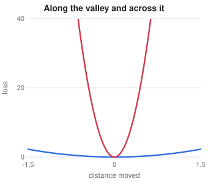

# Last Machine Learning Details

> Extended machine learning notes
> Sources: listed under References

**What this file is really about:**
$$\text{every remaining named idea}\ \to\ \text{its definition}\ \to\ \text{a calculation you can check}$$

**How to use this file.** A final audit compared every slide title and a long list of standard topics against this course. Each section here fills one gap that the audit found. The sections stand alone, so read the ones you need. Part B has checked code for most of them.

## Contents

---

# Part A — Maths From the Ground Up

## A1. Why the Rosenbrock function is hard

The classic test function for an optimiser is

$$f(x,y)=(1-x)^2+100\,(y-x^2)^2.$$

Its minimum is $f(1,1)=0$. It sits at the bottom of a narrow curved valley along $y=x^2$. The Hessian at the minimum is

$$H=\begin{bmatrix}802&-400\\-400&200\end{bmatrix},$$

whose eigenvalues are about $1001.6$ and $0.4$, so the condition number is about $2508$. Gradient descent needs a learning rate below $2/\lambda_{\max}\approx0.002$ to stay stable, which makes its progress along the flat direction very slow. Newton's method rescales each direction by its curvature.



## A2. The ID3 algorithm and its cost

ID3 grows a classification tree on categorical features.

1. If every example has the same label, return a leaf.
2. If no attributes remain, return a leaf with the majority label.
3. Otherwise pick the attribute $A$ with the largest information gain, $H(S)-\sum_v\frac{|S_v|}{|S|}H(S_v)$.
4. Create one branch per value of $A$, and call ID3 on each subset without $A$.

Each level of the tree scans at most $d$ attributes across all $n$ examples, so a level costs $O(nd)$. With depth at most $d$, training costs $O(nd^2)$. Prediction costs one comparison per level. **C4.5** extends ID3 by using the gain ratio, which corrects the bias towards attributes with many values, and by handling continuous features with thresholds.

## A3. Partitioned matrices and the Schur complement

Split a symmetric matrix into blocks, with $\Sigma_{22}$ invertible:

$$\Sigma=\begin{bmatrix}\Sigma_{11}&\Sigma_{12}\\\Sigma_{21}&\Sigma_{22}\end{bmatrix}.$$

The **Schur complement** is $S=\Sigma_{11}-\Sigma_{12}\Sigma_{22}^{-1}\Sigma_{21}$. The top-left block of $\Sigma^{-1}$ is exactly $S^{-1}$.

## A4. Marginals and conditionals of a multivariate normal

If $(x_1,x_2)$ is jointly normal, each marginal comes from reading off its blocks: $x_1\sim\mathcal N(\mu_1,\Sigma_{11})$. The conditional is also normal:

$$x_1\mid x_2\sim\mathcal N\big(\mu_1+\Sigma_{12}\Sigma_{22}^{-1}(x_2-\mu_2),\;\Sigma_{11}-\Sigma_{12}\Sigma_{22}^{-1}\Sigma_{21}\big).$$

The mean moves in proportion to how surprising $x_2$ is. The variance does not depend on the observed value, and it can only shrink. This one result powers Gaussian processes, Kalman filters and missing-value imputation.

## A5. Adjusted R squared, Mallows' Cp and Durbin-Watson

$R^2$ never falls when you add a feature, so it cannot choose a model size. Two corrections penalise size, with $n$ examples and $p$ features.

$$\bar R^2=1-(1-R^2)\frac{n-1}{n-p-1},\qquad C_p=\frac{\text{RSS}_p}{\hat\sigma^2}-n+2(p+1).$$

A good model has $C_p$ close to its number of parameters. The **Durbin-Watson** statistic checks whether residuals in time are independent:

$$d=\frac{\sum_{t=2}^n(e_t-e_{t-1})^2}{\sum_{t=1}^n e_t^2}\approx2(1-\hat\rho).$$

A value near 2 means no lag-one correlation. Values near 0 mean positive correlation, and values near 4 mean negative correlation.

## A6. OPTICS

DBSCAN uses one radius, so it fails when clusters differ in density. OPTICS orders points so that many radii can be read at once. With $\text{minPts}$ fixed,

$$\text{core}(p)=\text{distance to its minPts-th neighbour},\qquad\text{reach}(o,p)=\max\big(\text{core}(p),\,d(p,o)\big).$$

Points are visited by smallest reachability so far. Plotting reachability in visit order gives valleys, and each valley is a cluster. A cut at height $\varepsilon$ reproduces DBSCAN at that radius.

## A7. Two ways to decode a hidden Markov model

The forward and backward passes give, for each time, the probability of each hidden state:

$$\gamma_t(i)=P(z_t=i\mid x_{1:T})=\frac{\alpha_t(i)\,\beta_t(i)}{\sum_j\alpha_t(j)\,\beta_t(j)}.$$

**Posterior decoding**, also called maximum posterior marginal, takes $\arg\max_i\gamma_t(i)$ at each time. **Viterbi** finds the single most likely whole path. They answer different questions. Posterior decoding maximises the expected number of correct states, but its sequence can even contain a transition of probability zero. Viterbi always returns a feasible path.

**Baum-Welch** is EM for an HMM. The E-step computes $\gamma$ and the pairwise $\xi_t(i,j)\propto\alpha_t(i)A_{ij}B_j(x_{t+1})\beta_{t+1}(j)$. The M-step sets $A_{ij}\propto\sum_t\xi_t(i,j)$.

## A8. Sampling a normal with Box-Muller

Given independent $U_1,U_2\sim\text{Uniform}(0,1)$,

$$Z_1=\sqrt{-2\ln U_1}\cos(2\pi U_2),\qquad Z_2=\sqrt{-2\ln U_1}\sin(2\pi U_2)$$

are independent standard normals. The trick works in polar form: the squared radius of a 2-D standard normal is exponential, and its angle is uniform. For $\mathcal N(\mu,\Sigma)$, factor $\Sigma=LL^\top$ and return $\mu+Lz$.

## A9. What makes a Markov chain converge

- **Irreducible**: every state can reach every other state.
- **Aperiodic**: returns to a state are not locked to multiples of some period above 1.
- **Stationary distribution**: $\pi P=\pi$.
- **Ergodic theorem**: for a finite irreducible aperiodic chain, $P^t(i,\cdot)\to\pi$ from every start, and long-run averages converge to expectations under $\pi$.

Detailed balance, $\pi_iP_{ij}=\pi_jP_{ji}$, is sufficient for $\pi$ to be stationary. It is how Metropolis-Hastings is designed.

## A10. Huffman coding

Entropy is the limit on average code length. Huffman coding builds an optimal prefix code by repeatedly merging the two least likely symbols. Its average length $L$ satisfies

$$H(X)\le L<H(X)+1.$$

For probabilities $\tfrac12,\tfrac14,\tfrac14$ the code lengths are $1,2,2$, so $L=H=1.5$ bits.

## A11. Bayesian logistic regression

With prior $w\sim\mathcal N(0,S_0)$, the posterior has no closed form because the likelihood is not conjugate. The **Laplace approximation** fits a normal at the MAP estimate:

$$S_N^{-1}=S_0^{-1}+\sum_i p_i(1-p_i)\,x_ix_i^\top.$$

For prediction, let $\mu=x^\top w_{\text{MAP}}$ and $\sigma^2=x^\top S_Nx$. A good approximation to the predictive probability is

$$p(y=1\mid x)\approx\text{sigmoid}\big(\kappa(\sigma^2)\,\mu\big),\qquad\kappa(\sigma^2)=(1+\pi\sigma^2/8)^{-1/2}.$$

More uncertainty pulls the probability towards one half.

## A12. Hypernetworks

A hypernetwork is a network whose output is the weights of another network: $\theta=h_\phi(z)$, then $\hat y=f_\theta(x)$. Only $\phi$ is trained directly. Changing the embedding $z$ produces a different model, which is useful for meta-learning, for tasks with shared structure and for compactly generating ensembles of weights.

## A13. Partial pooling and empirical Bayes

Suppose group $j$ has an estimate $y_j$ with known variance $\sigma_j^2$. There are three choices: use each $y_j$ alone (no pooling), use one grand mean (complete pooling), or use a **hierarchical model** with $\theta_j\sim\mathcal N(\mu,\tau^2)$. The posterior mean is

$$\hat\theta_j=\frac{y_j/\sigma_j^2+\mu/\tau^2}{1/\sigma_j^2+1/\tau^2}.$$

Groups with little data are pulled strongly towards $\mu$, and groups with plenty of data barely move. **Empirical Bayes** estimates $\mu$ and $\tau$ from the data themselves. The same effect appears in James-Stein shrinkage, and it is why early-season batting averages predict the rest of a season better after shrinkage.

## A14. The partial autocorrelation function

The ACF at lag $k$ includes indirect effects through the lags in between. The PACF is the correlation at lag $k$ after removing the linear effect of lags $1,\dots,k-1$. It equals the last coefficient when fitting an AR($k$).

| Process | ACF | PACF |
|---|---|---|
| AR($p$) | Decays gradually | Cuts off after lag $p$ |
| MA($q$) | Cuts off after lag $q$ | Decays gradually |

## A15. Class-agnostic mAP and two small pictures

Class-agnostic mAP treats every category as one class, "object". It measures localisation alone, so comparing it with ordinary mAP separates finding the object from naming it.

The **dartboard picture** of bias and variance has four cases. Bias is how far the centre of the throws is from the bullseye, and variance is how widely they scatter. High bias with low variance is a tight cluster in the wrong place.

**Odds** express the same probability on another scale, $\text{odds}=p/(1-p)$. Logistic regression is linear in log odds, so one unit of $x_j$ multiplies the odds by $e^{w_j}$.

---

# Part B — In Code

## B1. Rosenbrock with gradient descent and Newton

```python
import numpy as np
f = lambda p: (1 - p[0])**2 + 100 * (p[1] - p[0]**2)**2
g = lambda p: np.array([-2*(1-p[0]) - 400*p[0]*(p[1]-p[0]**2), 200*(p[1]-p[0]**2)])
H = lambda p: np.array([[2 - 400*p[1] + 1200*p[0]**2, -400*p[0]], [-400*p[0], 200.0]])
print('condition number', round(np.linalg.cond(H([1.0, 1.0]))))
start = np.array([-1.2, 1.0])
w = start.copy()
for _ in range(5000): w = w - 0.0015 * g(w)
n = start.copy()
for _ in range(30): n = n - np.linalg.solve(H(n), g(n))
print('gradient descent', round(f(w), 5), 'Newton', round(f(n), 12))
assert f(n) < 1e-8 and f(n) < f(w)
```

## B2. A multivariate normal conditional, checked by sampling

```python
import numpy as np
rng = np.random.default_rng(0)
mu = np.array([1.0, -1.0]); S = np.array([[2.0, 1.2], [1.2, 1.5]])
given = 0.5
cond_mean = mu[0] + S[0, 1] / S[1, 1] * (given - mu[1])
cond_var = S[0, 0] - S[0, 1]**2 / S[1, 1]
x = rng.multivariate_normal(mu, S, 2_000_000)
near = x[np.abs(x[:, 1] - given) < 0.02, 0]
print(round(cond_mean, 3), round(near.mean(), 3), round(cond_var, 3), round(near.var(), 3))
assert abs(near.mean() - cond_mean) < 0.02 and abs(near.var() - cond_var) < 0.03
# The Schur complement is the inverse of the top-left block of the precision matrix.
assert abs(1 / np.linalg.inv(S)[0, 0] - cond_var) < 1e-12
```

## B3. Box-Muller and Huffman

```python
import numpy as np, heapq
rng = np.random.default_rng(1)
u1, u2 = rng.random(500_000), rng.random(500_000)
z = np.sqrt(-2 * np.log(u1)) * np.cos(2 * np.pi * u2)
print('mean', round(z.mean(), 3), 'variance', round(z.var(), 3))
assert abs(z.mean()) < 0.01 and abs(z.var() - 1) < 0.01

def huffman_lengths(p):
    h = [(q, i, [i]) for i, q in enumerate(p)]; heapq.heapify(h); L = [0] * len(p)
    while len(h) > 1:
        a = heapq.heappop(h); b = heapq.heappop(h)
        for s in a[2] + b[2]: L[s] += 1
        heapq.heappush(h, (a[0] + b[0], min(a[1], b[1]), a[2] + b[2]))
    return L
p = [0.4, 0.3, 0.15, 0.1, 0.05]
L = huffman_lengths(p); avg = sum(q * l for q, l in zip(p, L)); H = -sum(q * np.log2(q) for q in p)
print(L, round(avg, 3), round(H, 3))
assert H <= avg < H + 1
```

## B4. Viterbi and posterior decoding disagree

```python
import numpy as np
A = np.array([[0.6, 0.4, 0.0], [0.0, 0.5, 0.5], [0.4, 0.0, 0.6]])
B = np.array([[0.7, 0.3], [0.2, 0.8], [0.45, 0.55]])
pi = np.array([0.5, 0.2, 0.3])
def decode(x):
    T, K = len(x), len(pi); a = np.zeros((T, K)); b = np.ones((T, K))
    a[0] = pi * B[:, x[0]]
    for t in range(1, T): a[t] = (a[t-1] @ A) * B[:, x[t]]
    for t in range(T - 2, -1, -1): b[t] = A @ (B[:, x[t+1]] * b[t+1])
    g = a * b; g /= g.sum(1, keepdims=True)
    d = np.log(pi + 1e-300) + np.log(B[:, x[0]]); back = []
    for t in range(1, T):
        s = d[:, None] + np.log(A + 1e-300); back.append(s.argmax(0)); d = s.max(0) + np.log(B[:, x[t]])
    path = [int(d.argmax())]
    for ptr in reversed(back): path.append(int(ptr[path[-1]]))
    return g.argmax(1).tolist(), path[::-1]
found = None
for code in range(2**8):
    x = [(code >> i) & 1 for i in range(8)]
    mpm, vit = decode(x)
    infeasible = any(A[i, j] == 0 for i, j in zip(mpm, mpm[1:]))
    if infeasible: found = (x, mpm, vit); break
print(found)
assert found and all(A[i, j] > 0 for i, j in zip(found[2], found[2][1:]))
```

## B5. Partial pooling beats either extreme

```python
import numpy as np
rng = np.random.default_rng(3)
mu, tau, J = 0.26, 0.03, 30
err = {'none': 0.0, 'complete': 0.0, 'partial': 0.0}
for _ in range(400):
    theta = rng.normal(mu, tau, J); n = rng.integers(20, 120, J); s2 = 0.2 / n
    y = rng.normal(theta, np.sqrt(s2))
    grand = np.average(y, weights=1 / s2)
    tau2 = max(1e-6, np.var(y) - s2.mean())      # empirical Bayes moment estimate
    post = (y / s2 + grand / tau2) / (1 / s2 + 1 / tau2)
    for k, v in [('none', y), ('complete', np.full(J, grand)), ('partial', post)]: err[k] += np.mean((v - theta)**2)
print({k: round(v / 400 * 1e4, 2) for k, v in err.items()})
assert err['partial'] < err['none'] and err['partial'] < err['complete']
```

## B6. Durbin-Watson and the PACF cut-off

```python
import numpy as np
rng = np.random.default_rng(4)
def ar(phi, n=200_000):
    x = np.zeros(n); e = rng.normal(size=n)
    for t in range(2, n): x[t] = phi[0] * x[t-1] + phi[1] * x[t-2] + e[t]
    return x
dw = lambda e: np.sum(np.diff(e)**2) / np.sum(e**2)
x = ar((0.7, 0.0)); print('DW', round(dw(x), 3), 'rule', round(2 * (1 - 0.7), 3))
assert abs(dw(x) - 0.6) < 0.02
def pacf(x, k):
    X = np.column_stack([x[k - i - 1:-i - 1] for i in range(k)]); y = x[k:]
    return np.linalg.lstsq(X, y, rcond=None)[0][-1]
s = ar((0.5, 0.3)); p = [round(pacf(s, k), 3) for k in range(1, 5)]
print(p); assert abs(p[1] - 0.3) < 0.02 and abs(p[2]) < 0.02 and abs(p[3]) < 0.02
```

---

# Part C — Practice

**P1.** What is the condition number of $f(x,y)=x^2+100y^2$?

<details><summary>Answer</summary>

The Hessian is $\text{diag}(2,200)$, so the condition number is $100$.

</details>

**P2.** With $\Sigma_{11}=4,\Sigma_{12}=2,\Sigma_{22}=2$, what is $\text{Var}(x_1\mid x_2)$?

<details><summary>Answer</summary>

$4-2^2/2=2$.

</details>

**P3.** $R^2=0.8$, $n=21$, $p=5$. What is the adjusted $R^2$?

<details><summary>Answer</summary>

$1-0.2\times\frac{20}{15}\approx0.733$.

</details>

**P4.** Why can posterior decoding return an impossible sequence?

<details><summary>Answer</summary>

It chooses each state independently, using only the marginals, so nothing forces adjacent choices to be connected by an allowed transition.

</details>

**P5.** A group has $y=0.40$, $\sigma^2=0.01$, $\mu=0.25$ and $\tau^2=0.01$. What is its posterior mean?

<details><summary>Answer</summary>

The precisions are equal, so it is the midpoint, $0.325$.

</details>

**P6.** The ACF of a series decays slowly and the PACF is zero after lag 2. What model fits?

<details><summary>Answer</summary>

AR(2).

</details>

**P7.** What code lengths does Huffman coding give for probabilities $0.5,0.25,0.125,0.125$?

<details><summary>Answer</summary>

$1,2,3,3$, with average $1.75$ bits, which equals the entropy.

</details>
