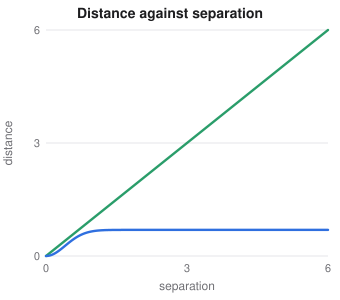

# Advanced Maths for Deep Learning

> Extended mathematics notes
> Sources: listed under References

**What this file is really about:**
$$\text{iteration}\ \to\ \text{rates}\ \to\ \text{frequencies}\ \to\ \text{dynamics}\ \to\ \text{distances between distributions}$$

**How to use this file.** This note covers the maths behind optimiser theory, generative models, geometric models and rendering, assuming only the notes on linear algebra, calculus and probability. Part B checks each main result.

## Contents

---

# Part A — Maths From the Ground Up

## A1. Numbers on a computer

A **floating point** number holds a limited number of significant digits. A 64-bit number has about 16 decimal digits and a 32-bit number about 7. Three failures recur: **underflow** of tiny products to zero, subtracting nearly equal numbers loses precision, and $x+\epsilon=x$ when $\epsilon$ is too small. This is why we work with log probabilities and use functions such as `log1p`.

## A2. Fixed points and contractions

A **fixed point** satisfies $x=f(x)$. A map is a **contraction** if $\lVert f(x)-f(y)\rVert\le c\lVert x-y\rVert$ with $c<1$. The Banach theorem says it then has one fixed point, and repeating $f$ reaches it, with the error shrinking by at least $c$ each step. The Bellman operator is a contraction with $c=\gamma$. That is why value iteration converges.

**Root finding** solves $f(x)=0$. **Bisection** halves an interval with a sign change, and Newton's method uses $x\leftarrow x-f(x)/f'(x)$.

## A3. Smoothness, strong convexity and convergence rates

A function is **Lipschitz** with constant $L$ if $\lVert f(x)-f(y)\rVert\le L\lVert x-y\rVert$. It is **$L$-smooth** if its gradient is $L$-Lipschitz, which means curvature is at most $L$. It is **$\mu$-strongly convex** if its curvature is at least $\mu$.

| Assumption | Method | **Convergence rate** after $t$ steps |
|---|---|---|
| $L$-smooth, convex | Gradient descent, $\eta=1/L$ | $O(1/t)$ |
| $L$-smooth, convex | Nesterov acceleration | $O(1/t^2)$ |
| $L$-smooth, $\mu$-strongly convex | Gradient descent | $O((1-\mu/L)^t)$ |
| Convex, noisy gradients | SGD with decay | $O(1/\sqrt t)$ |

On a quadratic, the eigenvalues of the Hessian decide everything. The ratio $\kappa=L/\mu$ is the condition number.

## A4. Line search and conjugate gradient

A **line search** chooses the step along a direction. The **Armijo** condition accepts a step if it lowers the loss by a fair share of what the gradient promised:

$$f(x+\eta d)\le f(x)+c\,\eta\nabla f^\top d.$$

**Conjugate gradient** solves $Ax=b$ for positive definite $A$ using only matrix-vector products. Each step is conjugate to the earlier ones, so it needs at most $n$ steps in exact arithmetic. That makes it suitable for very large systems.

## A5. Duality, proximal operators and subgradients

For a problem with Lagrangian $L(x,\lambda)$, the dual function $g(\lambda)=\min_xL(x,\lambda)$ is always a lower bound on the optimum, which is **weak duality**. **Strong duality** means the gap is zero, and it holds for convex problems under mild conditions.

A **subgradient** extends the gradient to kinks. At zero, $|x|$ has every value in $[-1,1]$ as a subgradient.

A **proximal operator** is $\text{prox}_{\eta h}(v)=\arg\min_x\tfrac1{2\eta}\lVert x-v\rVert^2+h(x)$. For $h=\lambda|x|$ it is soft-thresholding, which is the step inside lasso solvers.

## A6. Inner product spaces and kernels

An **inner product space** generalises the dot product: $\langle f,g\rangle$ can be defined on functions. A **metric space** has a distance that is symmetric, positive and satisfies the triangle inequality.

A **reproducing kernel Hilbert space** is a space of functions in which evaluation is an inner product, $f(x)=\langle f,k(x,\cdot)\rangle$. The **representer theorem** says that regularised solutions take the form $\sum_i\alpha_ik(x_i,\cdot)$, which is why kernel methods need only the Gram matrix.

## A7. Complex numbers and Euler's formula

A **complex number** is $a+bi$ with $i^2=-1$. **Euler's formula** is

$$e^{i\theta}=\cos\theta+i\sin\theta.$$

Multiplying complex numbers adds their angles and multiplies their lengths, so rotations become multiplication.

## A8. Fourier analysis

The **discrete Fourier transform** expresses $n$ samples as a sum of frequencies:

$$X_k=\sum_{t=0}^{n-1}x_te^{-2\pi ikt/n}.$$

The **FFT** computes it in $O(n\log n)$ instead of $O(n^2)$. The **convolution theorem** states that circular convolution in time equals multiplication in frequency:

$$\mathcal F(x*y)=\mathcal F(x)\,\mathcal F(y).$$

Positional encodings use a set of frequencies, low-pass filtering explains blur, and spectral graph methods extend the same idea. Neural networks often fit low frequencies first, called spectral bias.

## A9. Numerical integration

The **trapezoid rule** approximates an integral by trapezoids, with error $O(h^2)$ in step size $h$. **Simpson's rule** fits parabolas, with error $O(h^4)$. **Numerical integration** in high dimensions becomes costly, so Monte Carlo averages are used, whose error is $O(1/\sqrt n)$ in any dimension. Rendering a neural radiance field computes a numerical integral along each ray.

## A10. Ordinary differential equations

An **ordinary differential equation** is $\dot x=f(x,t)$. The **Euler method** steps $x_{t+h}=x_t+hf(x_t,t)$, with global error $O(h)$. **Runge-Kutta** methods sample $f$ several times per step, and the classic fourth-order version has global error $O(h^4)$.

A residual network resembles Euler's method. Probability flow, flow matching and neural ODEs all require solving one.

## A11. Brownian motion and stochastic differential equations

**Brownian motion** $W_t$ starts at 0, has independent increments, and $W_{t+s}-W_t\sim\mathcal N(0,s)$. Its variance grows linearly with time, so a small step changes it by order $\sqrt{dt}$, far more than $dt$.

A **stochastic differential equation** is

$$dx=f(x,t)\,dt+g(t)\,dW.$$

**Euler-Maruyama** simulates it: $x_{t+h}=x_t+hf+g\sqrt h\,z$. Because $(dW)^2=dt$, the chain rule gains a term. This is **Itô's lemma**:

$$dh(x)=\Big(h'f+\tfrac12h''g^2\Big)dt+h'g\,dW.$$

## A12. How a density moves

The **divergence** of a vector field is $\nabla\cdot v=\sum_i\partial_iv_i$, the rate of outflow per unit of volume. If particles follow $\dot x=v$, density obeys the **continuity equation**:

$$\partial_tp+\nabla\cdot(pv)=0.$$

For an SDE, the **Fokker-Planck equation** adds diffusion:

$$\partial_tp=-\nabla\cdot(fp)+\tfrac12g^2\nabla^2p.$$

From these two, an SDE and an ODE can share the same marginals, which is the **probability flow** ODE. Its velocity is $f-\tfrac12g^2\nabla\log p$.

**Hutchinson's estimator** computes a trace cheaply using random probes $\epsilon$ with identity covariance: $\text{Tr}(A)=\mathbb E[\epsilon^\top A\epsilon]$. Continuous flows use it for the log-determinant term.

## A13. Pushforward and measure

The **pushforward** $g_\#p$ is the distribution of $g(x)$ when $x\sim p$. A generator's output is a pushforward. It may live on a low-dimensional surface, a **manifold**, that has no ordinary density.

**Measure theory** defines probability on such sets. The **Lebesgue** integral assigns size to sets rather than to intervals. You need only the idea: if two distributions have disjoint supports, density ratios are undefined.

## A14. Distances between distributions

| Distance | Formula | Note |
|---|---|---|
| **Total variation** | $\tfrac12\int|p-q|$ | Largest difference in probability of any event |
| **f-divergence** | $\int q\,f(p/q)$, convex $f$ with $f(1)=0$ | KL and JS are special cases |
| Wasserstein-1 | $\inf_\gamma\mathbb E_\gamma\lVert x-y\rVert$ | Cost to move mass |

**Optimal transport** finds the cheapest plan $\gamma$ for moving $p$ onto $q$. **Kantorovich duality** turns that into a problem over 1-Lipschitz functions:

$$W_1(p,q)=\sup_{\lVert f\rVert_L\le1}\mathbb E_p[f]-\mathbb E_q[f].$$

That is the critic of a Wasserstein GAN. Unlike JS, it still gives a useful signal if supports are disjoint. For $\delta_0$ and $\delta_\theta$, $W_1=|\theta|$, whereas JS stays at $\ln2$. In one dimension, $W_1$ is the area between the two CDFs.



## A15. Geometry

**Curvature** of a surface tells how quickly it bends. A **geodesic** is the shortest path on a surface, as a great circle is on a sphere.

**Homogeneous coordinates** write $(x,y,z)$ as $(x,y,z,1)$, so that translation becomes matrix multiplication. A camera projects with

$$\begin{bmatrix}u\\v\\1\end{bmatrix}\propto K\,[R\mid t]\begin{bmatrix}X\\Y\\Z\\1\end{bmatrix}.$$

A **quaternion** $q=(w,x,y,z)$ of unit length represents a rotation with four numbers, avoiding the singularities of Euler angles. **Spherical harmonics** are a Fourier basis on a sphere.

## A16. Graphs as matrices

The **adjacency matrix** has $A_{ij}=1$ when there is an edge. With degree matrix $D$, the **graph Laplacian** is $L=D-A$, and

$$x^\top Lx=\sum_{(i,j)\in E}(x_i-x_j)^2.$$

The number of zero eigenvalues equals the number of connected components. Eigenvectors with small eigenvalues are smooth over the graph, and spectral clustering uses them.

## A17. Symmetry

A **group** is a set with an associative operation, an identity and inverses, such as rotations. A function is **equivariant** if $f(gx)=gf(x)$, and **invariant** if $f(gx)=f(x)$. A convolution is equivariant to translations, and global pooling then makes it invariant.

## A18. Dynamic programming

**Dynamic programming** solves overlapping subproblems once. **Recursion** defines a value through smaller ones, and storing the results avoids repeated work. Viterbi, the Bellman equations, edit distance and the forward algorithm are all examples.

---

# Part B — In Code

## B1. Rates on a quadratic

```python
import numpy as np
A = np.diag([1.0, 25.0]); L, mu = 25.0, 1.0
x = np.array([1.0, 1.0]); f = lambda v: 0.5 * v @ A @ v
values = []
for _ in range(40): x = x - (1 / L) * (A @ x); values.append(f(x))
ratio = values[-1] / values[-2]
print(round(ratio, 4), round((1 - mu / L)**2, 4)); assert abs(ratio - (1 - mu / L)**2) < 1e-3
def cg(A, b, steps):
    x = np.zeros(len(b)); r = b.copy(); d = r.copy()
    for _ in range(steps):
        a = (r @ r) / (d @ A @ d); x += a * d; n = r - a * (A @ d); d = n + (n @ n) / (r @ r) * d; r = n
    return x
rng = np.random.default_rng(0); M = rng.normal(size=(6, 6)); M = M @ M.T + np.eye(6); b = rng.normal(size=6)
assert np.allclose(cg(M, b, 6), np.linalg.solve(M, b), atol=1e-6)
```

## B2. The Fourier transform and convolution

```python
import numpy as np
rng = np.random.default_rng(1); x, y = rng.normal(size=32), rng.normal(size=32)
n = 32; slow = np.array([np.sum(x * np.exp(-2j * np.pi * k * np.arange(n) / n)) for k in range(n)])
assert np.allclose(slow, np.fft.fft(x))
circ = np.array([sum(x[j] * y[(t - j) % n] for j in range(n)) for t in range(n)])
assert np.allclose(np.fft.fft(circ), np.fft.fft(x) * np.fft.fft(y))
assert np.isclose(np.exp(1j * 0.7), np.cos(0.7) + 1j * np.sin(0.7))
print('Fourier identities hold')
```

## B3. Solvers lose accuracy at the expected rates

```python
import numpy as np
f = lambda x: -x
def solve(step, h):
    x = 1.0
    for _ in range(round(1 / h)): x = step(x, h)
    return abs(x - np.exp(-1))
def euler(x, h): return x + h * f(x)
def rk4(x, h):
    a = f(x); b = f(x + h * a / 2); c = f(x + h * b / 2); d = f(x + h * c); return x + h * (a + 2*b + 2*c + d) / 6
r1 = solve(euler, 0.02) / solve(euler, 0.01); r4 = solve(rk4, 0.02) / solve(rk4, 0.01)
print(round(r1, 2), round(r4, 2)); assert 1.8 < r1 < 2.2 and 14 < r4 < 18
x = np.linspace(0, 1, 101); assert abs(np.trapezoid(x**2, x) - 1/3) < 1e-4
```

## B4. Brownian motion and Itô's correction

```python
import numpy as np
rng = np.random.default_rng(2)
h = 0.002; n = 500; R = 200000
inc = rng.normal(0, np.sqrt(h), (R, n)); W = inc.cumsum(1)
assert abs(W[:, -1].var() - 1.0) < 0.02
# Ito: E[W^2] grows like t, so the increment of W^2 has drift 1, not 0.
assert abs(np.mean(W[:, -1]**2) - h * n) < 0.02
quad = np.sum(inc**2, 1); assert abs(quad.mean() - 1) < 1e-3 and quad.std() < 0.08
# An Ornstein-Uhlenbeck SDE reaches its known stationary variance.
x = np.zeros(R)
for _ in range(4000): x += -x * h + np.sqrt(2 * h) * rng.normal(size=R)
print(round(x.var(), 3)); assert abs(x.var() - 1) < 0.03
```

## B5. Hutchinson and the graph Laplacian

```python
import numpy as np
rng = np.random.default_rng(3)
A = rng.normal(size=(30, 30)); e = rng.choice([-1.0, 1.0], (300000, 30))
est = np.mean(np.sum(e * (e @ A), 1)); print(round(est, 2), round(np.trace(A), 2))
assert abs(est - np.trace(A)) < 0.5
Ad = np.zeros((6, 6))
for i, j in [(0,1),(1,2),(0,2),(3,4),(4,5)]: Ad[i, j] = Ad[j, i] = 1
La = np.diag(Ad.sum(1)) - Ad
assert (np.abs(np.linalg.eigvalsh(La)) < 1e-9).sum() == 2
x = rng.normal(size=6); assert np.isclose(x @ La @ x, sum((x[i]-x[j])**2 for i, j in [(0,1),(1,2),(0,2),(3,4),(4,5)]))
```

## B6. Wasserstein in one dimension

```python
import numpy as np
from scipy.stats import wasserstein_distance
rng = np.random.default_rng(4)
a, b = np.sort(rng.normal(0, 1, 200000)), np.sort(rng.normal(3, 1, 200000))
print(round(np.mean(np.abs(a - b)), 3), round(wasserstein_distance(a, b), 3))
assert abs(np.mean(np.abs(a - b)) - 3) < 0.02
js = lambda p, q: 0.5 * sum(x * np.log(x / ((x + y) / 2)) for x, y in zip(p, q) if x > 0) + 0.5 * sum(y * np.log(y / ((x + y) / 2)) for x, y in zip(p, q) if y > 0)
assert np.isclose(js([1, 0], [0, 1]), np.log(2))
```

---

# Part C — Practice

**P1.** A map has $c=0.9$. About how many iterations shrink the error by a factor of 100?

<details><summary>Answer</summary>

$\ln100/-\ln0.9\approx44$.

</details>

**P2.** With $L=100$ and $\mu=1$, gradient descent's error factor per step is about what?

<details><summary>Answer</summary>

$1-\mu/L=0.99$.

</details>

**P3.** Halving the step in the Euler method divides its global error by what?

<details><summary>Answer</summary>

By about 2.

</details>

**P4.** What is $\text{Var}(W_4-W_1)$?

<details><summary>Answer</summary>

$3$.

</details>

**P5.** Distributions $\delta_2$ and $\delta_5$: what are $W_1$ and JS (in nats)?

<details><summary>Answer</summary>

$W_1=3$ and JS $=\ln2$.

</details>

**P6.** A graph has three connected components. How many zero eigenvalues does its Laplacian have?

<details><summary>Answer</summary>

Three.

</details>

**P7.** What is the cost of multiplying two degree-$n$ polynomials by FFT?

<details><summary>Answer</summary>

$O(n\log n)$.

</details>
