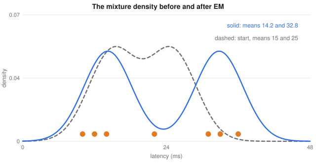
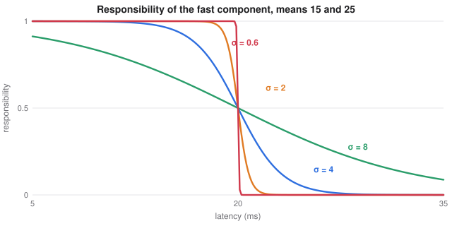
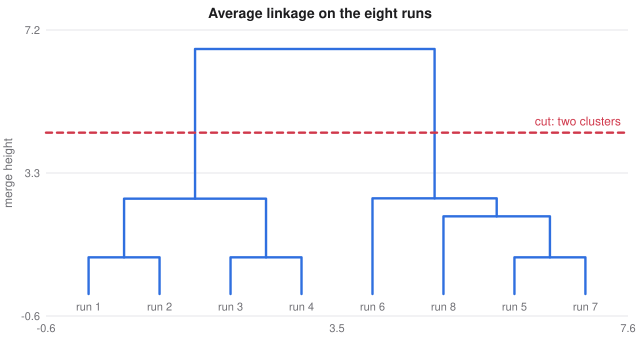
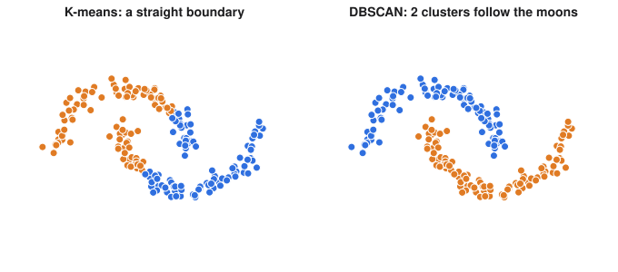

# Mixture Models, Hierarchical and Density-Based Clustering

> ES 335 / ES 678 Machine Learning, Sem I 2026
> Sources: `sources/course-2026/lectures/L13b_unsupervised_learning_handbook.pdf` (Chapter 3, pp. 42–60 of the file)

**What this file is really about:**
$$\text{hard groups}\ \to\ \text{soft membership (EM)}\ \to\ \text{a tree of groups}\ \to\ \text{dense regions of any shape}\ \to\ \text{is any of it real?}$$

**How to use this file.** Mixtures run on seven request latencies, hierarchical clustering runs on the eight training runs, and every number can be checked by hand. Part A builds the methods. Part C is practice with answers.

**The second dataset.** Seven requests to a deployed model took these latencies, in milliseconds: $10,12,14,22,31,33,36$. They look like two kinds of request, and the request of $22$ ms lies between them.

## Contents

---

# Part A — Maths From the Ground Up

## A1. From hard to soft membership

K-means must put every point wholly into one cluster, and a point between two clusters then moves a centroid as if it belonged there completely. A student in a mess hall sitting between two groups of friends belongs to neither completely. A **mixture model** can say 70% window group and 30% door group, and let the student count that way towards each group's average.

## A2. The normal distribution and the mixture density

A quantity spread around a centre $\mu$ with spread $\sigma$ is often modelled by the normal density

$$\mathcal N(x\mid\mu,\sigma)=\frac{1}{\sigma\sqrt{2\pi}}\exp\Big(-\frac{(x-\mu)^2}{2\sigma^2}\Big).$$

Suppose each latency comes from one of two normals, but we never see which. With unknown means, a known $\sigma=4$, and each component equally likely, the density of a latency is

$$p(x)=\tfrac12\mathcal N(x\mid\mu_1,\sigma)+\tfrac12\mathcal N(x\mid\mu_2,\sigma).$$

This is a **Gaussian mixture model**, and the two normals are its **components**.

## A3. The E-step: responsibilities

If the means were known, Bayes' rule would give the probability that request $i$ came from component $k$. The common factors $\tfrac12$ and $1/(\sigma\sqrt{2\pi})$ cancel:

$$r_{ik}=\frac{e^{-(x_i-\mu_k)^2/(2\sigma^2)}}{e^{-(x_i-\mu_1)^2/(2\sigma^2)}+e^{-(x_i-\mu_2)^2/(2\sigma^2)}}.$$

These $r_{ik}$ are **responsibilities**, and for each request they add to 1.

**Worked example.** Take $\mu_1=15$, $\mu_2=25$, so $2\sigma^2=32$. For $22$ ms: $e^{-49/32}=0.2163$ and $e^{-9/32}=0.7548$, so $r_{41}=0.2163/(0.2163+0.7548)=0.223$.

| latency | $r_{i1}$ (fast) | $r_{i2}$ (slow) |
|---|---|---|
| 10 | 0.998 | 0.002 |
| 12 | 0.993 | 0.007 |
| 14 | 0.977 | 0.023 |
| 22 | 0.223 | 0.777 |
| 31 | 0.001 | 0.999 |
| 33 | 0.000 | 1.000 |
| 36 | 0.000 | 1.000 |
| **sum** | **3.192** | **3.808** |

## A4. The M-step: weighted means

If the responsibilities were known, let request $i$ count towards component $k$ with weight $r_{ik}$. Differentiating the weighted log-likelihood and setting it to zero gives

$$\mu_k=\frac{\sum_ir_{ik}x_i}{\sum_ir_{ik}}.$$

The second derivative $-\sum_ir_{ik}/\sigma^2$ is negative, so this is a maximum. When every $r_{ik}$ is 0 or 1, it reduces to an ordinary cluster mean.

**Worked example.** $\sum_ir_{i1}x_i=40.52$, so $\mu_1=40.52/3.192=12.69$. Since $\sum_ix_i=158$, $\mu_2=(158-40.52)/3.808=30.85$.

## A5. The EM algorithm

Neither the labels nor the means are known. Alternate: guess the means, work out the responsibilities (**E-step**), recompute the means (**M-step**), and repeat.

| step | $\mu_1$ | $\mu_2$ | $r_{41}$ for 22 ms | log-likelihood |
|---|---|---|---|---|
| 0 | 15.00 | 25.00 | 0.223 | −28.985 |
| 1 | 12.69 | 30.85 | 0.436 | −24.133 |
| 2 | 13.27 | 31.54 | 0.613 | −23.980 |
| 3 | 13.70 | 32.04 | 0.730 | −23.901 |
| 4 | 13.96 | 32.40 | 0.795 | −23.868 |

It converges to means of about $14.2$ and $32.8$.

*The mixture density at the start, dashed, and after EM has converged, solid. The dots are the seven latencies. The two components have moved apart to fit the two groups.*

**Comparison.** K-means from the same start assigns 22 wholly to the slow cluster and stops at $12.0$ and $30.5$. Neither answer is the truth. Both are local optima of their own criteria, but EM does not force an uncertain point into one cluster, and its responsibilities state the uncertainty.

## A6. K-means is the limit of EM

Let $\mu_a$ be the nearer mean and $\mu_b$ the other, at distances $d_a<d_b$. Dividing through,

$$r_{ia}=\frac{1}{1+e^{-(d_b^2-d_a^2)/(2\sigma^2)}}.$$

As $\sigma\to0$ the exponential vanishes, so $r_{ia}\to1$: the soft assignment becomes the hard rule of K-means. For 22 ms with means 15 and 25, $d_b^2-d_a^2=40$. So $r_{42}$ is $0.777$ at $\sigma=4$, $0.993$ at $\sigma=2$, and essentially 1 at $\sigma=1$.

*As $\sigma$ shrinks, the soft curve becomes a step at the midpoint between the two means, which is exactly the K-means assignment rule.*

## A7. Why the log-likelihood never decreases

Write $p_k(x_i;\theta)=\pi_k\mathcal N(x_i\mid\mu_k,\sigma_k)$ and $\ell(\theta)=\sum_i\log\sum_kp_k(x_i;\theta)$.

**Step 1 — A lower bound.** The logarithm is concave, so for positive $a_k$ and weights $w_k$ adding to 1, $\log\sum_kw_ka_k\ge\sum_kw_k\log a_k$ (Jensen's inequality). Applying it with any weights $q_{ik}$ gives

$$\ell(\theta)\ge F(q,\theta)=\sum_i\sum_kq_{ik}\log\frac{p_k(x_i;\theta)}{q_{ik}}.$$

**Step 2 — The E-step makes it tight.** With $q=r$ at the current $\theta$, the ratio inside the log is the same for every $k$, so the bound equals $\ell(\theta)$.

**Step 3 — The M-step raises the bound.** It maximises $F(r,\theta')$ over $\theta'$.

**Step 4 — Chain them.** $\ell(\theta^{\text{new}})\ge F(r,\theta^{\text{new}})\ge F(r,\theta^{\text{old}})=\ell(\theta^{\text{old}})$.

So the log-likelihood never decreases, though it may stop at a stationary point that is not the global maximum.

## A8. General Gaussian mixtures

Allow each component its own weight and spread. The E-step is Bayes' rule with $\pi_k$, and the M-step is weighted versions of a proportion, a mean and a variance:

$$\pi_k=\frac1n\sum_ir_{ik},\qquad\mu_k=\frac{\sum_ir_{ik}x_i}{\sum_ir_{ik}},\qquad\sigma_k^2=\frac{\sum_ir_{ik}(x_i-\mu_k)^2}{\sum_ir_{ik}}.$$

$\pi_k=\tfrac1n\sum_ir_{ik}$ comes from a Lagrange multiplier on the constraint $\sum_k\pi_k=1$.

With several features each component has a covariance $\Sigma_k$, and its contours are ellipses:

$$\mathcal N(x\mid\mu,\Sigma)=\frac{1}{(2\pi)^{d/2}|\Sigma|^{1/2}}\exp\big(-\tfrac12(x-\mu)^\top\Sigma^{-1}(x-\mu)\big).$$

A small $\tau I$ is added to each covariance to keep it invertible.

**Careful.** A component can collapse onto one point with its variance going to zero, and the likelihood then grows without limit. That is why a variance floor or $\tau I$ is used, and why K-means starts are common.

## A9. Agglomerative hierarchical clustering

Start with every point alone and repeatedly merge the two closest clusters, recording each merge in a tree called a **dendrogram**. Cluster distance is the **linkage**:

| linkage | distance between clusters |
|---|---|
| single | the smallest pairwise distance |
| complete | the largest pairwise distance |
| average | the mean pairwise distance |

**Worked example, average linkage on the eight runs.**

| cluster formed | height |
|---|---|
| 1, 2 | 1.000 |
| 3, 4 | 1.000 |
| 5, 7 | 1.000 |
| 5, 7, 8 | 2.118 |
| 1, 2, 3, 4 | 2.600 |
| 5, 6, 7, 8 | 2.609 |
| all | 6.682 |

Run 8 joins $\{5,7\}$ at $(2+2.236)/2=2.118$. Any cut between 2.609 and 6.682 gives the K-means answer, and the big gap between the last two heights signals two well-separated clusters.

*Each horizontal segment is a merge at that height. A cut at the dashed line gives two clusters. The large vertical gap beneath it is the sign of well-separated groups.*

## A10. Ward's linkage

**Ward's method** merges the pair whose union raises the within-cluster sum of squares $W$ the least. Applying $T=W+B$ to the two clusters alone gives a closed form:

$$\Delta(C_1,C_2)=\frac{n_1n_2}{n_1+n_2}\|\mu_1-\mu_2\|^2.$$

It prefers close means and small clusters. Merging the small and large runs costs $\tfrac{4\times4}{8}\times42.8125=85.625$, exactly the between-cluster sum $B$.

## A11. Updating dissimilarities without the data

After merging $i$ and $j$, the **Lance-Williams update** gives the distance to any other cluster $k$ from the old table:

$$\delta(i\cup j,k)=\alpha_i\delta(i,k)+\alpha_j\delta(j,k)+\beta\delta(i,j)+\gamma|\delta(i,k)-\delta(j,k)|.$$

| linkage | $\alpha_i$ | $\alpha_j$ | $\beta$ | $\gamma$ |
|---|---|---|---|---|
| single | 1/2 | 1/2 | 0 | −1/2 |
| complete | 1/2 | 1/2 | 0 | 1/2 |
| average | $n_i/(n_i+n_j)$ | $n_j/(n_i+n_j)$ | 0 | 0 |
| Ward | $(n_i+n_k)/n_{ijk}$ | $(n_j+n_k)/n_{ijk}$ | $-n_k/n_{ijk}$ | 0 |

For single linkage, $\tfrac12(a+b)-\tfrac12|a-b|=\min(a,b)$. Memory is about $n^2$, and time at least $n^2\log n$, so the method suits small and medium data.

**Insight.** With two groups joined by a bridge, single linkage chains along the bridge and returns cluster sizes 1 and 94. Complete, average and Ward linkage cut the bridge.

## A12. Density-based clustering: DBSCAN

Here a cluster is a region where points are densely packed, separated by sparse regions. Fix a radius $\varepsilon$ and an integer minPts.

- The **$\varepsilon$-neighbourhood** of a point holds all points within $\varepsilon$, including itself.
- A **core point** has at least minPts points in its neighbourhood.
- A **cluster** is a maximal set of connected core points, together with the **border points** in their neighbourhoods.
- Everything else is **noise**.

Only core points pass the cluster on, so a border point joins without extending it. The number of clusters is not given in advance, and shapes can be arbitrary.

*On two interleaved half-moons K-means splits each moon with a straight boundary, while DBSCAN follows each one as a chain of dense neighbourhoods. Crosses mark noise.*

**Choosing $\varepsilon$.** Because the neighbourhood counts the point itself, a point is core exactly when its distance to its $(\text{minPts}-1)$-th nearest other point is at most $\varepsilon$. Sort those distances in decreasing order and take $\varepsilon$ near the bend. In the handbook's example, 200 half-moon points with minPts $=5$: $\varepsilon=0.1$ gives 8 clusters and 74 noise points, $\varepsilon=0.2$ recovers both moons, and $\varepsilon=0.5$ merges them.

## A13. HDBSCAN

A single $\varepsilon$ fails when clusters have different densities. HDBSCAN defines a **core distance** $\text{core}_k(a)$ as the distance to the $k$-th nearest other point, and a **mutual reachability distance**

$$d_{\text{mreach}}(a,b)=\max\{\text{core}_k(a),\ \text{core}_k(b),\ d(a,b)\},$$

which inflates distances in sparse regions. It builds a single-linkage tree under this distance and keeps the clusters that persist longest.

## A14. Evaluating a clustering

Every method returns clusters, whether or not any exist.

- **Silhouette.** On the 90-point data, the mean is 0.589 for $K=2$, 0.773 for $K=3$ and 0.635 for $K=4$.
- **Comparison with random data.** On 90 uniform points, K-means with $K=3$ still cuts $J$ by 64% and gives a silhouette of 0.411. The three-cluster data give 93% and 0.773. A moderate score is not evidence of clusters.
- **Stability.** Split the data in half, cluster one half, and compare labels on the other. Agreement is 1.00 on real clusters and 0.84 on uniform data, so judge it against data without clusters.
- **Interpretation.** Examine the mean of each feature within each cluster, and ask whether the clusters are useful for the next task.

## A15. Choosing a method

| method | a cluster is | $K$ given? | membership | noise label | suits |
|---|---|---|---|---|---|
| K-means | points near a centre | yes | hard | no | large data, compact groups |
| Gaussian mixture | a bell-shaped cloud | yes | soft | no | overlapping groups, uncertain members |
| hierarchical | a subtree | no | hard | no | small data, several scales |
| DBSCAN, HDBSCAN | a dense region | no | hard | yes | curved groups, outliers |

A common sequence: standardise, reduce with PCA if there are many features, try K-means as a baseline, and move to a mixture or a density method when its assumptions visibly fail.

---

# Part C — Practice

**P1.** With $\mu_1=15$, $\mu_2=25$, $\sigma=4$, find the responsibility of the fast component for $14$ ms.

Answer

$e^{-1/32}=0.9692$ and $e^{-121/32}=0.0228$, so $r=0.9692/0.9920=0.977$.

**P2.** Two points $x=10$ and $x=20$ have responsibilities $0.8$ and $0.25$ for a component. Find its new mean.

Answer

$(8+5)/(0.8+0.25)=13/1.05=12.38$.

**P3.** Ward's cost for merging clusters of sizes 2 and 3 whose means are at distance 5.

Answer

$\tfrac{2\times3}{5}\times25=30$.

**P4.** Points $0,1,2,10$ with $\varepsilon=1.5$ and minPts $=3$. Classify each.

Answer

$N(1)=\{0,1,2\}$, so $1$ is core. $0$ and $2$ have two points in their neighbourhoods, and are within reach of a core point, so they are border. $10$ is noise.

**P5.** $\text{core}(a)=2$, $\text{core}(b)=1$ and $d(a,b)=1.5$. Find the mutual reachability distance.

Answer

$\max(2,1,1.5)=2$.

**P6.** Why is a high stability score on its own not evidence of real clusters?

Answer

Agreement is at least $1/K$ by construction and can be high on structureless data, 0.84 in the handbook's example. It has to be compared with the same score on data with no clusters.

**P7.** Show that for single linkage the Lance-Williams formula gives $\min(a,b)$.

Answer

If $a\le b$: $\tfrac12(a+b)-\tfrac12(b-a)=a$. If $a>b$: $\tfrac12(a+b)-\tfrac12(a-b)=b$.

