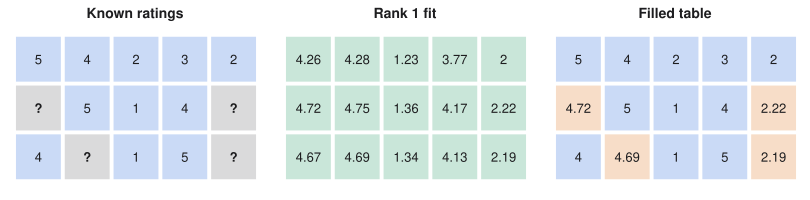
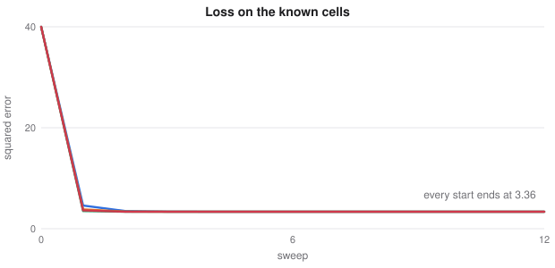

# Recommendation and Matrix Factorisation

> ES 335 Machine Learning, Semester I 2025–26
> Sources: lecture "Movie recommendation and matrix factorisation", cheat sheet ML11 and the movie-recommendation notebook

**What this file is really about:**
$$\text{a table with holes}\ \to\ \text{taste}\times\text{features}\ \to\ \text{fit only known cells}\ \to\ \text{alternate two regressions}\ \to\ \text{read off the holes}$$

**How to use this file.** Part A builds the method on one small ratings table you can check by hand. Part B shows the same thing in code. Part C is practice with answers.

## Contents

---

# Part A — Maths From the Ground Up

## A1. A table with holes

A streaming service knows who rated what, and wants to guess the ratings nobody has given yet. Put users in rows and films in columns. Here is the table used throughout, with `?` for ratings we do not have:

| | Sholay | Swades | Batman | Interstellar | Shawshank |
|---|---|---|---|---|---|
| User A | 5 | 4 | 2 | 3 | 2 |
| User B | ? | 5 | 1 | 4 | ? |
| User C | 4 | ? | 1 | 5 | ? |

Eleven cells are known and four are missing. Real tables are far emptier: with 200 million users, 15,000 films and 100 ratings per user, only about $0.67\%$ of the cells are filled.

Call the table $A\in\mathbb R^{n\times m}$, and call the set of known cells $\Omega$.

## A2. A rating as a dot product

Suppose a few hidden features explain most ratings, such as how Bollywood, how science-fiction and how dramatic a film is. Each film gets a feature vector $h_j$, and each user a taste vector $w_i$ saying how much each feature matters to them.

The predicted rating is the dot product

$$\hat a_{ij}=w_i^\top h_j=\sum_{k=1}^K w_{ik}h_{kj}.$$

**Worked example.** Take user A's taste $(3.8,\ 0.8,\ 1.5)$ and Sholay's features $(0.95,\ 0.10,\ 0.85)$. The prediction is $3.61+0.08+1.28=4.97$, close to the true rating of 5.

Real systems do not name these features. They are learned from the ratings, so they are called **latent**.

## A3. Stacking the vectors

Put every user's vector in a row of $W\in\mathbb R^{n\times k}$ and every film's vector in a column of $H\in\mathbb R^{k\times m}$. Then all predictions at once are

$$A\approx WH.$$

Cell $(i,j)$ is row $i$ of $W$ times column $j$ of $H$. Instead of $nm$ independent numbers, we store $k(n+m)$. For the streaming example at $k=100$ that is 150 times fewer numbers than cells.

## A4. Fit only what you know

We cannot compare the prediction with a rating that does not exist, so the loss adds up over known cells only:

$$\min_{W,H}\sum_{(i,j)\in\Omega}\left(a_{ij}-w_i^\top h_j\right)^2.$$

**Careful.** This loss is not convex in $W$ and $H$ together, because it multiplies them. Also the answer is not unique: for any invertible $D$, $WH=(WD)(D^{-1}H)$.

## A5. Alternating least squares

The key observation is that if $H$ is fixed, the loss is an ordinary least-squares problem in $W$, and each user can be solved separately. If $W$ is fixed, the same is true of each film.

For user $i$, let $X$ hold the feature vectors of the films they rated, and $y$ the ratings they gave. Then

$$w_i=(X^\top X+\lambda I)^{-1}X^\top y.$$

**Alternating least squares (ALS)** repeats: solve every film with $W$ fixed, then every user with $H$ fixed. Each solve is exact, so the loss never rises. It can still stop at a stationary point that is not the best one.

**Worked example.** With rank 1 and no penalty on the table above, ALS reaches a loss of $3.36$ and predicts user B's Sholay at $4.72$.

## A6. Gradient descent on the factors

Instead of solving exactly, step both factors downhill. For one known rating with error $e_{ij}=a_{ij}-w_i^\top h_j$, stochastic gradient descent does

$$w_i\leftarrow w_i+2\alpha e_{ij}h_j,\qquad h_j\leftarrow h_j+2\alpha e_{ij}w_i.$$

ALS suits batch jobs, because users and films can be solved in parallel. SGD suits online updates as ratings arrive.

## A7. Too many factors

**Careful.** If each user has as many ratings as there are factors, the fit can be exact while the missing cells are arbitrary. Different random starts then give very different guesses for the same missing cell.

Add a penalty to keep factors small:

$$\sum_{(i,j)\in\Omega}\left(a_{ij}-w_i^\top h_j\right)^2+\lambda\left(\|W\|_F^2+\|H\|_F^2\right).$$

Each ALS step then becomes a ridge regression. Choose $k$ and $\lambda$ on held-out ratings.


*Rank 1 fitted to the eleven known ratings. The rightmost table fills the four missing cells from the two factors.*


*Every ALS sweep lowers the loss on the known cells, and for rank 1 every start ends at the same value.*

## A8. Practical extensions

- **Biases.** $\hat a_{ij}=\mu+b_i+b_j+w_i^\top h_j$ absorbs the overall mean, generous users and well-liked films.
- **Cold start.** A new user has no equations for $w_i$. Use content features or popular items at first.
- **Implicit feedback.** With only clicks, weight each cell by a confidence such as $1+\alpha\cdot\text{frequency}$.
- **A nearest-neighbour alternative.** Find users whose known ratings resemble yours and average what they gave. It is simple, but it needs overlap between users.

**Link to the SVD.** With a full matrix, the best rank-$k$ fit is the truncated SVD. With missing cells the SVD cannot be used directly, which is why we fit only the observed entries.

---

# Part B — In Code

## B1. Keep only the known cells

```python
import numpy as np
A = np.array([[5, 4, 2, 3, 2],
              [np.nan, 5, 1, 4, np.nan],
              [4, np.nan, 1, 5, np.nan]])
M = ~np.isnan(A)  # True where a rating is known
```

## B2. One ALS sweep

```python
def ls(X, y, lam, k):
    return np.linalg.solve(X.T @ X + lam * np.eye(k), X.T @ y)

for j in range(m):               # fix W, solve each film
    o = M[:, j]
    H[:, j] = ls(W[o], A[o, j], lam, k)
for i in range(n):               # fix H, solve each user
    o = M[i]
    W[i] = ls(H[:, o].T, A[i, o], lam, k)
```

## B3. The same model as embeddings

The notebook stores the factors in embedding tables and trains them with a masked loss:

```python
users = nn.Embedding(n, k); films = nn.Embedding(m, k)
pred = (users(u) * films(f)).sum(1)
loss = ((pred - rating) ** 2).mean()
```

An embedding table is exactly the matrix $W$, looked up by row. The notebook **Movie recommendation** in this section runs this on a class survey and compares it with nearest neighbours.

---

# Part C — Practice

**P1.** Taste $(2,1)$ and features $(3,4)$. Find the predicted rating.

<details><summary>Answer</summary>

$2\times3+1\times4=10$.

</details>

**P2.** With $n=1000$, $m=200$ and $k=10$, how many numbers are learned, and how many cells does the table have?

<details><summary>Answer</summary>

$10\times1200=12{,}000$ numbers against $200{,}000$ cells.

</details>

**P3.** Why is the plain Frobenius norm of $A-WH$ the wrong loss?

<details><summary>Answer</summary>

Unknown cells would count, and they have no target value. In code, the norm becomes `nan`. Only observed cells must enter the loss.

</details>

**P4.** A user rated two films with features $(1,0)$ and $(0,1)$, giving 4 and 2. Find their taste with $\lambda=0$.

<details><summary>Answer</summary>

$X=I$, so $w=(4,2)$.

</details>

**P5.** Why does a rank 1 model not mean every user has the same taste?

<details><summary>Answer</summary>

There is one pattern, but each user scales it by their own number, so users can differ in how high they rate that pattern.

</details>

**P6.** Does ALS always find the global minimum?

<details><summary>Answer</summary>

No. Each solve is exact, so the loss never rises, but the joint problem is non-convex and ALS can stop at a poor stationary point.

</details>
