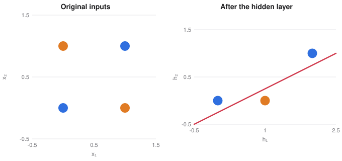
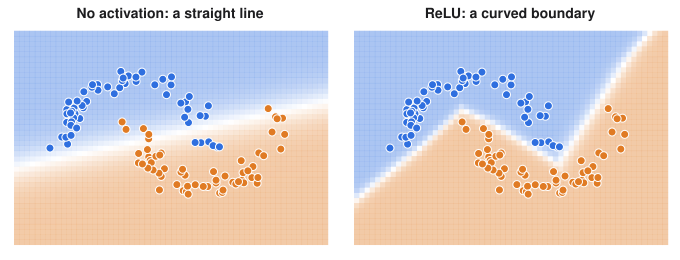

# Multi-Layer Perceptrons

> ES 335 Machine Learning, Semester I 2025–26
> Sources: lecture "Multi-layer perceptrons", cheat sheet ML17, and the perceptron and vectorisation notebooks

**What this file is really about:**
$$\text{one neuron}\ \to\ \text{XOR breaks it}\ \to\ \text{hidden layers}\ \to\ \text{activations}\ \to\ \text{backpropagation}\ \to\ \text{training}$$

**How to use this file.** Part A builds a network one neuron at a time. Part B writes it in code. Part C is practice with answers.

## Contents

---

# Part A — Maths From the Ground Up

## A1. A neuron sums, then activates

A neuron adds up weighted inputs and a bias, then passes the sum through an **activation** $\sigma$:

$$z=w^\top x+b,\qquad a=\sigma(z).$$

The activation decides the model. A step gives the perceptron, and a sigmoid gives logistic regression, so logistic regression is a single neuron.

**Worked example.** Weights $(1,1)$ and bias $-1.5$ with a step activation fire only when both inputs are 1: this neuron is an AND gate.

## A2. The perceptron learning rule

For a misclassified point, nudge the weights towards getting it right:

$$w\leftarrow w+\eta\,(y-\hat y)\,x.$$

If a line separates the classes, this rule finds one. AND and OR can be learned this way.

## A3. XOR breaks a single line

XOR outputs 1 when exactly one input is 1. No straight line puts $(0,1)$ and $(1,0)$ on one side and $(0,0)$ and $(1,1)$ on the other, so a single neuron can get at most 3 of the 4 right.

Adding a hand-made feature $x_1x_2$ solves it. A hidden layer learns such features for itself.

## A4. A hidden layer makes XOR separable

Take a network with two hidden ReLU units: $h=\text{ReLU}(W_1x+b_1)$ and $\hat y=W_2h+b_2$, with

$$W_1=\begin{bmatrix}1&1\\1&1\end{bmatrix},\quad b_1=\begin{bmatrix}0\\-1\end{bmatrix},\quad W_2=\begin{bmatrix}1&-2\end{bmatrix},\quad b_2=0.$$

| $x$ | $h$ | $\hat y$ |
|---|---|---|
| $(0,0)$ | $(0,0)$ | 0 |
| $(0,1)$ | $(1,0)$ | 1 |
| $(1,0)$ | $(1,0)$ | 1 |
| $(1,1)$ | $(2,1)$ | 0 |

The hidden layer moves the points to a new space where a line can split them. That is what a hidden layer is for.


*Left: no line separates the two colours. Right: the same four points after the hidden layer, where one line does.*

## A5. Activations and their slopes

| Activation | Formula | Slope |
|---|---|---|
| Sigmoid | $1/(1+e^{-z})$ | $\sigma(1-\sigma)$, at most $0.25$ |
| Tanh | $(e^z-e^{-z})/(e^z+e^{-z})$ | $1-\tanh^2z$, at most $1$ |
| ReLU | $\max(0,z)$ | $0$ or $1$ |

ReLU is cheap and does not shrink gradients where it is active, which is why it took over hidden layers. **Softmax** turns the final scores into class probabilities.

## A6. Without an activation, layers collapse

$$W_2(W_1x+b_1)+b_2=(W_2W_1)x+(W_2b_1+b_2).$$

Any stack of linear layers is one linear map. Without a nonlinearity, depth adds nothing.

## A7. The forward pass as matrices

Each layer computes $z^{(l)}=W^{(l)}h^{(l-1)}+b^{(l)}$, then $h^{(l)}=\sigma(z^{(l)})$, starting from $h^{(0)}=x$. $W^{(l)}$ has shape $n_l\times n_{l-1}$. For a batch of $N$ examples stacked in rows, the same computation becomes one matrix product per layer.

## A8. Counting parameters

A layer from $n_{\text{in}}$ to $n_{\text{out}}$ units has $n_{\text{in}}n_{\text{out}}+n_{\text{out}}$ parameters: one weight per connection and one bias per output unit.

**Worked example.** A $4$-$3$-$2$-$1$ network has $15+8+3=26$. A $784$-$128$-$10$ network has $101{,}770$.

## A9. Backpropagation

Backpropagation is the chain rule applied layer by layer, from the loss back to the input. Let $\delta^{(l)}=\partial L/\partial z^{(l)}$. For a sigmoid output with cross-entropy, $\delta^{(L)}=\hat y-y$. Then

$$\delta^{(l)}=\big(W^{(l+1)}\big)^\top\delta^{(l+1)}\odot\sigma'\big(z^{(l)}\big),\qquad\frac{\partial L}{\partial W^{(l)}}=\delta^{(l)}h^{(l-1)\top}.$$

The next note builds the general machinery, automatic differentiation.

## A10. What one hidden layer can fit

Three ReLUs make a bump, and a weighted sum of shifted ReLUs is a piecewise-linear curve with one kink per unit. With enough units this can approximate any continuous function on an interval. That is the **universal approximation** idea. It says the weights exist. It does not say that gradient descent finds them, or that the width needed is small.

## A11. Depth and its difficulties

Backpropagation multiplies one slope per layer. A sigmoid's slope is at most $0.25$, so five layers scale gradients by at most $0.25^5\approx10^{-3}$, and early layers barely learn. This is the **vanishing gradient** problem.

**Careful.** If all weights start equal, every hidden unit gets the same gradient and they stay copies of each other. Random initialisation breaks this tie.

Other pathologies appear during training. An all-zero start with ReLU gives zero gradients in hidden layers, and a too-large step size makes the loss diverge. Regularise with weight decay, dropout and early stopping.


*A network with one hidden layer of ReLU units bends its boundary to follow the moons. Logistic regression can only draw a straight line.*

## A12. Backpropagation for a full network, derived

Let $z^{(k)}=W^{(k)}a^{(k-1)}+b^{(k)}$ and $a^{(k)}=\phi(z^{(k)})$. Define the backward message $\delta^{(k)}=\partial L/\partial a^{(k)}$. The chain rule gives

$$\delta^{(k-1)}=W^{(k)\top}\big(\phi'(z^{(k)})\odot\delta^{(k)}\big).$$

Writing $g^{(k)}=\phi'(z^{(k)})\odot\delta^{(k)}$, the gradients are

$$\frac{\partial L}{\partial W^{(k)}}=g^{(k)}a^{(k-1)\top},\qquad\frac{\partial L}{\partial b^{(k)}}=g^{(k)}.$$

The same outer-product pattern appears at every layer.

## A13. XOR by hand

Take step activations. With $h_1$ computing OR and $h_2$ computing AND:

$$h_1=[x_1+x_2-0.5>0],\quad h_2=[x_1+x_2-1.5>0],\quad y=[h_1-h_2-0.5>0].$$

The output is true when OR holds and AND does not, which is XOR.

## A14. Why universal approximation holds

Two steep sigmoids form a bump: $\sigma(k(x-a))-\sigma(k(x-b))$ is near 1 between $a$ and $b$, and near 0 elsewhere. Sum many bumps with heights $f(x_i)$ to approximate any continuous function on an interval. The theorem says the width needed may be enormous, and says nothing about whether training finds such weights.

---

# Part B — In Code

## B1. The whole training loop in NumPy

```python
for step in range(3000):
    Z1 = X @ W1.T + b1              # N x hidden
    H1 = np.maximum(Z1, 0)          # ReLU
    p = sigmoid(H1 @ W2.T + b2)     # N x 1
    d2 = (p - y) / N                # dL/dz2
    gW2, gb2 = d2.T @ H1, d2.sum(0)
    d1 = (d2 @ W2) * (Z1 > 0)       # dL/dz1
    gW1, gb1 = d1.T @ X, d1.sum(0)
    W1 -= lr * gW1; b1 -= lr * gb1
    W2 -= lr * gW2; b2 -= lr * gb2
```

## B2. The same network in PyTorch

```python
model = nn.Sequential(nn.Linear(2, 16), nn.ReLU(), nn.Linear(16, 1))
loss_fn = nn.BCEWithLogitsLoss()
opt = torch.optim.Adam(model.parameters(), lr=1e-2)
for step in range(3000):
    opt.zero_grad()
    loss = loss_fn(model(X).squeeze(), y)
    loss.backward()
    opt.step()
```

## B3. XOR by hand, verified

```python
import numpy as np

X = np.array([[0, 0], [0, 1], [1, 0], [1, 1]])
h1 = (X.sum(1) - 0.5 > 0).astype(int)
h2 = (X.sum(1) - 1.5 > 0).astype(int)
y = (h1 - h2 - 0.5 > 0).astype(int)
print(y)
assert y.tolist() == [0, 1, 1, 0]
```

## B4. Backpropagation by hand, checked numerically

```python
import numpy as np

rng = np.random.default_rng(0)
X = rng.normal(size=(8, 3)); y = rng.normal(size=(8, 1))
W1, b1, W2, b2 = rng.normal(size=(5, 3)), rng.normal(size=(5, 1)), rng.normal(size=(1, 5)), rng.normal(size=(1, 1))


def loss_at(W1, b1, W2, b2):
    return ((np.tanh(X @ W1.T + b1.T) @ W2.T + b2.T - y) ** 2).mean()


z = X @ W1.T + b1.T
a = np.tanh(z)
out = a @ W2.T + b2.T

d_out = 2 * (out - y) / len(X)                      # backward pass begins here
grad_W2 = (a.T @ d_out).T
d_a = d_out @ W2
g = (1 - a ** 2) * d_a
grad_W1 = (X.T @ g).T

h, numeric = 1e-6, np.zeros_like(W1)
for i in range(W1.shape[0]):
    for j in range(W1.shape[1]):
        P = W1.copy(); P[i, j] += h
        M = W1.copy(); M[i, j] -= h
        numeric[i, j] = (loss_at(P, b1, W2, b2) - loss_at(M, b1, W2, b2)) / (2 * h)

print('largest difference', np.abs(grad_W1 - numeric).max())
assert np.abs(grad_W1 - numeric).max() < 1e-6
```

## B5. Approximating a function with bumps

```python
import numpy as np

sig = lambda x: 1 / (1 + np.exp(-np.clip(x, -500, 500)))
f = np.sin
x = np.linspace(0, 6, 400)

def bumps(n, k=200):
    edges = np.linspace(0, 6.001, n + 1)
    c = (edges[:-1] + edges[1:]) / 2
    return sum(f(ci) * (sig(k * (x - a)) - sig(k * (x - b))) for ci, a, b in zip(c, edges[:-1], edges[1:]))

for n in (5, 50):
    print(n, 'bumps: largest error', round(np.abs(bumps(n) - f(x)).max(), 3))
assert np.abs(bumps(50) - f(x)).max() < np.abs(bumps(5) - f(x)).max() / 3
```

---

# Part C — Practice

**P1.** Weights $(1,1)$, bias $-0.5$, step activation. Which gate is this?

<details><summary>Answer</summary>

OR.

</details>

**P2.** Count the parameters of a $10$-$5$-$2$ network.

<details><summary>Answer</summary>

$(50+5)+(10+2)=67$.

</details>

**P3.** Two layers with no activation compute $y=3(2x)$. Is this more powerful than one layer?

<details><summary>Answer</summary>

No. It equals $y=6x$, a single linear map.

</details>

**P4.** The slope of $(x^2+1)^3$ at $x=2$?

<details><summary>Answer</summary>

$3\times5^2\times4=300$.

</details>

**P5.** What goes wrong if every weight starts at the same value?

<details><summary>Answer</summary>

Hidden units in a layer get identical gradients and stay identical, so the layer behaves as a single unit.

</details>

**P6.** What is $\delta$ at a sigmoid output with cross-entropy?

<details><summary>Answer</summary>

$\hat y-y$.

</details>

**P7.** Use the hand-built XOR network on $(1,1)$. Give $h_1$, $h_2$ and $y$.

<details><summary>Answer</summary>

$h_1=1$, $h_2=1$, and $y=[1-1-0.5>0]=0$.

</details>
