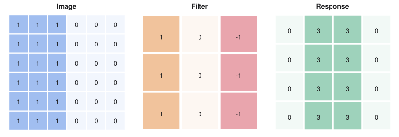

# Convolutional Networks

> ES 335 Machine Learning, Semester I 2025–26
> Sources: lecture "Convolutional networks", cheat sheet ML20, and the convolution, edge, LeNet and sequence-CNN notebooks

**What this file is really about:**
$$\text{too many weights}\ \to\ \text{sliding dot products}\ \to\ \text{size and padding}\ \to\ \text{pooling}\ \to\ \text{LeNet}$$

**How to use this file.** Part A works through convolution on small grids you can compute by hand. Part B writes it in code. Part C is practice with answers.

## Contents

---

# Part A — Maths From the Ground Up

## A1. Why not use dense layers on images

A 28×28 digit has 784 inputs, so 100 hidden units need 78,500 parameters. A 108-megapixel colour photo has $3.24\times10^8$ inputs, so 100 hidden units need 32.4 billion weights.

A dense layer also treats an ear in the top left and the same ear lower down as unrelated inputs, and it ignores that neighbouring pixels are alike. We want small local detectors, reused everywhere.

## A2. Convolution is a sliding dot product

Multiply an $f\times f$ filter element by element with a patch of the image and add up the results. Then slide by one pixel and repeat.

**Worked example.** A 3×3 filter on a 5×5 image:

$$\begin{bmatrix}3&3&2&1&0\\0&0&1&3&1\\3&1&2&2&3\\2&0&0&2&2\\2&0&0&0&1\end{bmatrix}\ \text{with}\ \begin{bmatrix}0&1&2\\2&2&0\\0&1&2\end{bmatrix}\ \text{gives}\ \begin{bmatrix}12&12&17\\10&17&19\\9&6&14\end{bmatrix}.$$

The top-left output is $3\cdot0+3\cdot1+2\cdot2+0\cdot2+0\cdot2+1\cdot0+3\cdot0+1\cdot1+2\cdot2=12$.

Libraries compute this cross-correlation. True convolution flips the filter first. Training learns the filter values.

## A3. An edge filter

The filter with rows $[1,0,-1]$ subtracts the right column from the left. On a flat region the output is 0. At a vertical edge from bright to dark it is $+3$, and from dark to bright it is $-3$. The transpose finds horizontal edges.


*The filter responds only where brightness changes. The sign tells you which side is bright.*

## A4. Output size

Padding $p$ adds zeros around the border, and stride $s$ moves the filter $s$ pixels at a time. The output side is

$$\Big\lfloor\frac{n+2p-f}{s}\Big\rfloor+1.$$

"Same" padding uses $p=(f-1)/2$ with $s=1$, which keeps the side length. That is why $f$ is usually odd. Without padding, each layer trims $f-1$ pixels. Corner pixels also enter fewer windows than central ones.

## A5. Pooling

**Max pooling** keeps the largest value in each window, and **average pooling** the mean. Pooling has no weights. A $2\times2$ pool with stride 2 halves each side, cuts later computation, and makes the output change less when a pattern moves by a pixel.

## A6. Channels

On an input with $c_{\text{in}}$ channels, a filter is $f\times f\times c_{\text{in}}$. Each channel meets its own slice, the results add up, and one bias is added. $c_{\text{out}}$ filters give $c_{\text{out}}$ output channels, so a layer has

$$c_{\text{out}}\,(f^2c_{\text{in}}+1)$$

parameters.

**Worked example.** 32 filters of size 3×3 on RGB have $32\times(9\times3+1)=896$ parameters.

## A7. What sharing buys

For LeNet's first layer, from $32\times32\times1$ to $28\times28\times6$, the convolution has 156 parameters. A dense layer with the same input and output shapes would need 4,821,600. A convolution is a dense layer with most weights forced to zero (locality) and the rest tied across positions (sharing).

## A8. Receptive fields

A unit's **receptive field** is the patch of input that can change it. Stacked 3×3 convolutions grow it by 2 per layer. A stride or pool multiplies the growth of every later layer:

$$r\leftarrow r+(f-1)\,j,\qquad j\leftarrow j\,s.$$

Early layers find edges, and later ones combine them into parts.

## A9. LeNet-5

| Layer | Output | Parameters |
|---|---|---|
| Input | $32\times32\times1$ | 0 |
| Convolution, $5\times5$, six filters | $28\times28\times6$ | 156 |
| Pooling | $14\times14\times6$ | 0 |
| Convolution, $5\times5$, sixteen filters | $10\times10\times16$ | 2,416 |
| Pooling | $5\times5\times16$ | 0 |
| Flatten | 400 | 0 |
| Dense | 120 | 48,120 |
| Dense | 84 | 10,164 |
| Output | 10 | 850 |
| **Total** | | **61,706** |

Most of the weights are in the dense layers: only 2,572 are convolutional.

## A10. Convolution along time

A 1-D convolution slides along a sequence. The filter $[1,0,-1]$ fires on falling edges, $[-1,0,1]$ on rising edges, and $[1,1,1]$ on high stretches.

## A11. Convolution commutes with translation

Let $(Tx)[n]=x[n-s]$ shift a signal by $s$, and $(x*w)[n]=\sum_kw[k]\,x[n-k]$. Then

$$((Tx)*w)[n]=\sum_kw[k]\,x[n-k-s]=(x*w)[n-s]=(T(x*w))[n].$$

Convolving then shifting equals shifting then convolving. This is **equivariance**.

## A12. Compute, and not just weights

A convolution has $f^2c_{\text{in}}c_{\text{out}}$ weights, but its compute also scales with output size:

$$\text{multiplications}=f^2c_{\text{in}}c_{\text{out}}\,H\,W.$$

Downsampling early therefore saves compute without changing the number of weights.

## A13. A short history of architectures

| Network | Key idea |
|---|---|
| LeNet | Convolution plus pooling |
| AlexNet | ReLU, dropout and GPUs |
| VGG | Stacks of small filters |
| Inception | Parallel filter sizes and $1\times1$ bottlenecks |
| ResNet | Residual connections |
| EfficientNet | Compound scaling |
| ConvNeXt | Convolutions with transformer-era design |

Two stacked $3\times3$ layers see $5\times5$ using $18c^2$ weights instead of $25c^2$, and add one more non-linearity.

---

# Part B — In Code

## B1. A convolution layer in NumPy

```python
def conv2d(x, k, s=1, p=0):
    x = np.pad(x, p)
    f = k.shape[0]
    n = (x.shape[0] - f) // s + 1
    out = np.zeros((n, n))
    for i in range(n):
        for j in range(n):
            win = x[i * s:i * s + f, j * s:j * s + f]
            out[i, j] = (win * k).sum()
    return out
```

## B2. LeNet in PyTorch

```python
nn.Sequential(
    nn.Conv2d(1, 6, 5), nn.ReLU(), nn.MaxPool2d(2),
    nn.Conv2d(6, 16, 5), nn.ReLU(), nn.MaxPool2d(2),
    nn.Flatten(), nn.Linear(400, 120), nn.ReLU(),
    nn.Linear(120, 84), nn.ReLU(), nn.Linear(84, 10))
```

The notebooks in this section run convolution by hand, detect edges, and train LeNet on digits.

## B3. Translation equivariance, verified

```python
import torch
from torch.nn import functional as F

x = torch.zeros(1, 1, 16); x[0, 0, 5] = 1
w = torch.tensor([[[1.0, 2.0, 3.0]]])
y = F.conv1d(x, w, padding=1)
shifted = F.conv1d(torch.roll(x, 3, 2), w, padding=1)
assert torch.equal(torch.roll(y, 3, 2), shifted)
print('shifting then convolving equals convolving then shifting')
```

## B4. A complete CNN on generated images

This task needs spatial structure: vertical or horizontal bars.

```python
import torch
from torch import nn

torch.manual_seed(0)

def images(n, size=16):
    x, y = torch.randn(n, 1, size, size) * 0.3, torch.randint(2, (n,))
    for i in range(n):
        p = torch.randint(2, size - 2, (1,)).item()
        if y[i]:
            x[i, 0, p - 1:p + 1, :] += 1
        else:
            x[i, 0, :, p - 1:p + 1] += 1
    return x, y


model = nn.Sequential(
    nn.Conv2d(1, 8, 3, padding=1), nn.BatchNorm2d(8), nn.ReLU(), nn.MaxPool2d(2),
    nn.Conv2d(8, 16, 3, padding=1), nn.BatchNorm2d(16), nn.ReLU(), nn.AdaptiveAvgPool2d(1),
    nn.Flatten(), nn.Linear(16, 2))
opt = torch.optim.Adam(model.parameters(), lr=3e-3)

for step in range(200):
    x, y = images(64)
    loss = nn.functional.cross_entropy(model(x), y)
    opt.zero_grad(); loss.backward(); opt.step()

model.eval()
x, y = images(512)
acc = model(x).argmax(1).eq(y).float().mean().item()
print('test accuracy', acc)
assert acc > 0.9
```

---

# Part C — Practice

**P1.** $n=64$, $f=3$, $p=1$, $s=2$. Find the output side.

<details><summary>Answer</summary>

$\lfloor(64+2-3)/2\rfloor+1=32$.

</details>

**P2.** Ten 5×5 filters on an RGB image. How many parameters?

<details><summary>Answer</summary>

$10\times(25\times3+1)=760$.

</details>

**P3.** How many weights does a 2×2 max pool have?

<details><summary>Answer</summary>

None.

</details>

**P4.** Which padding is "same" for $f=7$?

<details><summary>Answer</summary>

$p=3$.

</details>

**P5.** Two stacked 3×3 convolutions see how large a patch?

<details><summary>Answer</summary>

$5\times5$.

</details>

**P6.** Why is $f$ usually odd?

<details><summary>Answer</summary>

So same padding $p=(f-1)/2$ is a whole number, and the filter has a centre pixel.

</details>

**P7.** A $3\times3$ layer has 16 channels in, 32 out, on a $64\times64$ output. How many multiplications?

<details><summary>Answer</summary>

$9\times16\times32\times64\times64=18{,}874{,}368$.

</details>

**P8.** How many weights do three $3\times3$ layers use, against one $7\times7$ layer, for $c$ channels?

<details><summary>Answer</summary>

$27c^2$ against $49c^2$.

</details>
