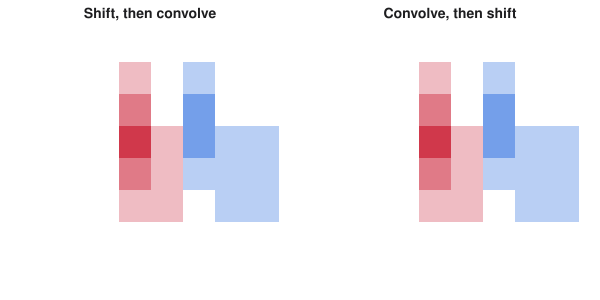
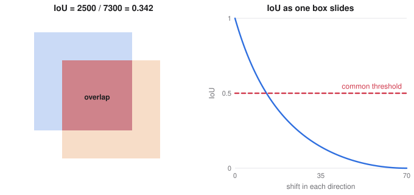

# Seeing Inside Vision Models, Pretrained Features and Detection

> ES 335 Machine Learning, Semester I 2025–26
> Sources: lectures "Grad-CAM, equivariance and invariance" and "Pretrained features with DINOv3", the object detection slides, and the matching notebooks and apps

**What this file is really about:**
$$\text{what moves with the input}\ \to\ \text{where the model looks}\ \to\ \text{reuse trained features}\ \to\ \text{find objects in boxes}$$

**How to use this file.** Part A builds each idea on small examples. Part B shows the code. Part C is practice with answers.

## Contents

---

# Part A — Maths From the Ground Up

## A1. Invariance and equivariance

Let $S$ shift an image.

- A function is **invariant** if $f(S(x))=f(x)$. An image classifier should say "cat" wherever the cat is.
- A function is **equivariant** if $f(S(x))=S(f(x))$. A segmentation mask should move with the object.

**Convolution is equivariant to shifts** (away from the borders): convolving then shifting equals shifting then convolving, because the same filter is used everywhere.

**Careful.** Max pooling with stride 2 breaks exact equivariance. The signal $0,1,0,0$ and its one-step shift can pool to different results, so a network is only approximately shift-invariant. Global pooling at the end makes the prediction less sensitive to position.


*Both paths give the same map. That is equivariance.*

## A2. Class activation maps

Suppose the network ends with global average pooling followed by one dense layer. If $A_k$ is the $k$-th feature map, the score for class $c$ is

$$y^c=\sum_kw_k^c\,\overline{A_k},\qquad\text{so}\qquad L^c=\sum_kw_k^cA_k$$

is a heat map of where evidence for class $c$ lies. It is called a **class activation map**.

## A3. Grad-CAM

**Grad-CAM** generalises this to any architecture, replacing the weight by the average gradient of the score with respect to that map:

$$\alpha_k^c=\frac1Z\sum_{i,j}\frac{\partial y^c}{\partial A_k^{ij}},\qquad L^c=\text{ReLU}\Big(\sum_k\alpha_k^cA_k\Big).$$

ReLU keeps only the parts that increase the score. The result has the resolution of the last convolutional layer, so it is upsampled over the image.

**Careful.** A heat map shows where the model looked, not whether it reasoned correctly. A model focusing on a watermark is exactly what such a map is good at revealing.

## A4. Pretrained features

A model trained on a huge dataset learns general features. **Transfer learning** freezes those layers and trains only a new final layer:

$$\hat y=W\,\phi(x),$$

where $\phi$ is the frozen network. Training $W$ is just logistic or linear regression on the features, so it is cheap and needs far fewer labels.

**DINO** is a family of vision models trained without labels, by making different views of the same image agree. Its features work well with simple heads for classification, regression and retrieval. Patch features also allow pixel-level comparison: pick a patch and find the similar patches by cosine similarity.

Few-shot and zero-shot methods go further. With a text-and-image model such as CLIP, a new class can be added by writing its name, with no training examples.

## A5. Object detection: the task

Classification names one thing. **Detection** names each object and draws a box around it. A box can be $(x_1,y_1,x_2,y_2)$, or a centre with a width and height. **Segmentation** labels each pixel.

## A6. Intersection over union

How good is a predicted box? Use the ratio of overlap to combined area:

$$\text{IoU}(A,B)=\frac{|A\cap B|}{|A\cup B|}.$$

**Worked example.** Two $70\times70$ boxes, one shifted 20 right and 20 down, overlap in $50\times50=2500$. The union is $4900+4900-2500=7300$, so IoU $=0.342$.


*IoU falls quickly as the boxes separate, which is why a threshold such as 0.5 is demanding.*

## A7. True positives and mean average precision

A prediction is a true positive if its IoU with an unmatched ground-truth box passes a threshold and its class is right. Sort predictions by confidence, and compute precision and recall as you move down the list.

**Average precision** (AP) is the area under the precision-recall curve for one class. **mAP** is the mean of AP over classes. COCO averages mAP over IoU thresholds from $0.5$ to $0.95$, a stricter test.

## A8. Non-maximum suppression

A detector often proposes several boxes for one object. **Non-maximum suppression** keeps the highest-scoring box and removes the others that overlap it by more than a threshold, then repeats.

## A9. CAM is a special case of Grad-CAM

A network ending in global average pooling and a linear layer scores class $c$ as $y_c=\sum_kw_k^c\bar A_k$, where $\bar A_k$ is the mean of feature map $k$ over its $Z$ pixels. Then

$$\frac{\partial y_c}{\partial A_k^{ij}}=\frac{w_k^c}Z,$$

and averaging over pixels gives Grad-CAM weights proportional to $w_k^c$. So the two agree when both apply, and Grad-CAM also works on any other architecture.

## A10. Integrated gradients

Plain gradients saturate: a confidently classified input can have a near-zero gradient. **Integrated gradients** accumulate along a path from a baseline $x'$:

$$\text{IG}_i=(x_i-x_i')\int_0^1\frac{\partial F(x'+\alpha(x-x'))}{\partial x_i}\,d\alpha.$$

These sum exactly to $F(x)-F(x')$.

## A11. Choosing a transfer strategy

| Your data | Similar to source | Different from source |
|---|---|---|
| Little | Linear head on frozen features | Use earlier features, augment heavily |
| Plenty | Fine-tune the later layers | Fine-tune everything |

When fine-tuning, use lower learning rates for earlier layers, and keep batch norm statistics frozen for small batches.

---

# Part B — In Code

## B1. Intersection over union

```python
def iou(a, b):
    w = max(0, min(a[2], b[2]) - max(a[0], b[0]))
    h = max(0, min(a[3], b[3]) - max(a[1], b[1]))
    inter = w * h
    area = lambda r: (r[2] - r[0]) * (r[3] - r[1])
    return inter / (area(a) + area(b) - inter)
```

## B2. Grad-CAM with hooks

```python
score = model(x)[0, c]
score.backward()                         # fills grads of the last conv layer
alpha = grads.mean(dim=(2, 3), keepdim=True)
cam = torch.relu((alpha * activations).sum(1))
```

## B3. A linear head on frozen features

```python
for p in backbone.parameters():
    p.requires_grad = False
head = nn.Linear(feature_dim, n_classes)
```

The Grad-CAM, DINO and object detection links are in **Slides, cheat sheets and videos** and in the notebooks of this section.

## B4. Integrated gradients

```python
import torch

def integrated_gradients(F, x, base=None, steps=64):
    base = torch.zeros_like(x) if base is None else base
    alphas = (torch.arange(steps) + 0.5) / steps
    path = base + alphas.view(-1, *[1] * x.ndim) * (x - base)
    path.requires_grad_(True)
    grads = torch.autograd.grad(F(path).sum(), path)[0]
    return (x - base) * grads.mean(0)

F = lambda v: (v ** 2).sum(-1) + v[..., 0] * v[..., 1]
x = torch.tensor([1.0, 2.0])
ig = integrated_gradients(F, x)
print(ig, 'sum', ig.sum().item(), 'F(x)-F(0)', F(x).item())
assert abs(ig.sum() - F(x)) < 1e-2
```

## B5. Freezing, and discriminative learning rates

```python
import torch
from torch import nn

torch.manual_seed(0)
body = nn.Sequential(nn.Linear(20, 64), nn.ReLU(), nn.Linear(64, 32), nn.ReLU())
head = nn.Linear(32, 3)

for p in body[0].parameters():
    p.requires_grad = False                 # the earliest layer stays fixed

opt = torch.optim.AdamW([
    {'params': [p for p in body.parameters() if p.requires_grad], 'lr': 1e-4},
    {'params': head.parameters(), 'lr': 1e-3},
])

before = body[0].weight.clone()
X, y = torch.randn(64, 20), torch.randint(3, (64,))
loss = nn.functional.cross_entropy(head(body(X)), y)
opt.zero_grad(); loss.backward(); opt.step()
assert torch.equal(before, body[0].weight)
print('trainable', sum(p.numel() for p in [*body.parameters(), *head.parameters()] if p.requires_grad))
```

---

# Part C — Practice

**P1.** Two $10\times10$ boxes overlap in a $5\times10$ region. Find the IoU.

<details><summary>Answer</summary>

$50/(100+100-50)=1/3$.

</details>

**P2.** Is a classifier meant to be invariant or equivariant to shifts?

<details><summary>Answer</summary>

Invariant. The label should not change when the object moves.

</details>

**P3.** Is segmentation meant to be invariant or equivariant?

<details><summary>Answer</summary>

Equivariant. The mask should move with the object.

</details>

**P4.** Why apply ReLU in Grad-CAM?

<details><summary>Answer</summary>

To keep only features that raise the class score. Negative values mostly belong to other classes.

</details>

**P5.** A frozen network has a final layer with 7,690 parameters. Is training convex?

<details><summary>Answer</summary>

Yes, for a logistic or softmax head, since only that one layer is trained. The features are fixed inputs.

</details>

**P6.** Boxes scored $0.9$, $0.8$, $0.7$, where the second overlaps the first by IoU $0.6$ and the third overlaps neither. Which survive NMS at threshold $0.5$?

<details><summary>Answer</summary>

The first and third.

</details>

**P7.** Why can a plain gradient be near zero for a confident prediction?

<details><summary>Answer</summary>

The sigmoid or softmax has saturated, so the output barely changes with small input changes.

</details>

**P8.** What do integrated gradients sum to?

<details><summary>Answer</summary>

$F(x)-F(x')$.

</details>
