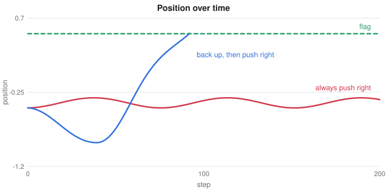
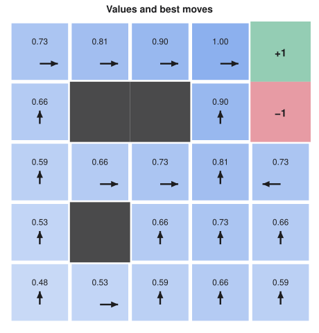

# Reinforcement Learning

> ES 335 Machine Learning, Semester I 2025–26
> Sources: lecture "Reinforcement learning", cheat sheet ML23, and the gym environments, Q-learning and deep Q-learning notebooks

**What this file is really about:**
$$\text{act}\ \to\ \text{reward}\ \to\ \text{discounted return}\ \to\ Q\text{ values}\ \to\ \text{Bellman}\ \to\ \text{learn from experience}$$

**How to use this file.** Part A builds the ideas on a small grid and a mountain car. Part B shows the code. Part C is practice with answers.

## Contents

---

# Part A — Maths From the Ground Up

## A1. Learning from reward

In supervised learning someone gives the right answer for each example. Here nobody does. An **agent** takes an action, the **environment** returns a reward and a new state, and the agent must discover which choices pay off, often many steps later.

In state $s_t$ the agent picks action $a_t$, and receives reward $r_t$ and the next state $s_{t+1}$. An **episode** runs from a reset until the game ends or a step limit is reached.

## A2. The mountain car

A car in a valley must reach a flag on the right hill, and its engine is too weak to drive straight up. Always pushing right only rocks it back and forth. Backing up the left hill first builds the momentum it needs. So the best action now depends on what comes later.


*Pushing right the whole time never reaches the flag. Backing up first does.*

## A3. The return

The agent maximises the discounted **return**:

$$G_t=r_t+\gamma r_{t+1}+\gamma^2r_{t+2}+\dots=r_t+\gamma G_{t+1},\qquad0<\gamma<1.$$

A reward $k$ steps away counts $\gamma^k$. The horizon is about $1/(1-\gamma)$ steps, so $\gamma=0.99$ looks about 100 steps ahead.

## A4. The value of an action

$Q(s,a)$ is the return expected after taking action $a$ in state $s$ and acting well afterwards. With few states it is a table with one row per state and one column per action. Acting is then a lookup, and

$$\pi(s)=\arg\max_aQ(s,a),\qquad V(s)=\max_aQ(s,a).$$

## A5. The Bellman equation

If each action has one outcome,

$$Q(s,a)=R(s,a)+\gamma\max_{a'}Q(s',a').$$

Reward now, plus the discounted best value one step on. With random outcomes, average over $s'$.

## A6. Value iteration

When the rules are known, start from $V=0$ and apply Bellman to every state, sweep after sweep:

$$V(s)\leftarrow\max_a\big[R(s,a)+\gamma V(s')\big].$$

Value spreads outward one step per sweep. With $\gamma=0.9$, values shrink by $0.9$ per step from the goal: $1,\ 0.9,\ 0.81,\dots$


*After convergence, each number is the discounted reward from that cell, and arrows point along the best route.*

## A7. Q-learning

Without the rules, use each step of experience as a sample of Bellman's right-hand side:

$$Q(s,a)\leftarrow Q(s,a)+\alpha\big[r+\gamma\max_{a'}Q(s',a')-Q(s,a)\big].$$

The bracket is the **temporal-difference error**. At the last step of an episode the target is just $r$.

**Worked example.** $Q=20$, reward $-1$, next-state best value $30$, $\gamma=0.99$, $\alpha=0.2$. The target is $-1+29.7=28.7$, the TD error is $8.7$, and the new value is $21.74$.

Q-learning is **off-policy**: its target uses the best next action, even while the agent is exploring.

## A8. Explore or exploit

With probability $\varepsilon$ take a random action, otherwise the best one. With $\varepsilon=0$ and an all-zero table, the agent may never reach a reward, because no reward ever breaks the tie. With high $\varepsilon$ it keeps falling into pits, even once it knows better.

## A9. Continuous states and deep Q-learning

A table needs discrete states, so continuous positions and velocities are cut into bins. Coarse bins merge states that need different actions, and fine bins leave many unvisited.

**Deep Q-learning** replaces the table with a network that maps a state to one Q value per action, and regresses on the TD target. Two additions make it stable:

- **Replay memory.** Train on random minibatches of past steps, which breaks the correlation between consecutive steps.
- **Target network.** Compute $\max Q(s',\cdot)$ with a slowly updated copy of the network.

## A10. Why value iteration converges

Define $(TV)(s)=\max_a\big[R+\gamma\sum_{s'}P(s'\mid s,a)V(s')\big]$. Since $|\max f-\max g|\le\max|f-g|$,

$$\|TV-TU\|_\infty\le\gamma\|V-U\|_\infty.$$

$T$ is a **contraction**. By the Banach fixed-point theorem there is exactly one fixed point, $V^*$, and the error shrinks by at least $\gamma$ per sweep.

## A11. Temporal-difference learning

Update a value towards a one-step target, without waiting for the end of the episode:

$$V(s)\leftarrow V(s)+\alpha\big(r+\gamma V(s')-V(s)\big).$$

Monte Carlo uses the true return, with low bias and high variance. TD uses an estimate, with some bias and less variance.

## A12. SARSA and Q-learning

$$\text{SARSA: }r+\gamma Q(s',a')\qquad\text{Q-learning: }r+\gamma\max_{a'}Q(s',a').$$

SARSA evaluates the action it will actually take, so it learns about its own exploration. Q-learning learns the greedy policy whatever it does, making it **off-policy**.

---

# Part B — In Code

## B1. The Q-learning loop

```python
for ep in range(n_episodes):
    s, done = reset(), False
    while not done:
        if rng.random() < eps:
            a = rng.integers(n_actions)      # explore
        else:
            a = np.argmax(Q[s])              # exploit
        s2, r, done = step(s, a)
        future = 0 if done else Q[s2].max()
        Q[s, a] += alpha * (r + gamma * future - Q[s, a])
        s = s2
```

## B2. Using Gym

```python
env = gym.make('MountainCar-v0')
obs, info = env.reset(seed=42)
obs, r, terminated, truncated, info = env.step(action)
```

## B3. Binning a continuous state

```python
edges = np.linspace(-1.2, 0.6, 25)
idx = np.digitize(position, edges)
```

The notebooks **Gym environments**, **Q-learning** and **Deep Q-learning** in this section run these.

## B4. Gridworld by value iteration and Q-learning

```python
import numpy as np

rng = np.random.default_rng(0)
N, GOAL, PIT, gamma = 4, 15, 5, 0.95
MOVES = [(-1, 0), (1, 0), (0, -1), (0, 1)]


def step(s, a):
    r, c = divmod(s, N)
    r, c = np.clip(r + MOVES[a][0], 0, N - 1), np.clip(c + MOVES[a][1], 0, N - 1)
    n = int(r * N + c)
    return n, (10.0 if n == GOAL else -10.0 if n == PIT else -1.0), n in (GOAL, PIT)


V = np.zeros(N * N)
for sweep in range(200):
    new = V.copy()
    for s in range(N * N):
        if s in (GOAL, PIT):
            continue
        q = []
        for a in range(4):
            n, r, done = step(s, a)
            q.append(r + gamma * V[n] * (not done))
        new[s] = max(q)
    if np.abs(new - V).max() < 1e-9:
        break
    V = new

Q = np.zeros((N * N, 4))
for episode in range(3000):
    s = 0
    for t in range(100):
        a = rng.integers(4) if rng.random() < 0.2 else int(Q[s].argmax())
        n, r, done = step(s, a)
        Q[s, a] += 0.2 * (r + gamma * Q[n].max() * (not done) - Q[s, a])
        s = n
        if done:
            break

print('value iteration V(0)', V[0].round(2), 'Q-learning', Q[0].max().round(2))
assert abs(V[0] - Q[0].max()) < 0.5
```

## B5. A complete deep Q-network

```python
import random
from collections import deque

import numpy as np
import torch
from torch import nn

random.seed(0); torch.manual_seed(0)
LEN = 8


def step(s, a):                             # walk along a corridor, and the right end pays
    n = max(0, min(LEN - 1, s + (1 if a else -1)))
    return n, (1.0 if n == LEN - 1 else -0.01), n == LEN - 1


def encode(s):
    v = torch.zeros(LEN); v[s] = 1
    return v


q = nn.Sequential(nn.Linear(LEN, 32), nn.ReLU(), nn.Linear(32, 2))
target = nn.Sequential(nn.Linear(LEN, 32), nn.ReLU(), nn.Linear(32, 2))
target.load_state_dict(q.state_dict())
opt = torch.optim.Adam(q.parameters(), lr=1e-3)
memory = deque(maxlen=5000)

for episode in range(300):
    s = 0
    for t in range(40):
        eps = max(0.05, 1 - episode / 200)
        a = random.randrange(2) if random.random() < eps else int(q(encode(s)).argmax())
        n, r, done = step(s, a)
        memory.append((s, a, r, n, done))
        s = n
        if len(memory) >= 64:
            S, A, R, N, D = zip(*random.sample(memory, 64))
            S, N = torch.stack([encode(x) for x in S]), torch.stack([encode(x) for x in N])
            A, R, D = torch.tensor(A), torch.tensor(R), torch.tensor(D, dtype=torch.float32)
            with torch.no_grad():
                y = R + 0.99 * target(N).max(1).values * (1 - D)
            loss = nn.functional.smooth_l1_loss(q(S).gather(1, A[:, None]).squeeze(1), y)
            opt.zero_grad(); loss.backward(); opt.step()
        if done:
            break
    if episode % 10 == 0:
        target.load_state_dict(q.state_dict())

policy = [int(q(encode(s)).argmax()) for s in range(LEN - 1)]
print('policy (1 means right):', policy)
assert sum(policy) >= LEN - 2
```

---

# Part C — Practice

**P1.** Rewards $0,0,1$ with $\gamma=0.9$. Find $G_0$.

<details><summary>Answer</summary>

$0.81$.

</details>

**P2.** What is the horizon of $\gamma=0.99$?

<details><summary>Answer</summary>

About 100 steps.

</details>

**P3.** With 3 actions and $\varepsilon=0.3$, what is the probability of taking the greedy action?

<details><summary>Answer</summary>

$0.7+0.3/3=0.8$.

</details>

**P4.** With $\alpha=1$, what does $Q$ become after an update?

<details><summary>Answer</summary>

The TD target.

</details>

**P5.** A table for $26\times26$ states and 3 actions has how many entries?

<details><summary>Answer</summary>

$2028$.

</details>

**P6.** Why use a target network?

<details><summary>Answer</summary>

So the regression target does not shift with every update, which keeps training stable.

</details>

**P7.** After 10 sweeps with $\gamma=0.9$, by what factor has the worst-case error shrunk?

<details><summary>Answer</summary>

At least $0.9^{10}=0.349$.

</details>

**P8.** Is SARSA on-policy or off-policy?

<details><summary>Answer</summary>

On-policy, because its target uses the action actually chosen.

</details>
