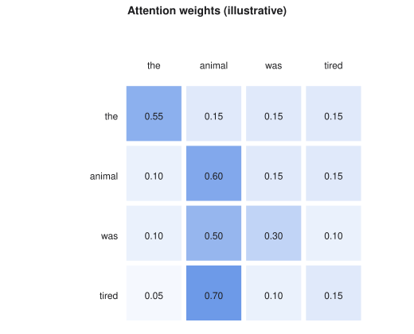

# Attention and Transformers

> Machine Learning course notes
> Sources: listed under References

**What this file is really about:**
$$\text{a fixed window forgets}\ \to\ \text{match, mix, project}\ \to\ \text{many heads}\ \to\ \text{position}\ \to\ \text{causal masks}\ \to\ \text{images and language together}$$

**How to use this file.** Part A builds attention on three small tokens. Part B writes it in code. Part C is practice with answers.

## Contents

---

# Part A — Maths From the Ground Up

## A1. Why a fixed window is not enough

The next-token model sees a fixed number of previous tokens, and its input width depends on that number. In "the animal did not cross the street because it was tired", the word "it" needs information from several words back. We want each token to look at every other token, and choose what to use.

## A2. Tokens and embeddings

Text is split into **tokens**, which might be characters, words or word pieces. Each token gets a learned vector. A batch of sequences has shape $B\times T\times d$: batch, tokens, and embedding size.

## A3. Match, mix, project

**Self-attention** gives each token three vectors, made by learned linear maps: a **query** $q$ saying what it is looking for, a **key** $k$ saying what it offers, and a **value** $v$ holding what it shares.

1. **Match.** Compare one token's query with every key: $s_{ij}=q_i^\top k_j$.
2. **Scale.** Divide by $\sqrt d$, so scores do not grow with the dimension.
3. **Normalise.** $\alpha_{ij}=\text{softmax}_j(s_{ij}/\sqrt d)$, so the weights add up to one.
4. **Mix.** $z_i=\sum_j\alpha_{ij}v_j$.

In matrix form, with rows of $Q$, $K$ and $V$ for the tokens:

$$Z=\text{softmax}\Big(\frac{QK^\top}{\sqrt d}\Big)V.$$

**Worked example.** With $d=2$, a query $(1,0)$ and keys $(1,0)$ and $(0,1)$ gives scores $1$ and $0$, scaled to $0.707$ and $0$. Softmax gives weights $0.670$ and $0.330$.


*Each row is one token's attention over all tokens, and it adds up to one.*

## A4. Order and position

Attention treats its input as a set: shuffling the tokens shuffles the output in the same way. To tell it about order, add a **positional encoding**, either learned or fixed:

$$PE_{t,2i}=\sin\frac{t}{10000^{2i/d}},\qquad PE_{t,2i+1}=\cos\frac{t}{10000^{2i/d}}.$$

## A5. Multiple heads

One set of weights captures one kind of relationship. **Multi-head attention** runs $h$ attentions in parallel on $d/h$ dimensions each, joins the results, and applies a linear map. A model with $d=512$ and $h=8$ gives 64 dimensions per head.

## A6. The transformer block

One block is

$$x\leftarrow x+\text{Attention}(\text{Norm}(x)),\qquad x\leftarrow x+\text{MLP}(\text{Norm}(x)).$$

Residual connections let gradients pass, and normalisation keeps the scales steady. A transformer stacks such blocks.

## A7. Causal masks

For generation a token must not see the future. A **causal mask** sets the scores for future positions to $-\infty$ before the softmax, so token $t$ attends only to tokens $1$ to $t$.

Encoder-only models classify. Decoder-only models with causal masks generate text. Encoder-decoder models translate, with a cross-attention layer taking queries from the decoder, and keys and values from the encoder.

## A8. Sampling from a language model

Greedy decoding always takes the most likely token. **Top-$k$** keeps the $k$ most likely tokens, and **nucleus sampling** keeps the smallest set whose probability reaches $p$. Temperature rescales the logits first.

## A9. Vision transformers

Cut an image into patches, flatten each patch, and map it to an embedding. A $224\times224$ image with $16\times16$ patches gives $14\times14=196$ tokens, plus one class token. Transformers then process them as they would words. Lacking the built-in locality of convolutions, they need more data or pretraining.

## A10. CLIP

**CLIP** has an image encoder and a text encoder, and trains them so matching image-text pairs get high cosine similarity. For a batch of $N$ pairs, the similarity matrix should be large on its diagonal, so the loss is a symmetric cross-entropy over rows and columns.

**Zero-shot classification** turns class names into sentences, embeds them, and picks the most similar one, with no training examples of those classes.

## A11. Foundation models, prompting and agents

A **foundation model** is pretrained on a very large corpus, then adapted to many tasks. **Prompting** steers it with instructions and examples, with no change to the weights. **Retrieval** fetches relevant documents and adds them to the prompt, which grounds answers in specific sources.

An **agent** runs the model in a loop: choose an action, call a tool, read the result, and continue. Evaluation is hard because answers vary and correct behaviour depends on the task, so use held-out tasks with explicit pass criteria.

## A12. Why scores are divided by $\sqrt d$

Let $q,k$ have independent entries with mean 0 and variance 1. Then $q\cdot k=\sum_{i=1}^dq_ik_i$ has variance $d$. Large scores push the softmax towards a single winner, where gradients vanish. Dividing by $\sqrt d$ restores unit variance.

## A13. Sinusoidal positions

$$\text{PE}(t,2i)=\sin\frac t{10000^{2i/d}},\qquad\text{PE}(t,2i+1)=\cos\frac t{10000^{2i/d}}.$$

Each pair of dimensions is a different frequency, so every position gets a distinct code. Learned position tables are simpler, while sinusoids extrapolate beyond the training length.

## A14. Why self-attention treats tokens as a set

Reorder the tokens with a permutation matrix $P$. Then $Q,K,V$ become $PQ,PK,PV$, and

$$\text{softmax}(PQK^\top P^\top)\,PV=P\,\text{softmax}(QK^\top)V.$$

The output is reordered in the same way, and nothing changes otherwise. Attention is **permutation equivariant**, so order must be provided explicitly.

## A15. Cost of attention

With $T$ tokens, the score matrix has $T^2$ entries per head. Memory and time scale quadratically in length, which is why long contexts are expensive, and why techniques such as key-value caching matter. A head has $d/h$ dimensions, so the total weight count does not depend on the number of heads.

---

# Part B — In Code

## B1. Scaled dot-product attention

```python
def attention(q, k, v, mask=None):
    s = q @ k.transpose(-2, -1) / math.sqrt(q.size(-1))
    if mask is not None:
        s = s.masked_fill(mask == 0, float('-inf'))
    return F.softmax(s, dim=-1) @ v
```

## B2. A causal mask

```python
mask = torch.tril(torch.ones(T, T))
```

## B3. A CLIP-style loss

```python
logits = img @ txt.T / temperature
labels = torch.arange(len(img))
loss = (F.cross_entropy(logits, labels) + F.cross_entropy(logits.T, labels)) / 2
```

## B4. Sinusoidal encoding

```python
import numpy as np

def positions(T, d):
    t = np.arange(T)[:, None]
    f = 1 / 10000 ** (np.arange(0, d, 2) / d)
    pe = np.zeros((T, d))
    pe[:, 0::2], pe[:, 1::2] = np.sin(t * f), np.cos(t * f)
    return pe

pe = positions(100, 32)
assert len(np.unique(pe.round(6), axis=0)) == 100
print('all positions are distinct', pe.shape)
```

## B5. A transformer that learns to reverse a sequence

A complete encoder, trained end to end. This task needs position information.

```python
import torch
from torch import nn

torch.manual_seed(0)
V, T, d = 10, 8, 64


class Reverser(nn.Module):
    def __init__(self):
        super().__init__()
        self.tok, self.pos = nn.Embedding(V, d), nn.Embedding(T, d)
        layer = nn.TransformerEncoderLayer(d, 4, 128, dropout=0.0, batch_first=True, norm_first=True)
        self.enc = nn.TransformerEncoder(layer, 2, enable_nested_tensor=False)
        self.out = nn.Linear(d, V)

    def forward(self, x):
        return self.out(self.enc(self.tok(x) + self.pos(torch.arange(T))))


m = Reverser()
opt = torch.optim.Adam(m.parameters(), lr=1e-3)
for step in range(600):
    x = torch.randint(V, (64, T))
    loss = nn.functional.cross_entropy(m(x).view(-1, V), x.flip(1).view(-1))
    opt.zero_grad(); loss.backward(); opt.step()

x = torch.randint(V, (512, T))
acc = m(x).argmax(-1).eq(x.flip(1)).float().mean().item()
print('accuracy per token', round(acc, 3))
assert acc > 0.9
```

---

# Part C — Practice

**P1.** $d=4$, score $q^\top k=6$. What is the scaled score?

<details><summary>Answer</summary>

$6/2=3$.

</details>

**P2.** Why does attention need positional information?

<details><summary>Answer</summary>

Attention is permutation-equivariant, so without it the order of tokens is lost.

</details>

**P3.** $d=768$ and $h=12$. How wide is each head?

<details><summary>Answer</summary>

$64$.

</details>

**P4.** A $32\times32$ image with $4\times4$ patches gives how many patch tokens?

<details><summary>Answer</summary>

$8\times8=64$.

</details>

**P5.** Probabilities $0.5,0.3,0.15,0.05$. Which tokens does nucleus sampling keep at $p=0.75$?

<details><summary>Answer</summary>

The first two, since $0.5+0.3=0.8\ge0.75$.

</details>

**P6.** A batch of 8 image-text pairs. Which entries of the similarity matrix are positives?

<details><summary>Answer</summary>

The 8 on the diagonal.

</details>

**P7.** With $d=64$, what is the standard deviation of raw dot-product scores of unit-variance vectors?

<details><summary>Answer</summary>

$\sqrt{64}=8$.

</details>

**P8.** How does doubling the sequence length change attention cost?

<details><summary>Answer</summary>

It quadruples the number of scores.

</details>
