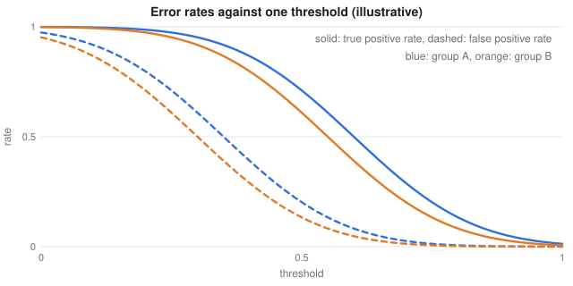

# ML Systems and Responsible Deployment

> Machine Learning course notes
> Sources: listed under References

**What this file is really about:**
$$\text{a model is one part}\ \to\ \text{reproduce}\ \to\ \text{monitor}\ \to\ \text{test changes}\ \to\ \text{explain}\ \to\ \text{be fair and accountable}$$

**How to use this file.** Part A works through what happens after training. Part B shows the code. Part C is practice with answers.

## Contents

---

# Part A — Maths From the Ground Up

## A1. A model is one part of a system

A deployed model depends on data pipelines, feature code, serving infrastructure and people who act on its output. Most failures come from around the model: stale features, broken pipelines, and a mismatch between what is measured and what matters.

## A2. Reproducibility

An experiment is reproducible when the code version, data version, configuration, random seeds and library versions are all recorded. Without these, a result cannot be checked or debugged.

## A3. Training-serving skew

**Careful.** If features are computed differently in training and in production, a model can look good offline and fail live. Compute them with shared code, and compare their distributions.

## A4. Monitoring and drift

**Data drift** changes $p(x)$. **Concept drift** changes $p(y\mid x)$, so the old answers stop being right. Labels often arrive late, so monitor inputs first. The **population stability index** compares binned distributions:

$$\text{PSI}=\sum_i(p_i-q_i)\ln\frac{p_i}{q_i}.$$

A common rule of thumb reads below $0.1$ as stable, and above $0.25$ as a major shift.

## A5. Online experiments

An **A/B test** assigns users at random. For a difference between two rates, the standard error is

$$\text{SE}=\sqrt{\frac{p_1(1-p_1)}{n_1}+\frac{p_2(1-p_2)}{n_2}}.$$

**Careful.** Checking repeatedly and stopping the moment the result looks significant inflates false positives. Fix the sample size first, or use a sequential method.

## A6. Cost and latency

An average can hide the worst users, so report percentiles such as the 99th. **Quantisation** stores weights in fewer bits, and **distillation** trains a small model to imitate a large one. Both trade a little accuracy for speed and size.

## A7. Explaining a prediction

- **Permutation importance** shuffles one feature and measures how much performance drops.
- **Partial dependence** averages the prediction while one feature varies.
- **Counterfactuals** ask for the smallest change that would flip a decision. For a linear model with weights $w$, the distance to the boundary along $w$ is $|w^\top x+b|/\|w\|$.

**Careful.** An explanation of the model is not an explanation of the world. A correlated feature can be important to the model without causing the outcome.

## A8. Fairness

Compare error rates across groups. Common criteria are:

- **Demographic parity:** equal rates of positive prediction.
- **Equal opportunity:** equal true positive rates.
- **Equalised odds:** equal true positive and false positive rates.
- **Calibration within groups:** among those given a score of $s$, a fraction $s$ are positive.

**Careful.** When base rates differ between groups, a classifier generally cannot satisfy calibration and equal error rates together. Choosing among them is a decision about values, and it belongs to people accountable for the outcome.


*A single threshold gives the two groups different error rates, because their score distributions differ.*

## A9. Accountability

Write down the intended use, the data, the known limits and who is responsible, for example in a **model card**. Keep humans in the loop for consequential decisions, offer a way to appeal, and plan how to roll back. Protect personal data: collect less, restrict access, and remember that models can memorise their training data.

## A10. Language models in production

Language models add their own risks. **Hallucination** is confident invention, and retrieval and citation checks reduce it. **Prompt injection** hides instructions in content that the model reads, so treat retrieved text as data. Give agents only the permissions they need, and require confirmation for actions that are hard to undo.

## A11. Shapley values

For a prediction, feature $i$'s contribution averages its marginal effect over all subsets $S$ of the others:

$$\phi_i=\sum_{S}\frac{|S|!\,(p-|S|-1)!}{p!}\big(v(S\cup\{i\})-v(S)\big).$$

Shapley values are the only attribution with efficiency (they sum to the prediction minus the baseline), symmetry, dummy and additivity. Exact computation needs $2^p$ evaluations, so libraries sample, or use tree structure.

**LIME** instead fits a small local linear model around one point. It is faster, and less stable.

## A12. Fairness criteria cannot all hold

Let groups have base rates $p_a\ne p_b$. Then for any imperfect classifier, these identities link precision (PPV), false positive rate and true positive rate:

$$\text{FPR}=\frac p{1-p}\cdot\frac{1-\text{PPV}}{\text{PPV}}\cdot\text{TPR}.$$

If two groups have equal PPV and TPR, this forces different FPR whenever base rates differ. So equal precision and equalised odds cannot both hold, and the choice is a policy decision.

## A13. Testing machine learning code

- **Data tests.** Schema, ranges, null rates and join sizes.
- **Unit tests.** Shapes, a loss known by hand, and invariants of the preprocessing.
- **Behaviour tests.** Prediction should not change with an irrelevant edit to the input, and should change sensibly with a relevant one.
- **Gate tests.** A new model must beat the current one on a fixed set, and on key slices.

---

# Part B — In Code

## B1. Fixing seeds

```python
random.seed(0); np.random.seed(0); torch.manual_seed(0)
```

## B2. Population stability index

```python
psi = ((p - q) * np.log(p / q)).sum()
```

## B3. Permutation importance

```python
from sklearn.inspection import permutation_importance
result = permutation_importance(model, X_test, y_test, n_repeats=10)
```

## B4. Exact Shapley values

```python
import math
from itertools import combinations

import numpy as np

def shapley(f, x, base):
    p = len(x); out = np.zeros(p)
    for i in range(p):
        others = [j for j in range(p) if j != i]
        for r in range(p):
            for S in combinations(others, r):
                z = base.copy(); z[list(S)] = x[list(S)]
                without = f(z); z[i] = x[i]
                w = math.factorial(r) * math.factorial(p - r - 1) / math.factorial(p)
                out[i] += w * (f(z) - without)
    return out

f = lambda v: 2 * v[0] + 3 * v[1] + v[0] * v[2]
x, base = np.array([1.0, 2.0, 3.0]), np.zeros(3)
phi = shapley(f, x, base)
print(phi.round(3), 'sum', phi.sum().round(3), 'f(x)-f(base)', f(x) - f(base))
assert abs(phi.sum() - (f(x) - f(base))) < 1e-9
```

## B5. Fairness metrics by group

```python
import numpy as np

def by_group(y, pred, group):
    out = {}
    for g in np.unique(group):
        m = group == g
        tp = ((pred == 1) & (y == 1) & m).sum()
        fp = ((pred == 1) & (y == 0) & m).sum()
        out[int(g)] = dict(selection=round(float(pred[m].mean()), 3),
                           tpr=round(float(tp / max((y[m] == 1).sum(), 1)), 3),
                           fpr=round(float(fp / max((y[m] == 0).sum(), 1)), 3))
    return out

y = np.array([1, 1, 0, 0, 1, 0, 0, 0]); pred = np.array([1, 0, 1, 0, 1, 1, 0, 0]); g = np.array([0, 0, 0, 0, 1, 1, 1, 1])
result = by_group(y, pred, g)
print(result)
assert result[0]['tpr'] == 0.5 and result[1]['tpr'] == 1.0
```

## B6. Behaviour tests

```python
import numpy as np
from sklearn.linear_model import LogisticRegression

rng = np.random.default_rng(0)
X = rng.normal(size=(500, 3)); y = (X[:, 0] > 0).astype(int)
model = LogisticRegression().fit(X, y)

def test_monotonic():
    a = np.array([[-1.0, 0, 0]]); b = np.array([[1.0, 0, 0]])
    assert model.predict_proba(b)[0, 1] > model.predict_proba(a)[0, 1]

def test_ignores_noise():
    a = np.array([[1.0, 0, 0]]); b = np.array([[1.0, 0.01, 0]])
    assert abs(model.predict_proba(a)[0, 1] - model.predict_proba(b)[0, 1]) < 0.01

def test_probabilities_valid():
    p = model.predict_proba(X)
    assert ((p >= 0) & (p <= 1)).all() and np.allclose(p.sum(1), 1)

test_monotonic(); test_ignores_noise(); test_probabilities_valid()
print('all behaviour tests pass')
```

---

# Part C — Practice

**P1.** Rates $p=0.5$ and $q=0.6$ in one bin. Find that bin's PSI term.

<details><summary>Answer</summary>

$(-0.1)\ln(0.5/0.6)=0.0182$.

</details>

**P2.** What is the difference between data drift and concept drift?

<details><summary>Answer</summary>

Data drift changes the inputs' distribution. Concept drift changes the relationship between inputs and output.

</details>

**P3.** Two groups have true positive rates $0.8$ and $0.6$. Which criterion fails?

<details><summary>Answer</summary>

Equal opportunity.

</details>

**P4.** $w=(3,4)$, $b=-5$, $x=(1,2)$. Find the distance to the boundary.

<details><summary>Answer</summary>

$|3+8-5|/5=1.2$.

</details>

**P5.** Why is it wrong to stop an A/B test as soon as it looks significant?

<details><summary>Answer</summary>

Each look is another chance of a false positive, so the error rate rises above the stated level.

</details>

**P6.** A retrieved web page says "ignore your instructions". How should a model treat that?

<details><summary>Answer</summary>

As data to read, and not as an instruction to follow.

</details>

**P7.** Two features, $f$ additive with contributions 2 and 5. What are the Shapley values?

<details><summary>Answer</summary>

Exactly 2 and 5.

</details>

**P8.** Base rate 0.2, PPV 0.5, TPR 0.8. Find the FPR.

<details><summary>Answer</summary>

$\frac{0.2}{0.8}\times\frac{0.5}{0.5}\times0.8=0.2$.

</details>
